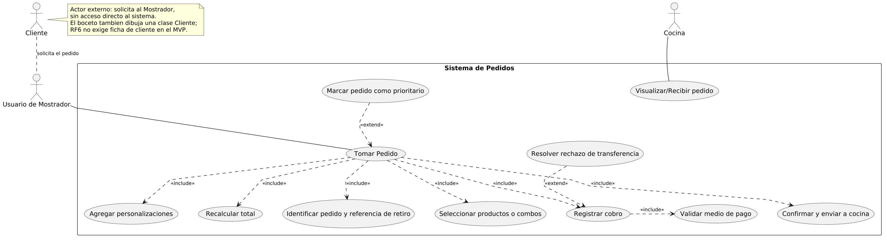
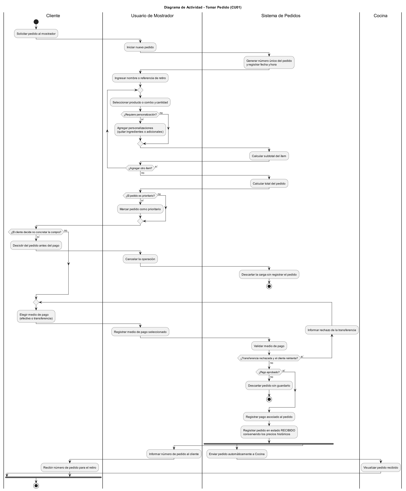
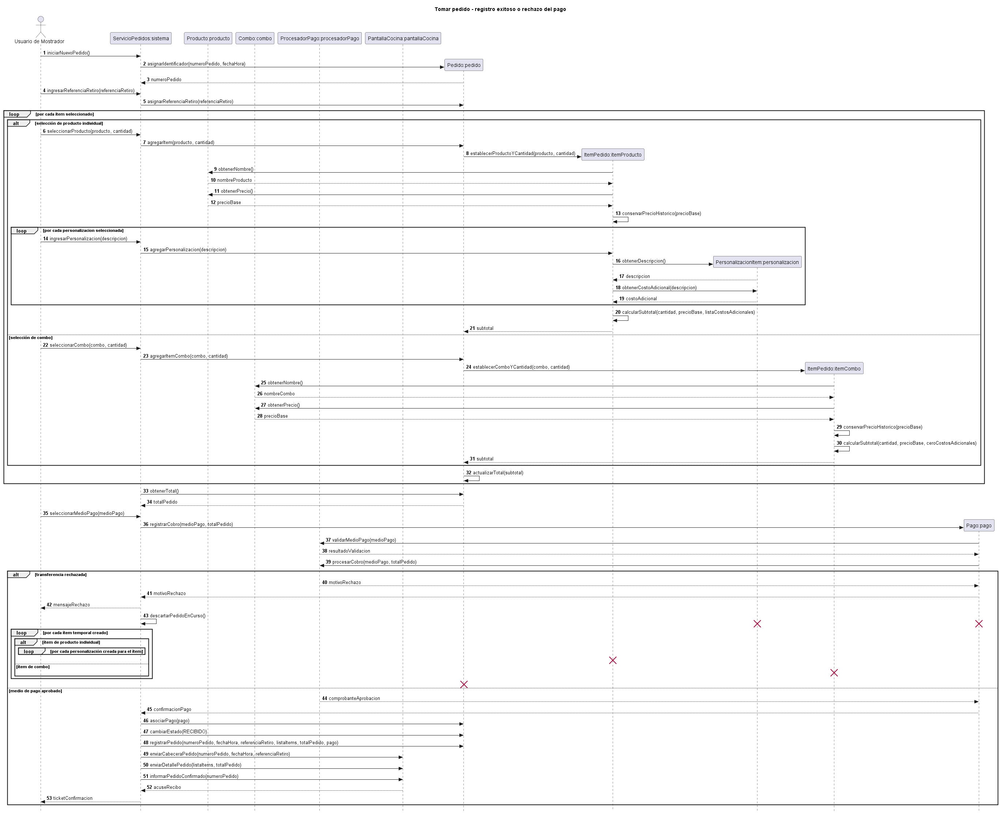
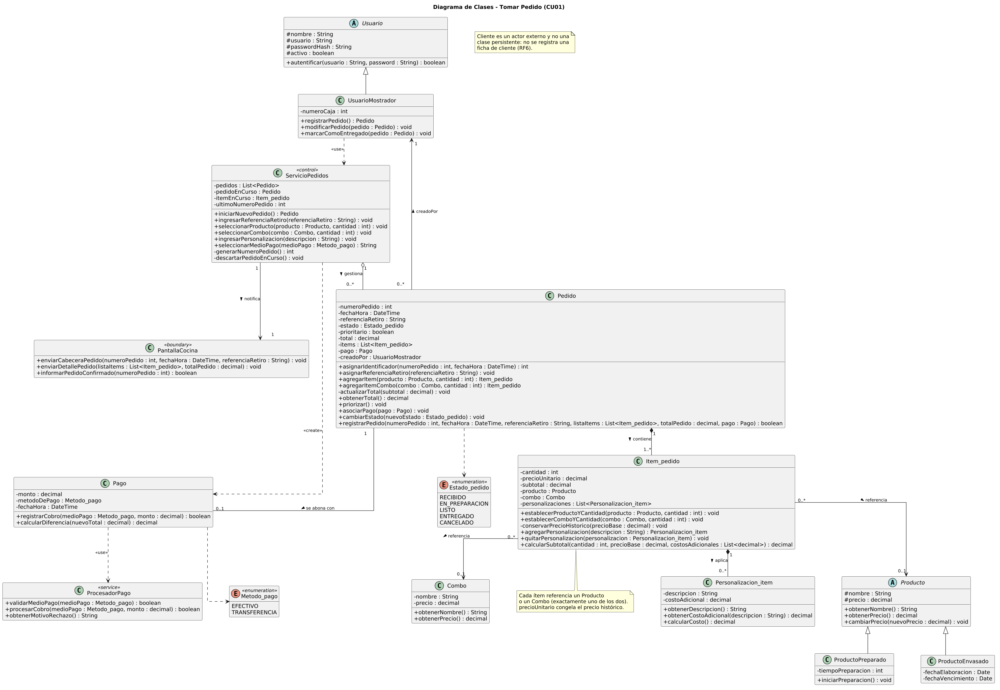

# Caso de Uso N° 1 - Tomar Pedido

## 1. Descripción y Trazabilidad con Requisitos Funcionales

**Actor/es:** Usuario de Mostrador y Cliente (interacción indirecta)

**Objetivo:** Permitir que el Usuario de Mostrador registre un pedido nuevo con sus productos, combos y personalizaciones, cobre el total y lo envíe automáticamente a Cocina en estado `RECIBIDO`.

**Flujo principal:**

1. El Usuario de Mostrador inicia un nuevo pedido.
2. El sistema genera un número único para el pedido y registra la fecha y hora.
3. El Usuario de Mostrador ingresa el nombre o referencia para el retiro.
4. Se seleccionan los productos o combos y sus cantidades.
5. Se agregan las personalizaciones correspondientes a los productos.
6. El sistema calcula los subtotales y el total del pedido.
7. Se selecciona y valida el medio de pago: efectivo o transferencia.
8. El sistema registra el pago asociado al pedido.
9. El sistema registra el pedido con estado `RECIBIDO`, conservando los precios históricos.
10. El sistema envía automáticamente el pedido confirmado a Cocina.

**Flujos alternativos:**

- **A1: Cancelación por parte del Cliente antes del pago.** El Cliente decide no concretar la compra durante la carga. El Usuario de Mostrador cancela la operación y el sistema descarta la carga sin registrar ningún pedido.
- **A2: Rechazo del pago por transferencia.** Si la transferencia no es aprobada, el sistema no crea el registro de `Pago`, informa el motivo del rechazo y bloquea la confirmación hasta que se elija un medio de pago válido (`EFECTIVO` o `TRANSFERENCIA`) o se cancele la operación. Si no se reintenta, el pedido se descarta sin guardarse.
- **A3: Pedido prioritario (extensión).** Antes del cobro, el Usuario de Mostrador puede marcar el pedido como prioritario para que se destaque en la pantalla de Cocina.

**Requisitos funcionales que satisface:**

| ID | Requisito Funcional (texto exacto de introduccion.md) | Cómo lo satisface este caso de uso |
| --- | --- | --- |
| RF1 | El sistema debe permitir al personal del mostrador registrar pedidos especificando productos individuales, combos predefinidos (los cuales tienen su propia lógica de precio y no corresponden a la simple suma de sus partes) e ítems con personalizaciones individuales de ingredientes (quitar ingredientes o agregar adicionales con costo extra), reflejando de forma precisa el desglose y el precio total recalculado en pantalla al momento del registro. | Los pasos 4 a 6 crean un `Item_pedido` por cada `Producto` o `Combo` (el combo usa su propio precio), le agregan `Personalizacion_item` con su costo adicional y recalculan subtotal y total con `calcularSubtotal()` y `actualizarTotal()`. |
| RF2 | El sistema debe transmitir de forma automática e inmediata cada pedido confirmado desde el mostrador a la pantalla de la cocina, eliminando el traslado físico de comandas impresas o manuscritas y evitando pérdidas de información en el proceso. | En el paso 10, `ServicioPedidos` envía cabecera, detalle y confirmación a `PantallaCocina` sin intervención del usuario, y espera el acuse de recibo. |
| RF3 | El sistema debe permitir al personal visualizar sincronizadamente los pedidos activos y controlar su ciclo de vida mediante un único estado secuencial y restringido: *Recibido*, *En preparación*, *Listo*, *Entregado* y *Cancelado*, garantizando una única fuente de verdad para evitar duplicaciones. | El caso de uso inicia el ciclo de vida: el pedido sólo se registra tras el pago y con `cambiarEstado(RECIBIDO)`, usando el enumerado `Estado_pedido` como único estado válido. |
| RF6 | El sistema debe generar un identificador numérico único para cada pedido y permitir asociar de manera obligatoria un nombre o referencia de retiro (ej. "Matías", "Carla") en la comanda, facilitando el llamado en el mostrador para su entrega sin necesidad de registrar datos personales del cliente ni crear una ficha de cliente formal. | En los pasos 2 y 3 se ejecutan `asignarIdentificador(numeroPedido, fechaHora)` y `asignarReferenciaRetiro(referenciaRetiro)`. El Cliente no se modela como clase, porque el requisito excluye la ficha de cliente. |
| RF7 | El sistema debe permitir marcar manualmente un pedido como prioritario (urgente) desde el mostrador al momento de tomarlo, visualizándose de forma destacada en la pantalla de cocina para que el personal altere el orden de preparación según su criterio. | El flujo alternativo A3 (`<<extend>>` "Marcar pedido como prioritario") invoca `Pedido.priorizar()`, que pone en verdadero el atributo `prioritario`. |
| RF8 | El sistema debe permitir asociar y registrar el cobro de cada pedido utilizando únicamente efectivo o transferencia bancaria (dejando fuera QR y tarjetas en esta fase); asimismo, si un pedido previamente pagado es modificado en estado *Recibido*, el sistema debe recalcular el total y permitir registrar el cobro o ajuste de la diferencia económica generada. | En los pasos 7 y 8, `Pago.registrarCobro()` valida el medio con `ProcesadorPago` y sólo admite los valores del enumerado `Metodo_pago` (`EFECTIVO`, `TRANSFERENCIA`). El pago queda asociado 1 a 1 al pedido con `asociarPago(pago)`. |

## 2. Diagrama de Casos de Uso



**Actores y relaciones:**

- **Usuario de Mostrador** → inicia y ejecuta "Tomar Pedido": identifica el pedido, carga los ítems y personalizaciones, registra el cobro y confirma.
- **Cocina** → participa en "Visualizar/Recibir pedido", donde recibe el pedido confirmado.
- **Cliente** → actor externo que solicita el pedido al Usuario de Mostrador; no interactúa directamente con el sistema. Existe una tarjeta CRC de Cliente en A2 ([06-tarjeta-crc-cliente.md](../../herramientas-agile/tarjetas-crc/06-tarjeta-crc-cliente.md)), pero no se modela como clase persistente porque el RF6 excluye la ficha de cliente.
- **Include/Extend:** "Tomar Pedido" incluye (`<<include>>`) identificar el pedido, seleccionar productos o combos, agregar personalizaciones, recalcular el total, registrar el cobro y confirmar, porque sin esos pasos no existe un pedido válido. "Registrar cobro" incluye "Validar medio de pago". "Marcar pedido como prioritario" y "Resolver rechazo de transferencia" se modelaron como `<<extend>>` porque sólo ocurren bajo una condición (pedido urgente o transferencia rechazada).

## 3. Diagrama de Actividades



**Swimlanes:**

- **Cliente:** solicita el pedido, decide si concreta la compra, elige el medio de pago y recibe el número para el retiro.
- **Usuario de Mostrador:** inicia el pedido, carga la referencia, los ítems y personalizaciones, marca la prioridad y registra el medio de pago.
- **Sistema de Pedidos:** genera el número, calcula subtotales y total, valida el pago, registra el pedido y lo envía a Cocina.
- **Cocina:** visualiza el pedido recibido.

**Decisiones clave del flujo:**

- **¿Requiere personalización?** dentro del bucle de ítems: si la respuesta es sí, se agregan ingredientes a quitar o adicionales antes de calcular el subtotal.
- **¿Agregar otro ítem?:** repite la carga hasta completar el pedido.
- **¿El pedido es prioritario?:** activa la marca de urgencia (RF7).
- **¿El cliente decide no concretar la compra?:** si la respuesta es sí, se descarta la carga sin registrar el pedido (flujo A1).
- **¿Transferencia rechazada y el cliente reintenta?** y **¿Pago aprobado?:** permiten reintentar el cobro o descartar el pedido (flujo A2).
- Al final, un **fork** envía el pedido a Cocina e informa el número al cliente en paralelo.

## 4. Diagrama de Secuencia



**Participantes:** `Usuario de Mostrador` (actor), `ServicioPedidos:sistema`, `Producto:producto`, `Combo:combo`, `ProcesadorPago:procesadorPago`, `PantallaCocina:pantallaCocina` y los objetos creados durante el escenario `Pedido:pedido`, `Item_pedido:itemProducto`, `Item_pedido:itemCombo`, `Personalizacion_item:personalizacion` y `Pago:pago`.

**Mensajes clave:**

- `iniciarNuevoPedido()` → crea `Pedido:pedido`, que con `asignarIdentificador(numeroPedido, fechaHora)` devuelve el `numeroPedido`.
- `agregarItem(producto, cantidad)` / `agregarItemCombo(combo, cantidad)` → crean el `Item_pedido`, que consulta `obtenerPrecio()` y ejecuta `conservarPrecioHistorico(precioBase)`.
- `agregarPersonalizacion(descripcion)` → crea `Personalizacion_item` y obtiene su `costoAdicional`.
- `calcularSubtotal(cantidad, precioBase, listaCostosAdicionales)` → devuelve el `subtotal`, que el pedido acumula con `actualizarTotal(subtotal)`.
- `registrarCobro(medioPago, totalPedido)` → `Pago` valida y procesa el cobro con `ProcesadorPago` y devuelve `confirmacionPago` o `motivoRechazo`.
- `asociarPago(pago)`, `cambiarEstado(RECIBIDO)` y `registrarPedido(...)` → dejan el pedido persistido en estado `RECIBIDO`.
- `enviarCabeceraPedido(...)`, `enviarDetallePedido(...)` e `informarPedidoConfirmado(numeroPedido)` → la cocina responde con `acuseRecibo` y el mostrador recibe el `ticketConfirmacion`.

**Objetos temporales destruidos:** si la transferencia es rechazada, se destruyen `Pago:pago`, cada `Personalizacion_item:personalizacion`, cada `Item_pedido` (de producto o de combo) y `Pedido:pedido`. No persisten porque un pedido sin pago aprobado no debe registrarse ni llegar a Cocina (aspecto sobresaliente del escenario CU01-01).

## 5. Diagrama de Clases del Caso de Uso



Fuente PlantUML: [01-clases-tomar-pedido-01.puml](../../diagramas/01-diagrama-clases/01-clases-tomar-pedido-01.puml)

**Clases involucradas:**

| Clase | Responsabilidad (según tarjeta CRC) | Tarjeta CRC |
| --- | --- | --- |
| Pedido | Agregar, modificar y cancelar la orden. Cambiar mi estado operativo y gestionar la prioridad del pedido | [01-tarjeta-crc-pedido.md](../../herramientas-agile/tarjetas-crc/01-tarjeta-crc-pedido.md) |
| Item_pedido | Calcular mi subtotal y recalcular el precio si sufro modificaciones. Agregar o quitar personalizaciones | [02-tarjeta-crc-item-pedido.md](../../herramientas-agile/tarjetas-crc/02-tarjeta-crc-item-pedido.md) |
| Producto | Proveer el precio base y el nombre para la venta comercial. Cambiar mi precio en el catálogo general | [03-tarjeta-crc-producto.md](../../herramientas-agile/tarjetas-crc/03-tarjeta-crc-producto.md) |
| Personalizacion_item | Calcular el costo de la modificación que represento | [04-tarjeta-crc-personalizacion-item.md](../../herramientas-agile/tarjetas-crc/04-tarjeta-crc-personalizacion-item.md) |
| Pago | Registrar el cobro efectuado. Calcular diferencias de dinero asociadas a la transacción | [05-tarjeta-crc-pago.md](../../herramientas-agile/tarjetas-crc/05-tarjeta-crc-pago.md) |
| ProductoPreparado | Subclase de Producto para los alimentos que se preparan en cocina (`tiempoPreparacion`) | [07-tarjeta-crc-producto-preparado.md](../../herramientas-agile/tarjetas-crc/07-tarjeta-crc-producto-preparado.md) |
| ProductoEnvasado | Subclase de Producto para los artículos de góndola (`fechaElaboracion`, `fechaVencimiento`) | [08-tarjeta-crc-producto-envasado.md](../../herramientas-agile/tarjetas-crc/08-tarjeta-crc-producto-envasado.md) |
| Combo | Agregar y eliminar combos del catálogo | [09-tarjeta-crc-combo.md](../../herramientas-agile/tarjetas-crc/09-tarjeta-crc-combo.md) |
| Usuario | Autentificar el acceso al sistema | [13-tarjeta-crc-usuario.md](../../herramientas-agile/tarjetas-crc/13-tarjeta-crc-usuario.md) |
| UsuarioMostrador | Registrar y modificar pedidos, y marcarlos como entregados | [14-tarjeta-crc-usuario-mostrador.md](../../herramientas-agile/tarjetas-crc/14-tarjeta-crc-usuario-mostrador.md) |
| ServicioPedidos | Clase de control que coordina el escenario. No tiene tarjeta CRC: surge como participante del diagrama de secuencia de A3 | No aplica (participante del diagrama de secuencia) |
| ProcesadorPago | Servicio que valida el medio de pago y procesa el cobro. Surge del diagrama de secuencia de A3 | No aplica (participante del diagrama de secuencia) |
| PantallaCocina | Clase de frontera que muestra el pedido en Cocina. Surge del diagrama de secuencia de A3 | No aplica (participante del diagrama de secuencia) |

**Relaciones UML:**

| Relación | Clases | Justificación |
| --- | --- | --- |
| Herencia | UsuarioMostrador → Usuario | El usuario de mostrador es un tipo de usuario del sistema y hereda sus credenciales y `autentificar()` (tarjetas CRC 13 y 14). |
| Herencia | ProductoPreparado → Producto, ProductoEnvasado → Producto | Ambos son productos del catálogo con nombre y precio; cada subclase agrega sus atributos propios. `Producto` es abstracta, como en el boceto inicial. |
| Composición | Pedido ◆→ Item_pedido (1 a 1..*) | Un ítem no existe fuera de su pedido: si el pago es rechazado, el pedido se destruye junto con sus ítems (diagrama de secuencia). |
| Composición | Item_pedido ◆→ Personalizacion_item (1 a 0..*) | La personalización sólo tiene sentido aplicada a un ítem concreto y se destruye con él. |
| Agregación | ServicioPedidos ◇→ Pedido (1 a 0..*) | El sistema agrupa los pedidos para gestionarlos, pero los pedidos registrados persisten de forma independiente por auditoría (RF5). |
| Asociación | Item_pedido → Producto / Combo (0..* a 0..1) | El ítem referencia el artículo del catálogo (un producto o un combo) para obtener nombre y precio base. El catálogo existe antes y después del pedido. |
| Asociación | Pedido — Pago (1 a 0..1) | Relación 1 a 1 para auditoría de caja. Es 0..1 mientras el pedido está en carga y todavía no se cobró. |
| Asociación | Pedido → UsuarioMostrador (0..* a 1) | `creadoPor` registra qué usuario tomó el pedido (trazabilidad, RNF5). |
| Asociación | ServicioPedidos → PantallaCocina | El sistema notifica cada pedido confirmado a la pantalla de Cocina (RF2). |
| Dependencia | UsuarioMostrador ⇢ ServicioPedidos (`<<use>>`) | El usuario opera el sistema para cargar el pedido, sin guardar una referencia permanente. |
| Dependencia | ServicioPedidos ⇢ Pago (`<<create>>`) | El sistema crea el `Pago` al seleccionar el medio de pago; luego lo asocia al pedido. |
| Dependencia | Pago ⇢ ProcesadorPago (`<<use>>`) | `Pago` usa el procesador sólo durante `registrarCobro()` para validar y procesar el cobro. |
| Dependencia | Pedido ⇢ Estado_pedido, Pago ⇢ Metodo_pago | Los enumerados restringen los valores válidos de estado (RF3) y de medio de pago (RF8). |

## 6. Pseudocódigo

```text
INICIO Tomar Pedido

// Contexto: un Cliente se acerca al mostrador y pide comida.
// El Usuario de Mostrador ya inició sesión y abre un pedido nuevo.

UsuarioMostrador cajero = nuevo UsuarioMostrador("Carla", "carla.m", hashClave, verdadero, numeroCaja = 1)
PantallaCocina pantallaCocina = nuevo PantallaCocina()
ProcesadorPago procesadorPago = nuevo ProcesadorPago()
ServicioPedidos sistema = nuevo ServicioPedidos(pantallaCocina)

// Catálogo disponible (precondición del caso de uso)
ProductoPreparado hamburguesa = nuevo ProductoPreparado("Hamburguesa clásica", 5500, tiempoPreparacion = 10)
ProductoEnvasado gaseosa = nuevo ProductoEnvasado("Gaseosa 500 ml", 1800, fechaElaboracion, fechaVencimiento)
Combo comboPapas = nuevo Combo("Combo papas + bebida", 4200)

// Pasos 1 y 2: el sistema crea el pedido con número único y fecha y hora
Pedido pedido = sistema.iniciarNuevoPedido()
    // internamente: numero = sistema.generarNumeroPedido()
    //               pedido.asignarIdentificador(numero, fechaHoraActual) retorna numero

// Paso 3: referencia obligatoria para el retiro (RF6)
sistema.ingresarReferenciaRetiro("Matías")
    // internamente: pedido.asignarReferenciaRetiro("Matías")

// Pasos 4 a 6: carga de ítems, personalizaciones y cálculo de totales (RF1)
sistema.seleccionarProducto(hamburguesa, 2)
    // internamente: item1 = pedido.agregarItem(hamburguesa, 2)
    //   item1.establecerProductoYCantidad(hamburguesa, 2)
    //   precioBase = hamburguesa.obtenerPrecio()          retorna 5500
    //   item1.conservarPrecioHistorico(precioBase)

sistema.ingresarPersonalizacion("Sin cebolla")
    // internamente: p1 = item1.agregarPersonalizacion("Sin cebolla")
    //   p1.obtenerCostoAdicional("Sin cebolla")           retorna 0
sistema.ingresarPersonalizacion("Extra cheddar")
    // internamente: p2 = item1.agregarPersonalizacion("Extra cheddar")
    //   p2.obtenerCostoAdicional("Extra cheddar")         retorna 800

    // subtotal1 = item1.calcularSubtotal(2, 5500, [0, 800])  retorna 12600
    // pedido.actualizarTotal(subtotal1)

sistema.seleccionarCombo(comboPapas, 1)
    // internamente: item2 = pedido.agregarItemCombo(comboPapas, 1)
    //   item2.establecerComboYCantidad(comboPapas, 1)
    //   precioBase = comboPapas.obtenerPrecio()           retorna 4200 (precio propio del combo)
    //   item2.conservarPrecioHistorico(precioBase)
    //   subtotal2 = item2.calcularSubtotal(1, 4200, [])   retorna 4200
    //   pedido.actualizarTotal(subtotal2)

totalPedido = pedido.obtenerTotal()                         // retorna 16800

// Extensión (RF7): el cliente avisa que está apurado
SI el pedido es urgente
    pedido.priorizar()
FIN SI

// Flujo alternativo A1: el cliente desiste antes de pagar
SI el cliente decide no concretar la compra
    sistema.descartarPedidoEnCurso()
    // no se registra ningún pedido
    Retornar "Operación cancelada"
FIN SI

// Pasos 7 y 8: selección, validación y registro del cobro (RF8)
ticket = sistema.seleccionarMedioPago(TRANSFERENCIA)
    // internamente: pago = nuevo Pago()
    //   aprobado = pago.registrarCobro(TRANSFERENCIA, totalPedido)
    //       procesadorPago.validarMedioPago(TRANSFERENCIA)        retorna verdadero
    //       procesadorPago.procesarCobro(TRANSFERENCIA, 16800)    retorna verdadero o falso

    SI aprobado
        // Paso 9: se asocia el pago y se registra el pedido en RECIBIDO (RF3)
        pedido.asociarPago(pago)
        pedido.cambiarEstado(RECIBIDO)
        pedido.registrarPedido(numero, fechaHora, "Matías", [item1, item2], 16800, pago)

        // Paso 10: envío automático a Cocina (RF2)
        pantallaCocina.enviarCabeceraPedido(numero, fechaHora, "Matías")
        pantallaCocina.enviarDetallePedido([item1, item2], 16800)
        acuse = pantallaCocina.informarPedidoConfirmado(numero)  // retorna verdadero
        ticket = "Pedido N° " + numero + " confirmado"
    SINO
        // Flujo alternativo A2: transferencia rechazada
        motivo = procesadorPago.obtenerMotivoRechazo()
        // se informa el motivo; si el cliente no reintenta con otro medio,
        // se destruyen pago, personalizaciones, ítems y pedido
        sistema.descartarPedidoEnCurso()
        ticket = "Pago rechazado: " + motivo
    FIN SI

// Estado final: pedido N° numero en estado RECIBIDO, con pago asociado,
// precios históricos congelados y visible en la pantalla de Cocina.
Retornar ticket

FIN
```
