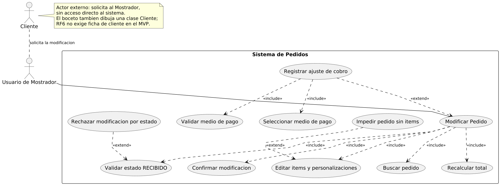
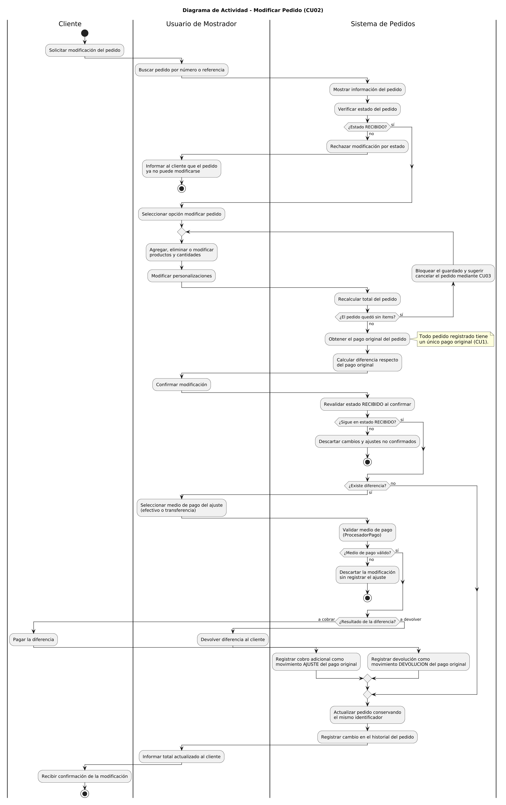
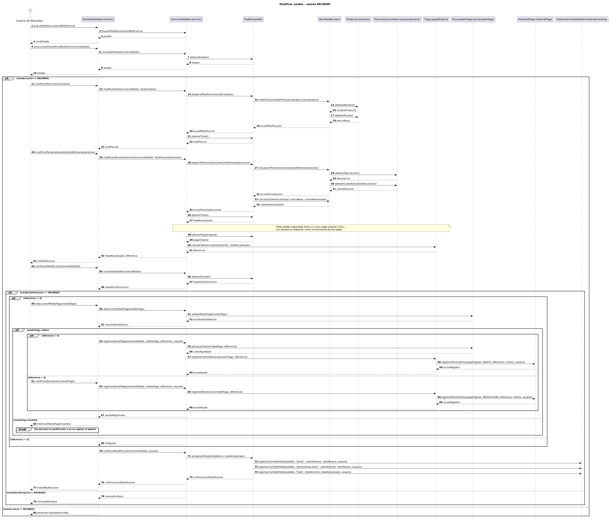
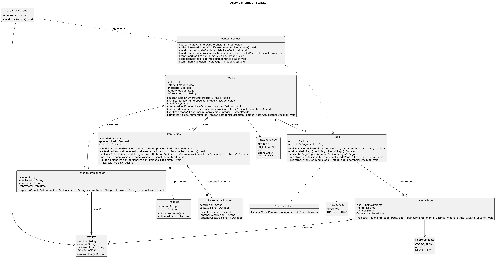

# Caso de Uso N° 2 - Modificar Pedido

---

## 1. Descripción y Trazabilidad con Requisitos Funcionales

**Actor/es:** Usuario de Mostrador.

**Objetivo:** Modificar los ítems, cantidades y personalizaciones de un pedido existente mientras se encuentre en estado RECIBIDO, conservando su identificador original.

**Flujo principal:**

1. El Usuario de Mostrador busca el pedido por número o referencia.
2. El sistema localiza el pedido, muestra sus datos y verifica que esté en estado RECIBIDO.
3. El Usuario de Mostrador selecciona la opción de modificar el pedido.
4. Agrega, elimina o modifica productos y cantidades.
5. Modifica las personalizaciones necesarias.
6. El sistema recalcula los subtotales y el total del pedido.
7. El sistema obtiene el pago original del pedido (todo pedido registrado tiene exactamente uno, creado en CU01) y calcula la diferencia contra el nuevo total.
8. El Usuario de Mostrador confirma la modificación.
9. El sistema vuelve a verificar que el pedido continúe en estado RECIBIDO.
10. Si hay diferencia, el Usuario de Mostrador selecciona el medio de pago; el sistema lo valida mediante `ProcesadorPago` y registra el cobro adicional o la devolución como movimiento (`AJUSTE` o `DEVOLUCION`) del pago original en `HistorialPago`.
11. El sistema actualiza el pedido conservando su identificador y registra los cambios realizados.

**Política de pagos:** cada pedido tiene un único `Pago` original (multiplicidad `Pedido 1 — 1 Pago`). Una modificación no crea pagos nuevos: los cobros adicionales y las devoluciones quedan como movimientos de ese pago en `HistorialPago`, con su tipo, monto, motivo y usuario responsable.

**Flujos alternativos:**

- **A1: Estado inicial no permitido.** Si el pedido no se encuentra en estado RECIBIDO, el sistema rechaza la modificación e informa al Usuario de Mostrador.
- **A2: Pedido sin ítems.** Si la modificación deja el pedido sin productos, el sistema impide guardar los cambios y sugiere utilizar CU03 - Cancelar Pedido.
- **A3: Cambio de estado durante la operación.** Si el pedido deja de estar RECIBIDO antes de confirmar, se descartan los cambios y ajustes no confirmados.
- **A4: Medio de pago inválido.** Si el medio seleccionado no es efectivo ni transferencia, se rechaza el ajuste y no se confirma la modificación.
- **A5: Pedido inexistente.** Si no se encuentra el pedido solicitado, se informa el error y finaliza la operación.

**Requisitos funcionales que satisface:**

| ID | Requisito Funcional  | Cómo lo satisface este caso de uso |
|---|---|---|
| RF3 | **Seguimiento y visualización del estado del pedido.** El sistema debe permitir al personal visualizar sincronizadamente los pedidos activos y controlar su ciclo de vida mediante un único estado secuencial y restringido: *Recibido*, *En preparación*, *Listo*, *Entregado* y *Cancelado*, garantizando una única fuente de verdad para evitar duplicaciones. | Consulta el estado del pedido al comenzar y lo vuelve a validar antes de confirmar. |
| RF4 | **Modificación de pedidos activos (antes de preparación).** El sistema debe permitir al usuario modificar los ítems, cantidades y personalizaciones de un pedido activo (manteniendo el mismo identificador y número de pedido original), única y exclusivamente mientras este se encuentre en estado *Recibido*; una vez que la cocina cambia el estado del pedido a *En preparación*, el sistema debe bloquear cualquier intento de modificación. | Permite modificar ítems y personalizaciones exclusivamente en RECIBIDO y conserva el número original del pedido. |
| RF8 | **Registro de pago.** El sistema debe permitir asociar y registrar el cobro de cada pedido utilizando únicamente efectivo o transferencia bancaria (dejando fuera QR y tarjetas en esta fase); asimismo, si un pedido previamente pagado es modificado en estado *Recibido*, el sistema debe recalcular el total y permitir registrar el cobro o ajuste de la diferencia económica generada. | Recalcula el total, conserva el pago original y registra por separado los cobros adicionales o devoluciones. |

---

## 2. Diagrama de Casos de Uso

**Actores y Procesos:**

- **Usuario de Mostrador:** busca el pedido, solicita su modificación, modifica ítems y personalizaciones y confirma la operación.
- **Validación del estado:** la modificación solo puede realizarse mientras el pedido se encuentre en RECIBIDO.
- **Recálculo del total:** forma parte del proceso de modificación cuando cambian los ítems o sus personalizaciones.
- **Ajuste de pago:** se realiza de manera condicional cuando el nuevo total genera una diferencia económica respecto del pago original del pedido.

**Include/Extend:**

- La validación del estado y el recálculo del total son comportamientos necesarios para completar la modificación.
- El ajuste económico es un comportamiento condicionado por la existencia de una diferencia de importe respecto del pago original.

---

## 3. Diagrama de Actividades

**Swimlanes:**

- **Usuario de Mostrador:** busca el pedido, solicita la modificación, edita los productos y personalizaciones, selecciona el medio de pago cuando corresponde y confirma.
- **Sistema:** consulta el pedido, verifica el estado, recalcula los importes, valida el pago y registra los cambios.

**Decisiones clave del flujo:**

- **¿Existe el pedido solicitado?**
  - **Sí:** el flujo continúa hacia la verificación del estado del pedido.
  - **No:** se informa que el pedido no existe y finaliza el flujo.

- **¿El pedido está en estado RECIBIDO?**
  - **Sí:** el flujo continúa hacia la modificación de ítems, cantidades y personalizaciones.
  - **No:** se informa que la modificación no está permitida y finaliza el flujo.

- **¿El pedido conserva al menos un ítem?**
  - **Sí:** el flujo continúa hacia el recálculo del total.
  - **No:** se rechaza la modificación, se sugiere cancelar el pedido mediante CU03 y finaliza el flujo.

- Después del recálculo, el sistema obtiene el pago original y calcula la diferencia. No hay decisión "¿existe un pago previo?": todo pedido registrado tiene un único pago original (CU01).

- **¿El pedido continúa en estado RECIBIDO al confirmar?**
  - **Sí:** el flujo continúa hacia el ajuste económico (si corresponde) y la actualización del pedido.
  - **No:** se descartan los cambios pendientes y finaliza el flujo.

- **¿Existe una diferencia económica?**
  - **Sí:** el Usuario de Mostrador selecciona el medio de pago del ajuste.
  - **No:** el flujo continúa hacia la actualización del pedido sin ajustes económicos.

- **¿El medio de pago seleccionado es válido?** (validación de `ProcesadorPago`)
  - **Sí:** se registra el cobro adicional (diferencia positiva) o la devolución (diferencia negativa) como movimiento del pago original.
  - **No:** se descarta la modificación sin registrar el ajuste y finaliza el flujo.

---

## 4. Diagrama de Secuencia

**Participantes:**

- **UsuarioMostrador:** actor que inicia la modificación.
- **PantallaPedidos:** interfaz utilizada para buscar y modificar pedidos; delega cada operación en `ServicioPedidos`.
- **ServicioPedidos:** control que localiza el pedido, consulta su estado, coordina la modificación, el ajuste de pago y la confirmación.
- **Pedido:** entidad que mantiene el estado y la identidad del pedido.
- **ItemPedido:** entidad que administra cantidades, precios y subtotales.
- **Producto:** entidad que proporciona información de los productos.
- **PersonalizacionItem:** entidad que representa modificaciones y costos adicionales.
- **Pago:** pago original del pedido; calcula la diferencia y registra cobros adicionales y devoluciones.
- **ProcesadorPago:** único responsable de validar el medio de pago y de procesar el cobro adicional.
- **HistorialPago:** registro de movimientos económicos del pago original.
- **HistorialCambioPedido:** registro de modificaciones realizadas.

**Mensajes clave** (todas las operaciones figuran con la misma firma en el diagrama de clases del CU2 y en el diagrama final):

- `ServicioPedidos.buscarPedido(numeroOReferencia)` → localiza el pedido solicitado.
- `ServicioPedidos.consultarEstado(numeroPedido)` → el servicio pide a `Pedido` `obtenerEstado()` y devuelve el estado; se usa al seleccionar el pedido y otra vez al confirmar.
- `ServicioPedidos.modificarItems(numeroPedido, listaCambios)` → invoca `Pedido.prepararModificacion(listaCambios)`, que actualiza cada ítem con `ItemPedido.modificarCantidadYPrecio(cantidad, precioUnitario)`.
- `ServicioPedidos.modificarPersonalizaciones(numeroPedido, listaPersonalizaciones)` → invoca `Pedido.prepararPersonalizaciones(listaPersonalizaciones)`, que usa `ItemPedido.actualizarPersonalizaciones(listaPersonalizaciones)` y recalcula `ItemPedido.calcularSubtotal(cantidad, precioBase, costosAdicionales)`.
- `Pedido.obtenerTotal()` → devuelve el total actualizado.
- `Pedido.obtenerPagoOriginal()` → devuelve el único pago original del pedido.
- `Pago.calcularDiferencia(totalAnterior, totalActualizado)` → determina la diferencia entre el total ya abonado (`totalAnterior`) y el nuevo total del pedido (`totalActualizado`).
- `ServicioPedidos.seleccionarMedioPago(medioPago)` → delega la validación en `ProcesadorPago.validarMedioPago(medioPago)`.
- `ServicioPedidos.registrarAjustePago(numeroPedido, medioPago, diferencia, usuario)` → si la diferencia es positiva procesa el cobro con `ProcesadorPago.procesarCobro(medioPago, diferencia)` y llama a `Pago.registrarCobroAdicional(medioPago, diferencia)`; si es negativa llama a `Pago.registrarDevolucion(medioPago, diferencia)`.
- `HistorialPago.registrarMovimiento(pago, tipo, monto, motivo, usuario)` → registra el movimiento `AJUSTE` o `DEVOLUCION` del pago original.
- `ServicioPedidos.confirmarModificacion(numeroPedido, usuario)` → invoca `Pedido.actualizarPedido(listaItems, totalActualizado)`.
- `HistorialCambioPedido.registrarCambioPedido(pedido, campo, valorAnterior, valorNuevo, usuario)` → conserva cada modificación en el historial.

**Objetos temporales destruidos:**

No se representa la destrucción explícita de objetos persistentes. Los cambios preparados que no llegan a confirmarse se descartan.

---

## 5. Diagrama de Clases del Caso de Uso

**Clases involucradas:**

| Clase | Responsabilidad | Tarjeta CRC |
|---|---|---|
| Usuario | Representar la identidad y autenticación de los usuarios del sistema. | [Usuario](../../herramientas-agile/tarjetas-crc/13-tarjeta-crc-usuario.md) |
| UsuarioMostrador | Realizar operaciones de gestión de pedidos desde el mostrador. | [Usuario de Mostrador](../../herramientas-agile/tarjetas-crc/14-tarjeta-crc-usuario-mostrador.md) |
| PantallaPedidos | Recibir las acciones del usuario y comunicar las operaciones relacionadas con el pedido. | [Pantalla Pedidos](../../herramientas-agile/tarjetas-crc/20-tarjeta-crc-pantalla-pedidos.md) |
| ServicioPedidos | Localizar el pedido, consultar su estado y coordinar la modificación, el ajuste de pago y la confirmación. | [Servicio Pedidos](../../herramientas-agile/tarjetas-crc/17-tarjeta-crc-servicio-pedidos.md) |
| Pedido | Mantener el estado, la identidad y la información del pedido. | [Pedido](../../herramientas-agile/tarjetas-crc/01-tarjeta-crc-pedido.md) |
| ItemPedido | Administrar los productos, cantidades, personalizaciones y subtotales del pedido. | [Ítem de Pedido](../../herramientas-agile/tarjetas-crc/02-tarjeta-crc-item-pedido.md) |
| Producto | Proporcionar los datos y precios de los productos. | [Producto](../../herramientas-agile/tarjetas-crc/03-tarjeta-crc-producto.md) |
| PersonalizacionItem | Representar las personalizaciones y sus costos adicionales. | [Personalización de Ítem](../../herramientas-agile/tarjetas-crc/04-tarjeta-crc-personalizacion-item.md) |
| Pago | Administrar los importes, medios de pago y ajustes económicos. | [Pago](../../herramientas-agile/tarjetas-crc/05-tarjeta-crc-pago.md) |
| ProcesadorPago | Validar el medio de pago seleccionado y procesar el cobro adicional (única responsable de la validación). | [Procesador Pago](../../herramientas-agile/tarjetas-crc/18-tarjeta-crc-procesador-pago.md) |
| HistorialPago | Conservar los movimientos económicos asociados a un pago. | [Historial de Pago](../../herramientas-agile/tarjetas-crc/10-tarjeta-crc-historial-pago.md) |
| HistorialCambioPedido | Registrar los cambios realizados sobre un pedido. | [Historial de Cambio de Pedido](../../herramientas-agile/tarjetas-crc/12-tarjeta-crc-historial-cambio-pedido.md) |
| EstadoPedido | Definir el conjunto cerrado de estados del ciclo de vida del pedido | [21-tarjeta-crc-estado-pedido.md](../../herramientas-agile/tarjetas-crc/21-tarjeta-crc-estado-pedido.md) |

**Relaciones UML:**

| Relación | Clases | Justificación |
|---|---|---|
| Herencia | UsuarioMostrador → Usuario | UsuarioMostrador especializa a Usuario y hereda sus características generales. |
| Dependencia | UsuarioMostrador → PantallaPedidos | El actor utiliza la interfaz para modificar pedidos. |
| Dependencia | PantallaPedidos → ServicioPedidos | La interfaz delega en el servicio todas las operaciones de la modificación. |
| Dependencia | ServicioPedidos → Pedido | El servicio consulta el estado y aplica los cambios sobre el pedido. |
| Dependencia | ServicioPedidos → Pago | El servicio calcula la diferencia y registra el ajuste sobre el pago original. |
| Dependencia | ServicioPedidos → ProcesadorPago | El servicio valida el medio de pago y procesa el cobro adicional mediante el procesador. |
| Composición | Pedido → ItemPedido | Los ítems forman parte del pedido y dependen de él. |
| Asociación | ItemPedido → Producto (0..* a 0..1) | Cada ítem referencia un producto o un combo, como en el diagrama final. |
| Composición | ItemPedido → PersonalizacionItem | Las personalizaciones pertenecen al ítem correspondiente. |
| Asociación | Pedido — Pago (1 a 1) | Cada pedido tiene un único pago original; los ajustes no crean pagos nuevos (política de pagos). |
| Asociación | Pago → HistorialPago (1 a 0..*) | Los cobros adicionales (`AJUSTE`) y las devoluciones (`DEVOLUCION`) se registran como movimientos del pago original. |
| Asociación | Pedido → HistorialCambioPedido | El pedido conserva registros de sus modificaciones. |
| Asociación | HistorialPago → Usuario | Permite identificar al usuario responsable del movimiento. |
| Asociación | HistorialCambioPedido → Usuario | Permite identificar al usuario responsable de la modificación. |

---

## 6. Pseudocódigo

    INICIO Modificar Pedido

        // El Usuario de Mostrador busca el pedido; la pantalla delega en ServicioPedidos.
        pedido = ServicioPedidos.buscarPedido(numeroOReferencia)

        SI pedido == NULL
            Retornar "Pedido inexistente"
        FIN SI

        // Se verifica que el pedido permita modificaciones.
        estado = ServicioPedidos.consultarEstado(numeroPedido)
            // ServicioPedidos obtiene el estado con pedido.obtenerEstado()

        SI estado != RECIBIDO
            Retornar "No se permite modificar el pedido"
        FIN SI

        // Se preparan los cambios de productos y cantidades.
        ServicioPedidos.modificarItems(numeroPedido, listaCambios)
            // pedido.prepararModificacion(listaCambios)
            //   PARA CADA item modificado: item.modificarCantidadYPrecio(cantidad, precioUnitario)

        // Se preparan los cambios de personalización y se recalculan los subtotales.
        ServicioPedidos.modificarPersonalizaciones(numeroPedido, listaPersonalizaciones)
            // pedido.prepararPersonalizaciones(listaPersonalizaciones)
            //   PARA CADA item afectado:
            //     item.actualizarPersonalizaciones(listaPersonalizaciones)
            //     subtotal = item.calcularSubtotal(cantidad, precioBase, costosAdicionales)

        // No se permite confirmar un pedido sin ítems.
        SI pedido.items está vacío
            Retornar "El pedido debe tener al menos un ítem"
        FIN SI

        totalAnterior = total registrado antes de la modificación
        totalActualizado = pedido.obtenerTotal()

        // Todo pedido registrado tiene un único pago original (CU01).
        pagoOriginal = pedido.obtenerPagoOriginal()
        diferencia = pagoOriginal.calcularDiferencia(totalAnterior, totalActualizado)

        // Antes de confirmar, se vuelve a validar el estado.
        estadoActual = ServicioPedidos.consultarEstado(numeroPedido)

        SI estadoActual != RECIBIDO
            Descartar cambios pendientes
            Retornar "El pedido cambió de estado"
        FIN SI

        // Ajuste económico sobre el pago original (sin crear pagos nuevos).
        SI diferencia != 0

            resultado = ServicioPedidos.seleccionarMedioPago(medioPago)
                // ProcesadorPago.validarMedioPago(medioPago) es el único validador

            SI resultado es inválido
                Descartar cambios pendientes
                Retornar "Medio de pago inválido"
            FIN SI

            ServicioPedidos.registrarAjustePago(numeroPedido, medioPago, diferencia, usuario)
                // SI diferencia > 0:
                //   ProcesadorPago.procesarCobro(medioPago, diferencia)
                //   pagoOriginal.registrarCobroAdicional(medioPago, diferencia)
                //   historialPago.registrarMovimiento(pagoOriginal, AJUSTE, diferencia, motivo, usuario)
                // SINO (diferencia < 0):
                //   pagoOriginal.registrarDevolucion(medioPago, diferencia)
                //   historialPago.registrarMovimiento(pagoOriginal, DEVOLUCION, diferencia, motivo, usuario)

        FIN SI

        // Se actualiza el pedido conservando su identificador y se registra el historial.
        ServicioPedidos.confirmarModificacion(numeroPedido, usuario)
            // pedido.actualizarPedido(listaItems, totalActualizado)
            // historialCambios.registrarCambioPedido(pedido, campo, valorAnterior, valorNuevo, usuario)
            //   para "items", "personalizaciones" y "total"

        Retornar "Pedido modificado correctamente"

    FIN
