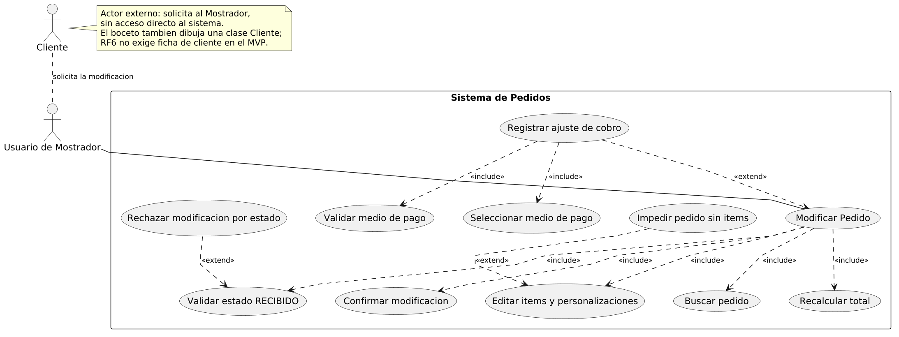
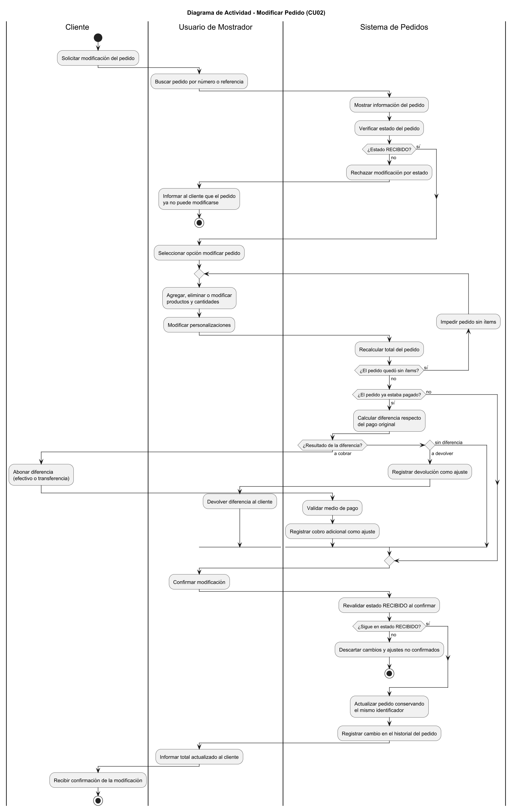
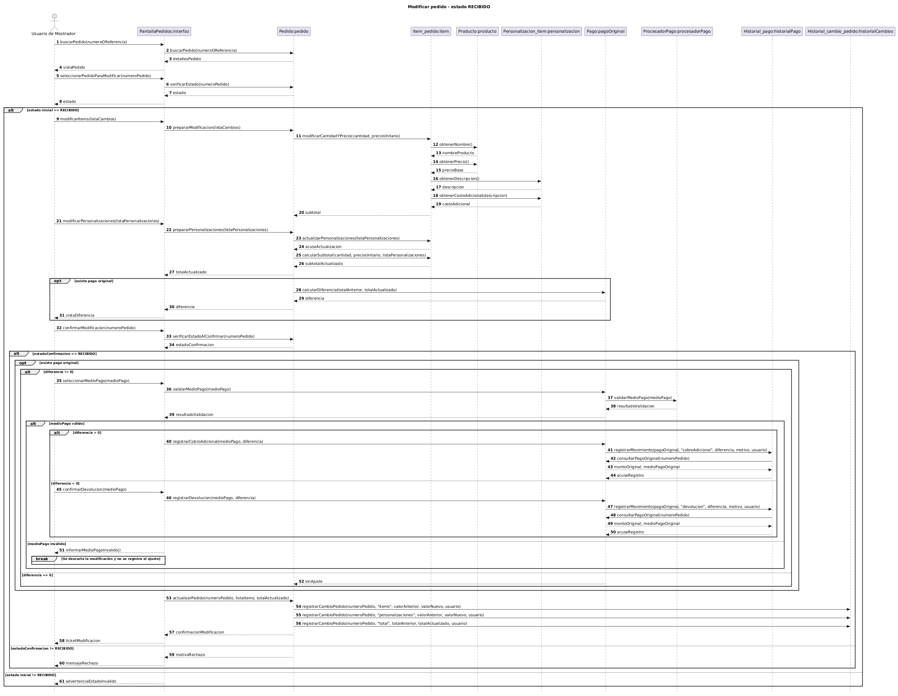
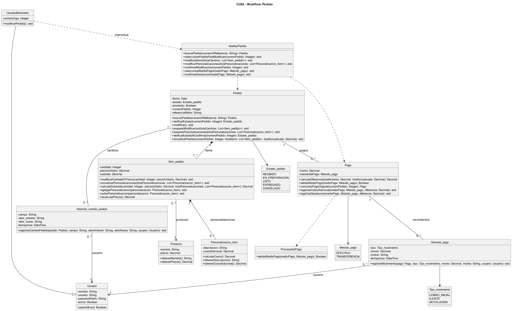

# Caso de Uso N° 2 - Modificar Pedido

---

## 1. Descripción y Trazabilidad con Requisitos Funcionales

**Actor/es:** Usuario de Mostrador.

**Objetivo:** Modificar los ítems, cantidades y personalizaciones de un pedido existente mientras se encuentre en estado RECIBIDO, conservando su identificador original.

**Flujo principal:**

1. El Usuario de Mostrador busca el pedido por número o referencia.
2. El sistema localiza el pedido, muestra sus datos y verifica que esté en estado RECIBIDO.
3. El Usuario de Mostrador selecciona la opción de modificar el pedido.
4. Agrega, elimina o modifica productos y cantidades.
5. Modifica las personalizaciones necesarias.
6. El sistema recalcula los subtotales y el total del pedido.
7. Si existe un pago previo, el sistema conserva el pago original, calcula la diferencia y permite registrar un cobro adicional o una devolución.
8. El Usuario de Mostrador selecciona el medio de pago correspondiente, cuando sea necesario.
9. El Usuario de Mostrador confirma la modificación.
10. El sistema vuelve a verificar que el pedido continúe en estado RECIBIDO.
11. El sistema actualiza el pedido conservando su identificador y registra los cambios realizados.

**Flujos alternativos:**

- **A1: Estado inicial no permitido.** Si el pedido no se encuentra en estado RECIBIDO, el sistema rechaza la modificación e informa al Usuario de Mostrador.
- **A2: Pedido sin ítems.** Si la modificación deja el pedido sin productos, el sistema impide guardar los cambios y sugiere utilizar CU03 - Cancelar Pedido.
- **A3: Cambio de estado durante la operación.** Si el pedido deja de estar RECIBIDO antes de confirmar, se descartan los cambios y ajustes no confirmados.
- **A4: Medio de pago inválido.** Si el medio seleccionado no es efectivo ni transferencia, se rechaza el ajuste y no se confirma la modificación.
- **A5: Pedido inexistente.** Si no se encuentra el pedido solicitado, se informa el error y finaliza la operación.

**Requisitos funcionales que satisface:**

| ID | Requisito Funcional  | Cómo lo satisface este caso de uso |
|---|---|---|
| RF3 | **Seguimiento y visualización del estado del pedido.** El sistema debe permitir al personal visualizar sincronizadamente los pedidos activos y controlar su ciclo de vida mediante un único estado secuencial y restringido: *Recibido*, *En preparación*, *Listo*, *Entregado* y *Cancelado*, garantizando una única fuente de verdad para evitar duplicaciones. | Consulta el estado del pedido al comenzar y lo vuelve a validar antes de confirmar. |
| RF4 | **Modificación de pedidos activos (antes de preparación).** El sistema debe permitir al usuario modificar los ítems, cantidades y personalizaciones de un pedido activo (manteniendo el mismo identificador y número de pedido original), única y exclusivamente mientras este se encuentre en estado *Recibido*; una vez que la cocina cambia el estado del pedido a *En preparación*, el sistema debe bloquear cualquier intento de modificación. | Permite modificar ítems y personalizaciones exclusivamente en RECIBIDO y conserva el número original del pedido. |
| RF8 | **Registro de pago.** El sistema debe permitir asociar y registrar el cobro de cada pedido utilizando únicamente efectivo o transferencia bancaria (dejando fuera QR y tarjetas en esta fase); asimismo, si un pedido previamente pagado es modificado en estado *Recibido*, el sistema debe recalcular el total y permitir registrar el cobro o ajuste de la diferencia económica generada. | Recalcula el total, conserva el pago original y registra por separado los cobros adicionales o devoluciones. |

---

## 2. Diagrama de Casos de Uso

**Actores y Procesos:**

- **Usuario de Mostrador:** busca el pedido, solicita su modificación, modifica ítems y personalizaciones y confirma la operación.
- **Validación del estado:** la modificación solo puede realizarse mientras el pedido se encuentre en RECIBIDO.
- **Recálculo del total:** forma parte del proceso de modificación cuando cambian los ítems o sus personalizaciones.
- **Ajuste de pago:** se realiza de manera condicional cuando existe un pago previo y el nuevo total genera una diferencia económica.

**Include/Extend:**

- La validación del estado y el recálculo del total son comportamientos necesarios para completar la modificación.
- El ajuste económico es un comportamiento condicionado por la existencia de un pago previo y una diferencia de importe.

---

## 3. Diagrama de Actividades

**Swimlanes:**

- **Usuario de Mostrador:** busca el pedido, solicita la modificación, edita los productos y personalizaciones, selecciona el medio de pago cuando corresponde y confirma.
- **Sistema:** consulta el pedido, verifica el estado, recalcula los importes, valida el pago y registra los cambios.

**Decisiones clave del flujo:**

- **¿Existe el pedido solicitado?**
  - **Sí:** el flujo continúa hacia la verificación del estado del pedido.
  - **No:** se informa que el pedido no existe y finaliza el flujo.

- **¿El pedido está en estado RECIBIDO?**
  - **Sí:** el flujo continúa hacia la modificación de ítems, cantidades y personalizaciones.
  - **No:** se informa que la modificación no está permitida y finaliza el flujo.

- **¿El pedido conserva al menos un ítem?**
  - **Sí:** el flujo continúa hacia el recálculo del total.
  - **No:** se rechaza la modificación, se sugiere cancelar el pedido mediante CU03 y finaliza el flujo.

- **¿Existe un pago previo?**
  - **Sí:** el flujo se dirige al cálculo de la diferencia económica.
  - **No:** el flujo continúa hacia la confirmación de la modificación.

- **¿Existe una diferencia económica?**
  - **Positiva:** el flujo se dirige a la gestión de un cobro adicional.
  - **Negativa:** el flujo se dirige a la gestión de una devolución.
  - **Igual a cero:** el flujo continúa hacia la confirmación sin ajustes económicos.

- **¿El medio de pago seleccionado es válido?**
  - **Sí:** el flujo continúa hacia la confirmación de la modificación.
  - **No:** se rechaza el ajuste económico y finaliza el flujo sin guardar los cambios.

- **¿El pedido continúa en estado RECIBIDO al confirmar?**
  - **Sí:** el flujo continúa hacia la actualización del pedido y el registro de los cambios, y luego finaliza.
  - **No:** se descartan los cambios pendientes y finaliza el flujo.

---

## 4. Diagrama de Secuencia

**Participantes:**

- **UsuarioMostrador:** actor que inicia la modificación.
- **InterfazPedido:** interfaz utilizada para buscar y modificar pedidos.
- **Pedido:** entidad que mantiene el estado y la identidad del pedido.
- **Item_pedido:** entidad que administra cantidades, precios y subtotales.
- **Producto:** entidad que proporciona información de los productos.
- **Personalizacion_item:** entidad que representa modificaciones y costos adicionales.
- **Pago:** entidad que administra los importes y diferencias económicas.
- **ProcesadorPago:** componente encargado de validar el medio de pago.
- **Historial_pago:** registro de movimientos económicos.
- **Historial_cambio_pedido:** registro de modificaciones realizadas.

**Mensajes clave:**

- `buscarPedido(numeroOReferencia)` → localiza el pedido solicitado.
- `verificarEstado()` → comprueba si el pedido se encuentra en RECIBIDO.
- `modificarItems(listaCambios)` → recibe los cambios sobre los productos y cantidades.
- `modificarPersonalizaciones(listaPersonalizaciones)` → recibe los cambios de personalización.
- `prepararModificacion()` → prepara los cambios sobre el pedido.
- `prepararPersonalizaciones()` → prepara los cambios de personalización.
- `modificarCantidadYPrecio()` → actualiza cantidades y precios de los ítems.
- `actualizarPersonalizaciones()` → modifica las personalizaciones asociadas.
- `calcularSubtotal(...)` → obtiene el subtotal correspondiente a cada ítem.
- `recalcularPrecio()` → actualiza el importe del ítem.
- `consultarPagoOriginal()` → obtiene la información del pago anterior.
- `calcularDiferencia()` → determina la diferencia entre el pago anterior y el nuevo total.
- `validarMedioPago()` → comprueba que el medio seleccionado sea válido.
- `registrarCobroAdicional()` → registra un importe adicional.
- `registrarDevolucion()` → registra una devolución.
- `verificarEstadoAlConfirmar()` → vuelve a comprobar que el pedido esté RECIBIDO.
- `actualizarPedido()` → confirma los cambios del pedido.
- `registrarMovimiento()` → registra el movimiento económico.
- `registrarCambioPedido()` → conserva la modificación en el historial.

**Objetos temporales destruidos:**

No se representa la destrucción explícita de objetos persistentes. Los cambios preparados que no llegan a confirmarse se descartan.

---

## 5. Diagrama de Clases del Caso de Uso

**Clases involucradas:**

| Clase | Responsabilidad | Tarjeta CRC |
|---|---|---|
| Usuario | Representar la identidad y autenticación de los usuarios del sistema. | [Usuario](../../herramientas-agile/tarjetas-crc/13-tarjeta-crc-usuario.md) |
| UsuarioMostrador | Realizar operaciones de gestión de pedidos desde el mostrador. | [Usuario de Mostrador](../../herramientas-agile/tarjetas-crc/14-tarjeta-crc-usuario-mostrador.md) |
| InterfazPedido | Recibir las acciones del usuario y comunicar las operaciones relacionadas con el pedido. | Interfaz específica del caso de uso |
| Pedido | Mantener el estado, la identidad y la información del pedido. | [Pedido](../../herramientas-agile/tarjetas-crc/01-tarjeta-crc-pedido.md) |
| Item_pedido | Administrar los productos, cantidades, personalizaciones y subtotales del pedido. | [Ítem de Pedido](../../herramientas-agile/tarjetas-crc/02-tarjeta-crc-item-pedido.md) |
| Producto | Proporcionar los datos y precios de los productos. | [Producto](../../herramientas-agile/tarjetas-crc/03-tarjeta-crc-producto.md) |
| Personalizacion_item | Representar las personalizaciones y sus costos adicionales. | [Personalización de Ítem](../../herramientas-agile/tarjetas-crc/04-tarjeta-crc-personalizacion-item.md) |
| Pago | Administrar los importes, medios de pago y ajustes económicos. | [Pago](../../herramientas-agile/tarjetas-crc/05-tarjeta-crc-pago.md) |
| ProcesadorPago | Validar el medio de pago seleccionado. | Componente de apoyo del caso de uso |
| Historial_pago | Conservar los movimientos económicos asociados a un pago. | [Historial de Pago](../../herramientas-agile/tarjetas-crc/10-tarjeta-crc-historial-pago.md) |
| Historial_cambio_pedido | Registrar los cambios realizados sobre un pedido. | [Historial de Cambio de Pedido](../../herramientas-agile/tarjetas-crc/12-tarjeta-crc-historial-cambio-pedido.md) |

**Relaciones UML:**

| Relación | Clases | Justificación |
|---|---|---|
| Herencia | UsuarioMostrador → Usuario | UsuarioMostrador especializa a Usuario y hereda sus características generales. |
| Dependencia | UsuarioMostrador → InterfazPedido | El actor utiliza la interfaz para modificar pedidos. |
| Dependencia | InterfazPedido → Pedido | La interfaz consulta y solicita operaciones sobre el pedido. |
| Dependencia | InterfazPedido → Pago | La interfaz participa en la gestión de ajustes económicos. |
| Dependencia | Pago → ProcesadorPago | El pago utiliza el procesador para validar el medio seleccionado. |
| Composición | Pedido → Item_pedido | Los ítems forman parte del pedido y dependen de él. |
| Asociación | Item_pedido → Producto | Cada ítem corresponde a un producto. |
| Composición | Item_pedido → Personalizacion_item | Las personalizaciones pertenecen al ítem correspondiente. |
| Asociación | Pedido → Pago | Un pedido puede tener pagos asociados. |
| Asociación | Pago → Historial_pago | Los movimientos económicos se relacionan con el pago correspondiente. |
| Asociación | Pedido → Historial_cambio_pedido | El pedido conserva registros de sus modificaciones. |
| Asociación | Historial_pago → Usuario | Permite identificar al usuario responsable del movimiento. |
| Asociación | Historial_cambio_pedido → Usuario | Permite identificar al usuario responsable de la modificación. |

---

## 6. Pseudocódigo

    INICIO Modificar Pedido

        // El Usuario de Mostrador solicita modificar un pedido.
        pedido = interfaz.buscarPedido(numeroOReferencia)

        SI pedido == NULL
            Retornar "Pedido inexistente"
        FIN SI

        // Se verifica que el pedido permita modificaciones.
        estado = pedido.verificarEstado()

        SI estado != RECIBIDO
            Retornar "No se permite modificar el pedido"
        FIN SI

        // Se preparan los cambios solicitados.
        pedido.prepararModificacion(listaCambios)
        pedido.prepararPersonalizaciones(listaPersonalizaciones)

        PARA CADA item EN pedido.items
            item.modificarCantidadYPrecio()
            item.actualizarPersonalizaciones()
            item.recalcularPrecio()
        FIN PARA

        // No se permite confirmar un pedido sin ítems.
        SI pedido.items está vacío
            Retornar "El pedido debe tener al menos un ítem"
        FIN SI

        totalNuevo = SUMAR subtotales de pedido.items

        // Se consulta el pago anterior, si existe.
        pagoOriginal = pago.consultarPagoOriginal()

        diferencia = 0

        SI pagoOriginal existe

            diferencia = pago.calcularDiferencia(
                totalNuevo, pagoOriginal.monto
            )

            SI diferencia != 0

                medio = interfaz.seleccionarMedioPago()
                valido = procesadorPago.validarMedioPago(medio)

                SI valido == FALSO
                    Descartar cambios pendientes
                    Retornar "Medio de pago inválido"
                FIN SI

            FIN SI

        FIN SI

        // Antes de confirmar, se vuelve a validar el estado.
        estadoActual = pedido.verificarEstadoAlConfirmar()

        SI estadoActual != RECIBIDO
            Descartar cambios y ajustes pendientes
            Retornar "El pedido cambió de estado"
        FIN SI

        // Se actualiza el pedido conservando su identificador.
        pedido.actualizarPedido()

        // Se registra el ajuste económico correspondiente.
        SI pagoOriginal existe Y diferencia > 0

            pago.registrarCobroAdicional(diferencia)
            historialPago.registrarMovimiento()

        SINO SI pagoOriginal existe Y diferencia < 0

            pago.registrarDevolucion(ABS(diferencia))
            historialPago.registrarMovimiento()

        FIN SI

        // Se conserva el historial de modificaciones.
        historialCambio.registrarCambioPedido()

        Retornar "Pedido modificado correctamente"

    FIN
