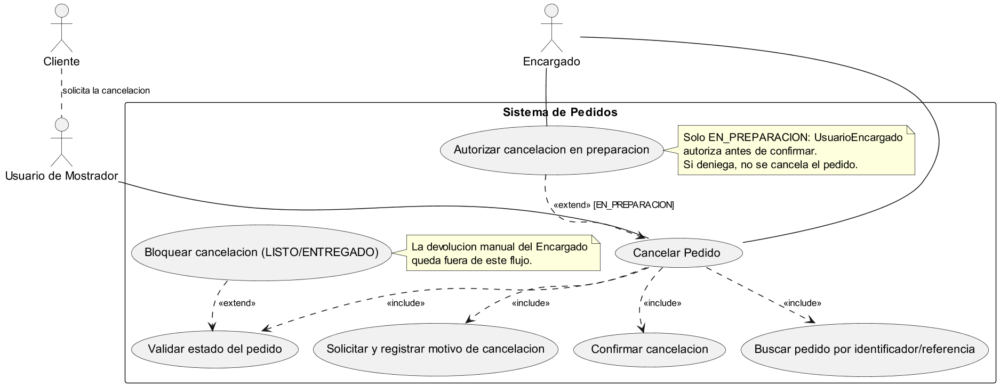
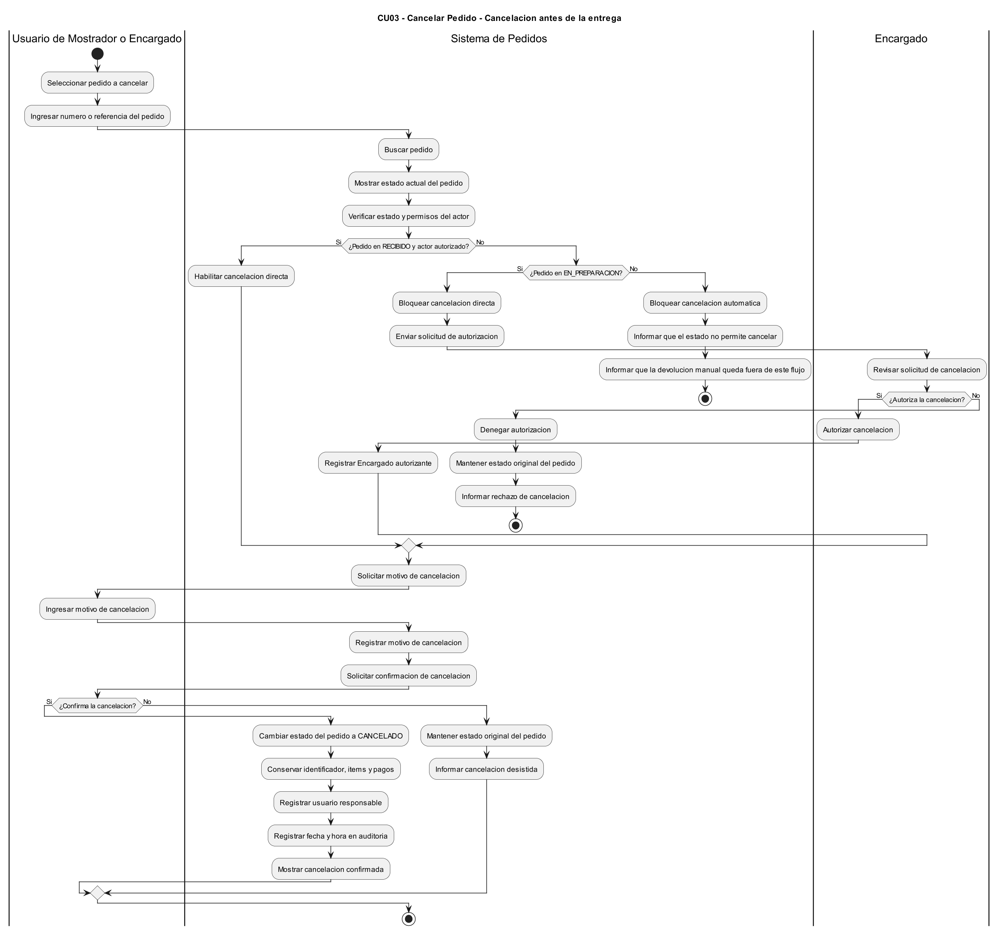
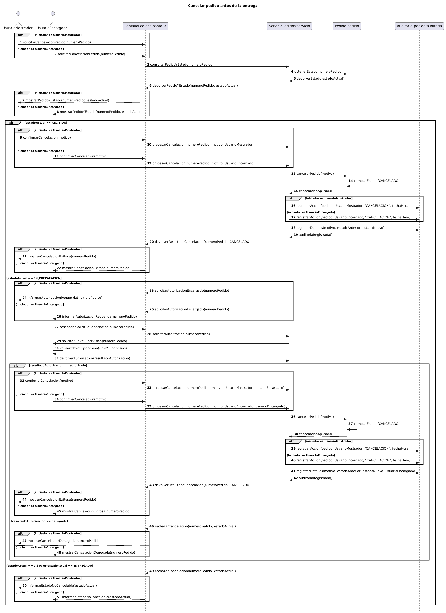
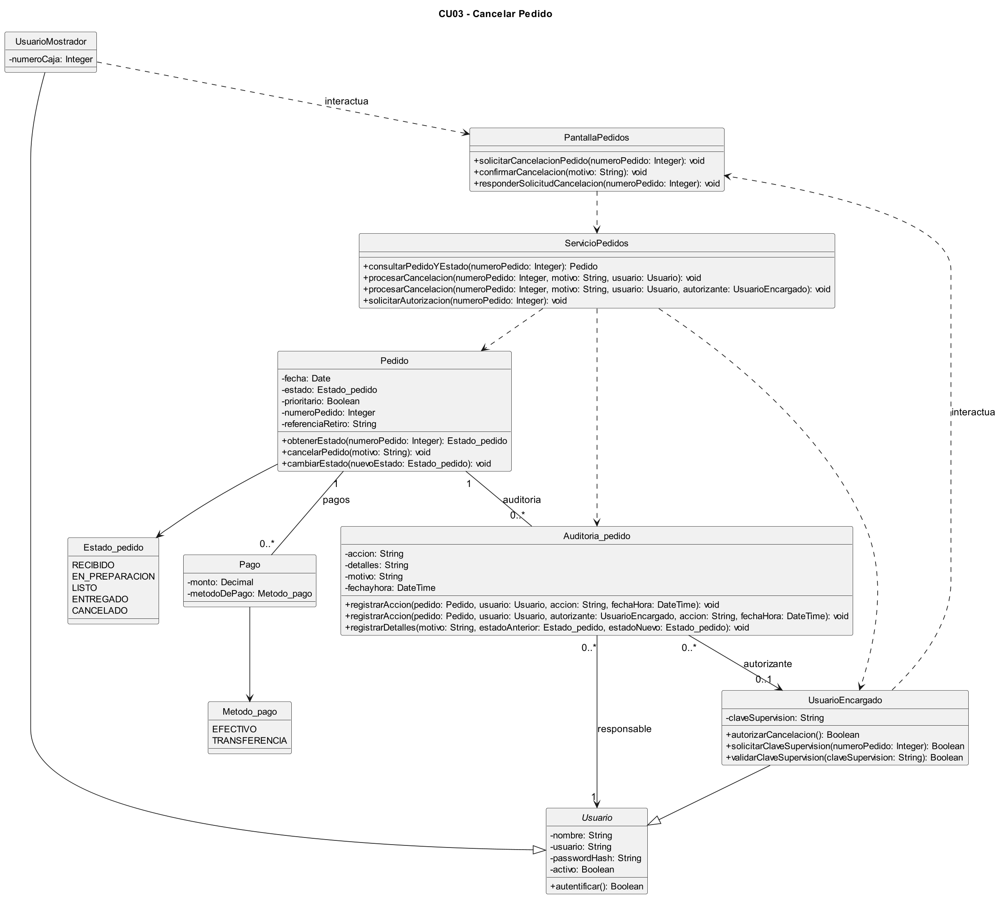

# Caso de Uso N° 3 - Cancelar Pedido

---

## 1. Descripción y Trazabilidad con Requisitos Funcionales

**Actor/es:** Usuario de Mostrador, Encargado.

**Objetivo:** Cancelar completamente un pedido activo antes de su entrega, cuando las condiciones de su estado lo permitan, conservando el registro original y estableciendo de forma definitiva el estado CANCELADO.

**Flujo principal:**

1. El Usuario de Mostrador busca el pedido mediante su número o referencia.
2. El sistema localiza el pedido, muestra su información y consulta el estado actual.
3. El sistema verifica que el pedido se encuentre en estado RECIBIDO.
4. El Usuario de Mostrador selecciona la opción de cancelar pedido.
5. El sistema solicita el motivo de la cancelación.
6. El Usuario de Mostrador ingresa el motivo.
7. El sistema solicita la confirmación de la operación.
8. El Usuario de Mostrador confirma la cancelación.
9. El sistema procesa la solicitud y cambia el estado del pedido a CANCELADO.
10. El sistema conserva el identificador, los ítems y los pagos asociados al pedido.
11. El sistema registra la cancelación en la auditoría, incluyendo usuario responsable, fecha, hora, motivo y cambio de estado.
12. El sistema informa que el pedido fue cancelado correctamente.

**Flujos alternativos:**

- **A1: Pedido en estado EN_PREPARACION.** El sistema solicita autorización del Encargado. Si la autorización es válida, permite continuar con el motivo y la confirmación de la cancelación.
- **A2: Autorización denegada.** Si el Encargado no autoriza la operación o la clave de supervisión es incorrecta, el sistema rechaza la cancelación y mantiene el estado original del pedido.
- **A3: Pedido en estado LISTO o ENTREGADO.** El sistema bloquea la cancelación automática e informa que la operación no está permitida.
- **A4: Cancelación no confirmada.** Si el usuario desiste de la operación, el sistema mantiene el estado original del pedido.
- **A5: Pedido inexistente.** Si el sistema no encuentra el pedido solicitado, informa el error y finaliza la operación.
- **A6: Pedido ya CANCELADO.** Si el pedido ya se encuentra cancelado, el sistema impide repetir la operación y conserva su estado definitivo.

**Requisitos funcionales que satisface:**

| ID | Requisito Funcional | Cómo lo satisface este caso de uso |
|---|---|---|
| RF3 | **Seguimiento y visualización del estado del pedido.** El sistema debe permitir al personal visualizar sincronizadamente los pedidos activos y controlar su ciclo de vida mediante un único estado secuencial y restringido: *Recibido*, *En preparación*, *Listo*, *Entregado* y *Cancelado*, garantizando una única fuente de verdad para evitar duplicaciones. | Consulta el estado actual del pedido y registra su transición a CANCELADO cuando corresponde. |
| RF5 | **Cancelación completa del pedido.** El sistema debe posibilitar la cancelación completa de un pedido activo antes de que sea entregado, asegurando que por razones de auditoría interna de caja el registro nunca se elimine físicamente de la base de datos y que pase de forma definitiva y permanente al estado *Cancelado*. | Cancela el pedido sin eliminarlo físicamente y conserva la información necesaria para auditoría. |
| RF8 | **Registro de pago.** El sistema debe permitir asociar y registrar el cobro de cada pedido utilizando únicamente efectivo o transferencia bancaria (dejando fuera QR y tarjetas en esta fase); asimismo, si un pedido previamente pagado es modificado en estado *Recibido*, el sistema debe recalcular el total y permitir registrar el cobro o ajuste de la diferencia económica generada. | Conserva los pagos asociados al pedido cancelado para mantener su trazabilidad. La devolución automática no forma parte de este caso de uso. |

---

## 2. Diagrama de Casos de Uso

**Actores y Procesos:**

- **Usuario de Mostrador:** busca el pedido, solicita la cancelación, ingresa el motivo y confirma la operación.
- **Encargado:** autoriza las cancelaciones que requieren supervisión, especialmente cuando el pedido se encuentra EN_PREPARACION.
- **Validación del estado:** determina si el pedido puede cancelarse directamente, requiere autorización o debe rechazarse.
- **Registro de auditoría:** conserva la información de la cancelación y los usuarios involucrados.

**Include/Extend:**

- La consulta del pedido y la validación de su estado son comportamientos necesarios para procesar la cancelación.
- La confirmación de la operación es necesaria antes de modificar el estado.
- La autorización del Encargado es un comportamiento condicional cuando el pedido está EN_PREPARACION.
- El registro de auditoría forma parte del procesamiento exitoso de la cancelación.

---

## 3. Diagrama de Actividades

**Swimlanes:**

- **Usuario de Mostrador:** busca el pedido, solicita su cancelación, ingresa el motivo y confirma la operación.
- **Encargado:** recibe la solicitud de autorización, ingresa la clave de supervisión y autoriza o rechaza la cancelación.
- **Sistema:** consulta el pedido, verifica su estado, valida la autorización, cambia el estado y registra la auditoría.

**Decisiones clave del flujo:**

- **¿Existe el pedido solicitado?**
  - **Sí:** el flujo continúa hacia la consulta del estado actual del pedido.
  - **No:** se informa que el pedido no existe y finaliza el flujo.

- **¿El pedido está en estado RECIBIDO?**
  - **Sí:** el flujo se dirige a solicitar el motivo y la confirmación de cancelación.
  - **No:** continúa hacia la evaluación del estado EN_PREPARACION.

- **¿El pedido está en estado EN_PREPARACION?**
  - **Sí:** el flujo se dirige a solicitar la autorización del Encargado.
  - **No:** se rechaza la cancelación automática y finaliza el flujo.

- **¿El Encargado autoriza la cancelación?**
  - **Sí:** el flujo continúa hacia la solicitud del motivo y la confirmación.
  - **No:** se informa que la autorización fue denegada, se mantiene el estado original y finaliza el flujo.

- **¿El actor confirma la cancelación?**
  - **Sí:** el flujo se dirige al procesamiento de la cancelación, al cambio de estado a CANCELADO y al registro de auditoría.
  - **No:** se mantiene el estado original del pedido y finaliza el flujo.

---

## 4. Diagrama de Secuencia

**Participantes:**

- **UsuarioMostrador:** actor que solicita la cancelación.
- **UsuarioEncargado:** actor responsable de autorizar las cancelaciones que requieren supervisión.
- **PantallaPedidos:** interfaz que recibe las solicitudes, motivos y confirmaciones.
- **ServicioPedidos:** componente que coordina las validaciones y el procesamiento de la cancelación.
- **Pedido:** entidad que administra la información y el estado del pedido.
- **Auditoria_pedido:** entidad que registra la operación, el motivo y los responsables.

**Mensajes clave:**

- `solicitarCancelacionPedido(numeroPedido)` → inicia la solicitud de cancelación del pedido.
- `consultarPedidoYEstado(numeroPedido)` → obtiene el pedido solicitado y consulta su estado actual.
- `obtenerEstado(numeroPedido)` → devuelve el estado vigente del pedido.
- `solicitarAutorizacion(numeroPedido)` → solicita la intervención del Encargado cuando el pedido está EN_PREPARACION.
- `solicitarClaveSupervision(numeroPedido)` → solicita la clave de supervisión del Encargado.
- `validarClaveSupervision(claveSupervision)` → verifica si la autorización ingresada es válida.
- `autorizarCancelacion()` → autoriza la cancelación del pedido.
- `confirmarCancelacion(motivo)` → recibe el motivo y confirma la solicitud de cancelación.
- `procesarCancelacion(numeroPedido, motivo, usuario)` → procesa una cancelación que no requiere autorización adicional.
- `procesarCancelacion(numeroPedido, motivo, usuario, autorizante)` → procesa una cancelación supervisada.
- `cancelarPedido(motivo)` → ejecuta la cancelación del pedido.
- `cambiarEstado(CANCELADO)` → establece el estado definitivo CANCELADO.
- `registrarAccion(pedido, usuario, accion, fechaHora)` → registra la operación y el usuario responsable.
- `registrarAccion(pedido, usuario, autorizante, accion, fechaHora)` → registra la operación y el Encargado que la autorizó.
- `registrarDetalles(motivo, estadoAnterior, estadoNuevo)` → conserva el motivo y la transición de estado.

**Objetos temporales destruidos:**

No se representa la destrucción explícita de objetos persistentes. El pedido, sus pagos y los registros de auditoría se conservan para garantizar la trazabilidad de la cancelación.

---

## 5. Diagrama de Clases del Caso de Uso

**Clases involucradas:**

| Clase | Responsabilidad | Tarjeta CRC |
|---|---|---|
| Usuario | Representar la identidad y autenticación de los usuarios del sistema. | [Usuario](../../herramientas-agile/tarjetas-crc/13-tarjeta-crc-usuario.md) |
| UsuarioMostrador | Gestionar solicitudes de cancelación desde el mostrador. | [Usuario de Mostrador](../../herramientas-agile/tarjetas-crc/14-tarjeta-crc-usuario-mostrador.md) |
| UsuarioEncargado | Autorizar cancelaciones que requieren supervisión mediante una clave. | Clase especializada de Usuario |
| PantallaPedidos | Recibir las solicitudes, motivos y confirmaciones de cancelación. | Interfaz específica del caso de uso |
| ServicioPedidos | Consultar pedidos, validar condiciones y coordinar cancelaciones. | Control del caso de uso |
| Pedido | Mantener la información, el identificador y el estado del pedido. | [Pedido](../../herramientas-agile/tarjetas-crc/01-tarjeta-crc-pedido.md) |
| Pago | Conservar los pagos asociados al pedido. | [Pago](../../herramientas-agile/tarjetas-crc/05-tarjeta-crc-pago.md) |
| Auditoria_pedido | Registrar las cancelaciones, motivos, fechas y usuarios responsables. | [Auditoría de Pedido](../../herramientas-agile/tarjetas-crc/11-tarjeta-crc-auditoria-pedido.md) |

**Relaciones UML:**

| Relación | Clases | Justificación |
|---|---|---|
| Herencia | UsuarioMostrador → Usuario | UsuarioMostrador especializa a Usuario y hereda sus características generales. |
| Herencia | UsuarioEncargado → Usuario | UsuarioEncargado especializa a Usuario e incorpora responsabilidades de supervisión. |
| Dependencia | UsuarioMostrador → PantallaPedidos | El usuario utiliza la interfaz para solicitar la cancelación. |
| Dependencia | UsuarioEncargado → PantallaPedidos | El Encargado utiliza la interfaz para autorizar operaciones. |
| Dependencia | PantallaPedidos → ServicioPedidos | La interfaz delega la lógica de cancelación al servicio. |
| Dependencia | ServicioPedidos → Pedido | El servicio consulta y solicita cambios sobre el estado del pedido. |
| Dependencia | ServicioPedidos → Auditoria_pedido | El servicio solicita registrar la operación realizada. |
| Dependencia | ServicioPedidos → UsuarioEncargado | El servicio requiere autorización cuando el pedido está EN_PREPARACION. |
| Asociación | Pedido → Pago | El pedido mantiene vinculados sus pagos registrados. |
| Asociación | Pedido → Auditoria_pedido | Un pedido puede tener múltiples registros de auditoría. |
| Asociación | Auditoria_pedido → Usuario | Cada registro identifica al usuario responsable. |
| Asociación | Auditoria_pedido → UsuarioEncargado | El registro puede identificar al Encargado que autorizó la cancelación. |

**Justificación de la clase Pago:**

La clase `Pago` se mantiene en el diagrama de clases porque representa los pagos asociados al pedido, los cuales deben conservarse incluso después de su cancelación para garantizar la trazabilidad y auditoría.

No participa directamente en el diagrama de secuencia porque el proceso de cancelación no contempla operaciones de cobro ni devolución.

---

## 6. Pseudocódigo

    INICIO Cancelar Pedido

        // El Usuario de Mostrador solicita cancelar un pedido.
        pedido = servicio.consultarPedidoYEstado(numeroPedido)

        SI pedido == NULL
            Retornar "Pedido inexistente"
        FIN SI

        // Se consulta el estado actual del pedido.
        estadoAnterior = pedido.obtenerEstado(numeroPedido)

        SI estadoAnterior == RECIBIDO

            // El pedido puede cancelarse directamente.
            motivo = solicitarMotivo()
            confirmacion = solicitarConfirmacion()

            SI confirmacion == VERDADERO

                servicio.procesarCancelacion(
                    numeroPedido,
                    motivo,
                    usuario
                )

                pedido.cancelarPedido(motivo)
                pedido.cambiarEstado(CANCELADO)

                // Se registra la cancelación en la auditoría.
                auditoria.registrarAccion(
                    pedido,
                    usuario,
                    "CANCELACION",
                    fechaHora
                )

                auditoria.registrarDetalles(
                    motivo,
                    estadoAnterior,
                    CANCELADO
                )

                Retornar "Cancelación confirmada"

            SINO

                // El usuario desiste de la cancelación.
                Retornar "Cancelación desistida"

            FIN SI

        SINO SI estadoAnterior == EN_PREPARACION

            // Se solicita autorización del Encargado.
            servicio.solicitarAutorizacion(numeroPedido)

            claveSupervision = encargado.solicitarClaveSupervision(
                numeroPedido
            )

            autorizado = encargado.validarClaveSupervision(
                claveSupervision
            )

            SI autorizado == VERDADERO

                encargado.autorizarCancelacion()

                // Se solicita el motivo y la confirmación.
                motivo = solicitarMotivo()
                confirmacion = solicitarConfirmacion()

                SI confirmacion == VERDADERO

                    servicio.procesarCancelacion(
                        numeroPedido,
                        motivo,
                        usuario,
                        encargado
                    )

                    pedido.cancelarPedido(motivo)
                    pedido.cambiarEstado(CANCELADO)

                    // Se registra también al Encargado autorizante.
                    auditoria.registrarAccion(
                        pedido,
                        usuario,
                        encargado,
                        "CANCELACION",
                        fechaHora
                    )

                    auditoria.registrarDetalles(
                        motivo,
                        estadoAnterior,
                        CANCELADO
                    )

                    Retornar "Cancelación autorizada y confirmada"

                SINO

                    Retornar "Cancelación desistida"

                FIN SI

            SINO

                // La autorización fue rechazada.
                // El pedido mantiene su estado original.
                Retornar "Autorización denegada"

            FIN SI

        SINO

            // Incluye los estados LISTO, ENTREGADO y CANCELADO.
            // No se permite la cancelación automática.
            // Las devoluciones manuales no forman parte de este CU.

            Retornar "Cancelación no permitida"

        FIN SI

    FIN
