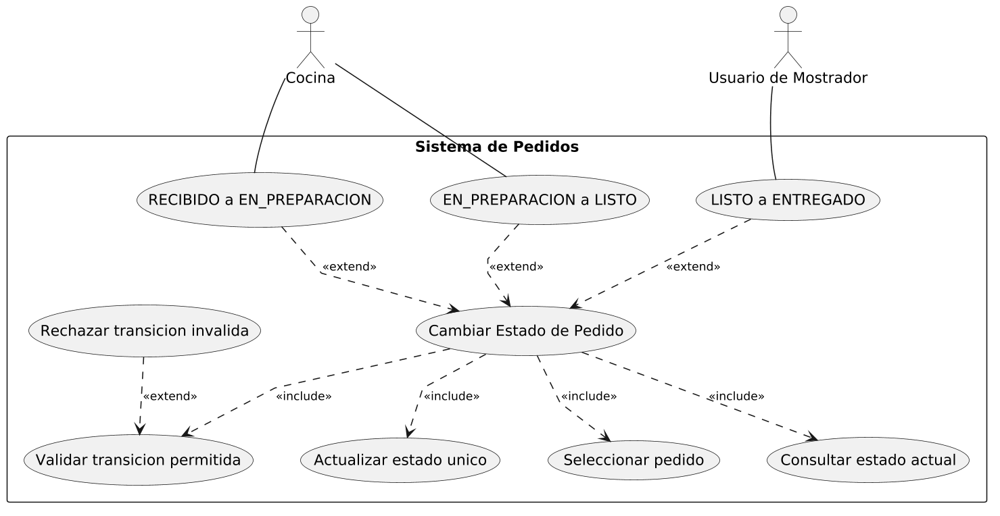
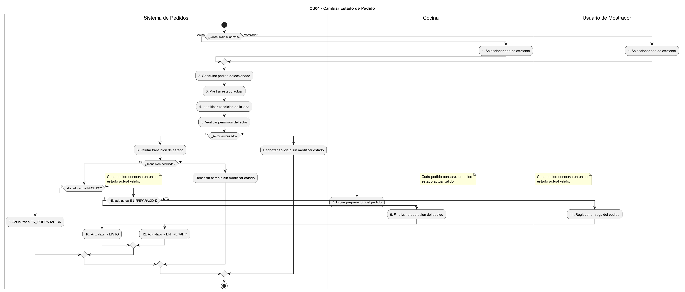
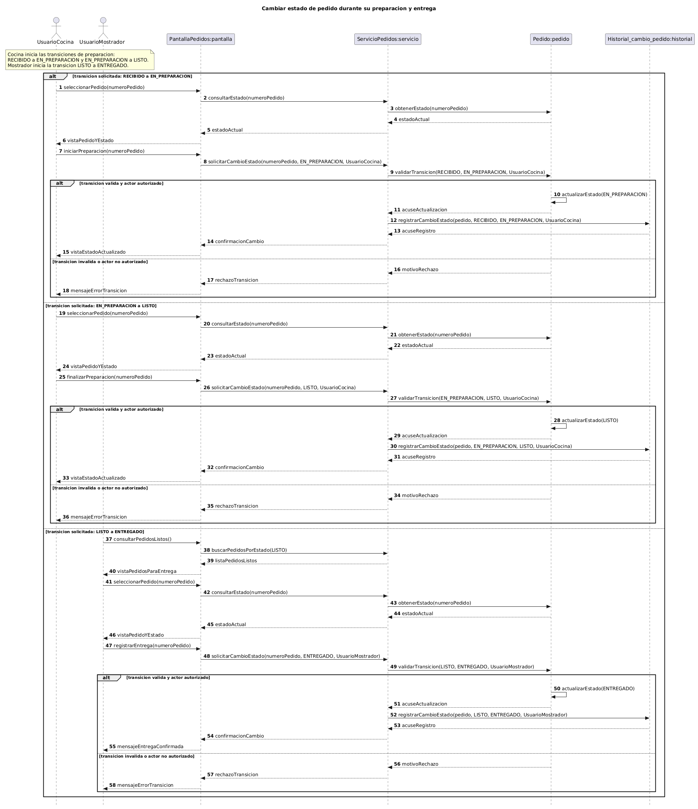
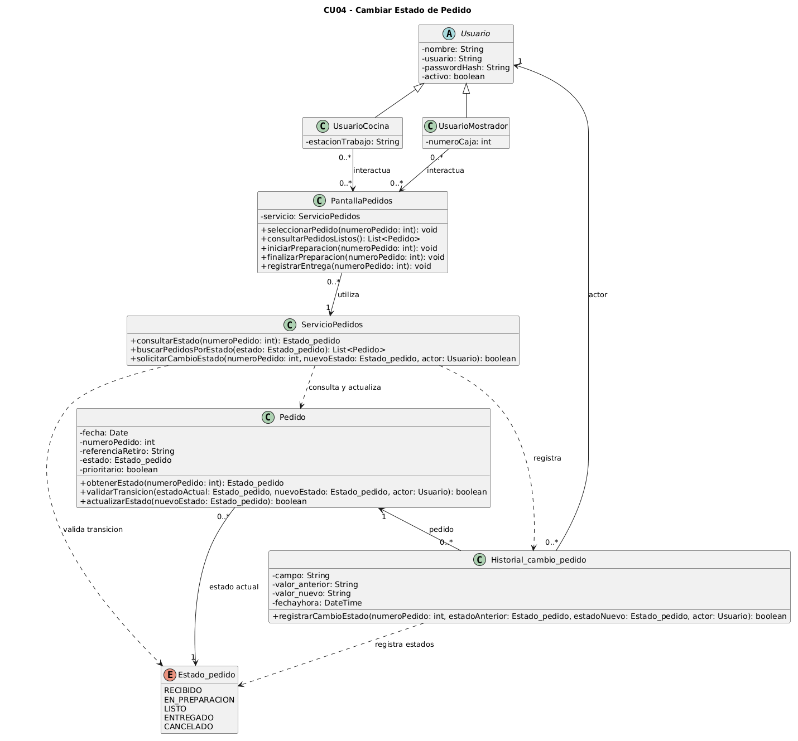

# Caso de Uso N° 4 - Cambiar Estado de Pedido

## 1. Descripción y Trazabilidad con Requisitos Funcionales

**Actor/es:** Cocina y Usuario de Mostrador

**Objetivo:** Permite actualizar el estado de un pedido durante su ciclo de vida, de acuerdo con las transiciones permitidas por el sistema.

**Flujo principal:**

1. El actor selecciona un pedido existente
2. El sistema muestra el estado actual del pedido
3. Cocina cambia el pedido de `RECIBIDO` a `EN_PREPARACION`
4. Cocina cambia el pedido de `EN_PREPARACION` a `LISTO` cuando finaliza la preparación
5. El Usuario de Mostrador cambia el pedido de `LISTO` a `ENTREGADO` al realizar la entrega
6. El sistema valida cada transición antes de realizarla
7. El sistema actualiza el estado del pedido cuando la transición es válida
8. El sistema mantiene un único estado actual para cada pedido

**Flujos alternativos:**

- **A1: Transición inválida.** Si el actor intenta una transición que no respeta la secuencia permitida, el sistema rechaza el cambio sin modificar el estado del pedido.
- **A2: Actor no autorizado.** Si el actor no está autorizado para la transición solicitada, el sistema rechaza la solicitud sin modificar el estado del pedido.

**Requisitos funcionales que satisface:**

| ID | Requisito Funcional (texto exacto de introduccion.md) | Cómo lo satisface este caso de uso |
| --- | --- | --- |
| RF3 | El sistema debe permitir al personal visualizar sincronizadamente los pedidos activos y controlar su ciclo de vida mediante un único estado secuencial y restringido: *Recibido*, *En preparación*, *Listo*, *Entregado* y *Cancelado*, garantizando una única fuente de verdad para evitar duplicaciones. | Los pasos 2 a 8 consultan, validan y actualizan el estado vigente del pedido siguiendo las transiciones permitidas. |
| RF5 | El sistema debe posibilitar la cancelación completa de un pedido activo antes de que sea entregado, asegurando que por razones de auditoría interna de caja el registro nunca se elimine físicamente de la base de datos y que pase de forma definitiva y permanente al estado *Cancelado*. | El escenario CU04 incluye `CANCELADO` entre los estados permitidos del ciclo de vida. La secuencia de este documento cubre el avance hasta `ENTREGADO`, pero no detalla la ejecución de la cancelación ni su persistencia. |

---

## 2. Diagrama de Casos de Uso



**Actores y relaciones:**

- **Cocina** → inicia las transiciones `RECIBIDO` a `EN_PREPARACION` y `EN_PREPARACION` a `LISTO`.
- **Usuario de Mostrador** → registra la transición `LISTO` a `ENTREGADO` cuando realiza la entrega.
- **Include/Extend:** "Cambiar Estado de Pedido" incluye seleccionar el pedido, consultar el estado actual, validar la transición y actualizar el estado, porque son pasos comunes del caso base. Las tres transiciones válidas extienden el caso base para representar el cambio específico solicitado. "Rechazar transición inválida" extiende la validación cuando la solicitud no es válida.

---

## 3. Diagrama de Actividades



**Swimlanes:**

- **Sistema de Pedidos:** consulta y muestra el estado, identifica y valida la transición, verifica la autorización y actualiza el pedido.
- **Cocina:** selecciona pedidos e inicia o finaliza su preparación.
- **Usuario de Mostrador:** selecciona pedidos y registra su entrega.

**Decisiones clave del flujo:**

- **¿Quién inicia el cambio?** Determina si el actor es Cocina o Usuario de Mostrador.
- **¿El actor está autorizado?** Si no, se rechaza la solicitud sin cambiar el pedido.
- **¿La transición está permitida?** Si no, se rechaza el cambio sin modificar el estado.
- **¿Cuál es el estado actual y el actor?** Determina cuál de las tres transiciones del flujo principal corresponde ejecutar.

---

## 4. Diagrama de Secuencia



**Participantes:** `UsuarioCocina` y `UsuarioMostrador` (actores); `PantallaPedidos:pantalla`, `ServicioPedidos:servicio`, `Pedido:pedido` y `Historial_cambio_pedido:historial` (objetos con la notación `Clase:objeto`).

**Mensajes clave:**

- `seleccionarPedido(numeroPedido)` → solicita mostrar el estado del pedido seleccionado.
- `consultarEstado(numeroPedido)` → `ServicioPedidos` solicita a `Pedido` `obtenerEstado(numeroPedido)` y devuelve el estado actual.
- `iniciarPreparacion(numeroPedido)`, `finalizarPreparacion(numeroPedido)` y `registrarEntrega(numeroPedido)` → expresan la acción del actor correspondiente; la pantalla solicita `solicitarCambioEstado(numeroPedido, nuevoEstado, actor)`.
- `validarTransicion(estadoActual, nuevoEstado, actor)` → comprueba la validez de la transición y la autorización del actor.
- `actualizarEstado(nuevoEstado)` → cambia el estado cuando la transición es válida.
- `registrarCambioEstado(numeroPedido, estadoAnterior, estadoNuevo, actor)` → registra el cambio en `Historial_cambio_pedido`.
- `motivoRechazo` y `rechazoTransicion` → devuelven el rechazo sin modificar el estado cuando la solicitud no es válida o autorizada.

**Objetos temporales destruidos:** no se representan objetos temporales ni mensajes de destrucción en esta secuencia.

---

## 5. Diagrama de Clases del Caso de Uso



Fuente PlantUML: [04-clases-cambiar-estado-de-pedido-04.puml](../../diagramas/01-diagrama-clases/04-clases-cambiar-estado-de-pedido-04.puml)

**Clases involucradas:**

| Clase | Responsabilidad (según tarjeta CRC o artefacto de origen) | Tarjeta CRC |
| --- | --- | --- |
| Usuario | Autentificar el acceso al sistema | [13-tarjeta-crc-usuario.md](../../herramientas-agile/tarjetas-crc/13-tarjeta-crc-usuario.md) |
| UsuarioCocina | Comenzar preparaciones y marcar pedidos como listos | [15-tarjeta-crc-usuario-cocina.md](../../herramientas-agile/tarjetas-crc/15-tarjeta-crc-usuario-cocina.md) |
| UsuarioMostrador | Registrar y modificar pedidos, y marcarlos como entregados | [14-tarjeta-crc-usuario-mostrador.md](../../herramientas-agile/tarjetas-crc/14-tarjeta-crc-usuario-mostrador.md) |
| PantallaPedidos | Frontera participante de A3: recibe selección y acciones del actor, y envía solicitudes a `ServicioPedidos` | Sin tarjeta CRC; participante del [diagrama de secuencia A3](../../diagramas/05-diagramas-secuencia/05-secuencia-cambiar-estado-pedido-avance-preparacion-04.puml) |
| ServicioPedidos | Control participante de A3: consulta el estado y coordina la solicitud de cambio con `Pedido` y el registro en el historial | Sin tarjeta CRC; participante del [diagrama de secuencia A3](../../diagramas/05-diagramas-secuencia/05-secuencia-cambiar-estado-pedido-avance-preparacion-04.puml) |
| Pedido | Agregar, modificar y cancelar la orden. Cambiar mi estado operativo y gestionar la prioridad del pedido | [01-tarjeta-crc-pedido.md](../../herramientas-agile/tarjetas-crc/01-tarjeta-crc-pedido.md) |
| Historial_cambio_pedido | Registrar alteraciones específicas de campos | [12-tarjeta-crc-historial-cambio-pedido.md](../../herramientas-agile/tarjetas-crc/12-tarjeta-crc-historial-cambio-pedido.md) |
| Estado_pedido | Enumeración del boceto inicial que restringe los estados del ciclo de vida del pedido | [Boceto inicial](../../diagramas/01-diagrama-clases/01-boceto-inicial.excalidraw); no tiene tarjeta CRC |

**Relaciones UML:**

| Relación | Clases | Justificación |
| --- | --- | --- |
| Herencia | Usuario → UsuarioCocina y UsuarioMostrador | Las tarjetas CRC definen ambas clases como subclases de `Usuario`. |
| Asociación | UsuarioCocina / UsuarioMostrador → PantallaPedidos | Los actores interactúan con la pantalla para seleccionar pedidos y solicitar acciones; la secuencia no indica que sean partes de su ciclo de vida. |
| Asociación | PantallaPedidos → ServicioPedidos | `PantallaPedidos` mantiene el atributo `servicio: ServicioPedidos`; es una referencia estructural y no sólo un uso puntual. |
| Dependencia | ServicioPedidos → Pedido | El servicio consulta el pedido y coordina la validación y actualización solicitadas, sin declarar una referencia permanente al pedido. |
| Dependencia | ServicioPedidos → Historial_cambio_pedido | El servicio invoca `registrarCambioEstado` cuando el estado se actualiza. |
| Asociación | Pedido → Estado_pedido | `Pedido` conserva `estado: Estado_pedido` como su estado vigente único. |
| Asociación | Historial_cambio_pedido → Pedido y Usuario | La tarjeta CRC declara a `Pedido` y `Usuario` como colaboradores y propiedades del historial; cada registro corresponde a un pedido y a un actor. |
| Dependencia | ServicioPedidos / Historial_cambio_pedido → Estado_pedido | El enum tipa las transiciones que valida el servicio y los valores anterior y nuevo que registra el historial. |

---

## 6. Pseudocódigo

```text
INICIO Cambiar Estado de Pedido

// Cocina inicia o finaliza la preparación, o el Usuario de Mostrador registra la entrega.
// El pedido existe y el actor solicita una transición de estado.
// Cada solicitud cambia una etapa; las siguientes transiciones ocurren en solicitudes posteriores.

actorSolicitante selecciona un pedido mediante PantallaPedidos.seleccionarPedido(numeroPedido)
estadoActual = ServicioPedidos.consultarEstado(numeroPedido)
    // ServicioPedidos consulta Pedido.obtenerEstado(numeroPedido)

SI actorSolicitante es Cocina Y estadoActual es RECIBIDO
    PantallaPedidos.iniciarPreparacion(numeroPedido)
    nuevoEstado = EN_PREPARACION
SINO SI actorSolicitante es Cocina Y estadoActual es EN_PREPARACION
    PantallaPedidos.finalizarPreparacion(numeroPedido)
    nuevoEstado = LISTO
SINO SI actorSolicitante es Usuario de Mostrador Y estadoActual es LISTO
    PantallaPedidos.registrarEntrega(numeroPedido)
    nuevoEstado = ENTREGADO
SINO
    // No corresponde ninguna transición del flujo principal para este actor y estado.
    Retornar "Transición no disponible"
FIN SI

// ServicioPedidos coordina la comprobación y el cambio solicitado por la pantalla.
resultado = ServicioPedidos.solicitarCambioEstado(numeroPedido, nuevoEstado, actorSolicitante)
    // Pedido.validarTransicion(estadoActual, nuevoEstado, actorSolicitante)

SI la transición es válida y el actor está autorizado
    // Pedido actualiza su único estado vigente.
    Pedido.actualizarEstado(nuevoEstado)
    // El servicio registra los valores anterior y nuevo junto con el actor.
    Historial_cambio_pedido.registrarCambioEstado(numeroPedido, estadoActual, nuevoEstado, actorSolicitante)
    Retornar "Cambio confirmado"
SINO SI la transición no está permitida
    // Se informa el rechazo y el pedido conserva el estado anterior.
    Retornar "Transición inválida"
SINO
    // Se informa la falta de autorización sin modificar el estado.
    Retornar "Actor no autorizado"
FIN SI

// Estado final: cada pedido conserva un único estado vigente válido.
FIN
```