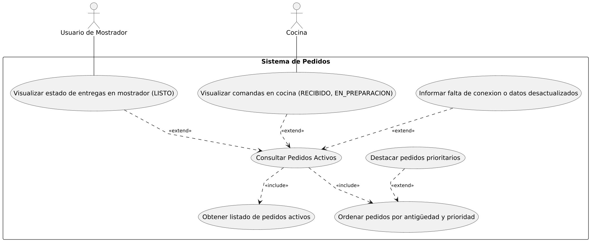
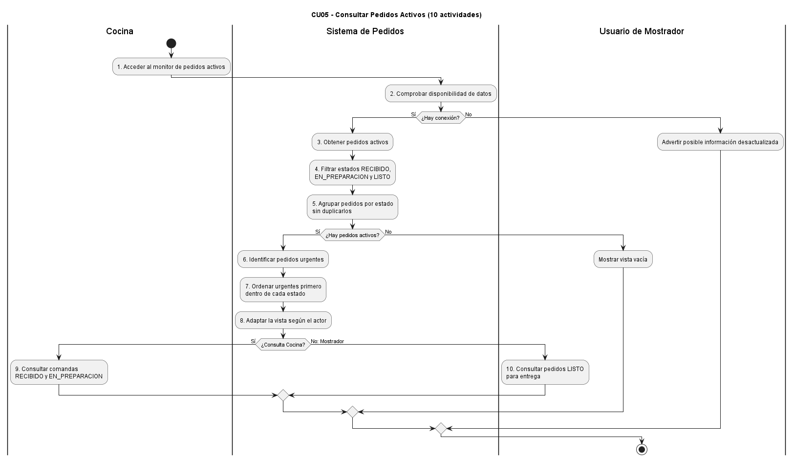
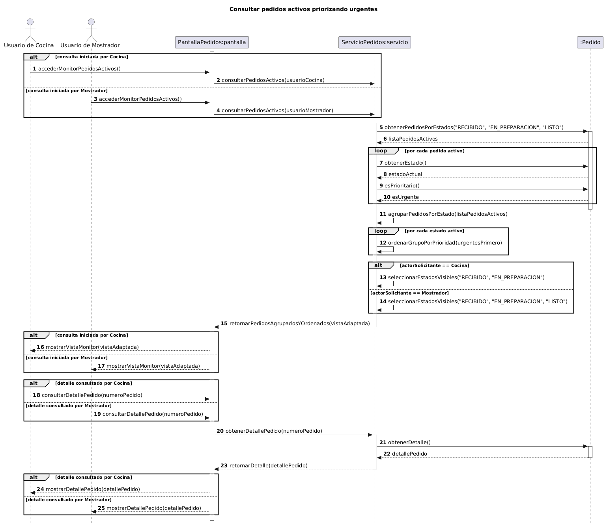
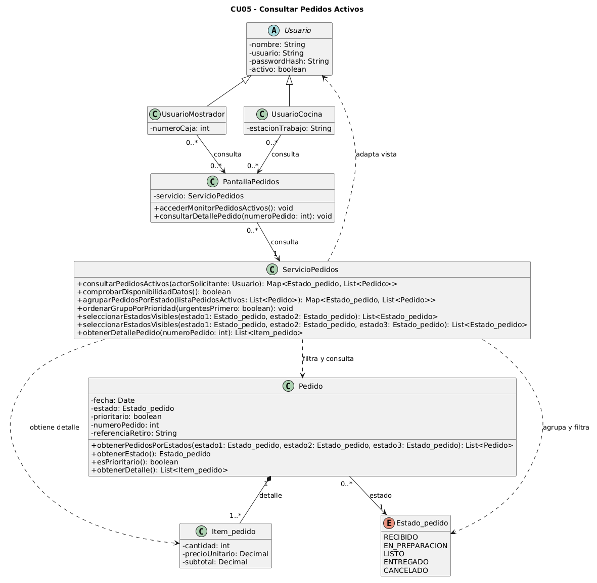

# Caso de Uso N° 5 - Consultar Pedidos Activos

## 1. Descripción y Trazabilidad con Requisitos Funcionales

**Actor/es:** Cocina y Usuario de Mostrador

**Objetivo:** Permite consultar los pedidos activos y visualizarlos según su estado actual, facilitando el seguimiento y la preparación de los pedidos.

**Flujo principal:**

1. El actor accede al monitor de pedidos activos
2. El sistema obtiene los pedidos que se encuentran activos
3. El sistema agrupa o filtra los pedidos según su estado
4. El sistema adapta la visualización según el actor que realiza la consulta
5. El sistema identifica los pedidos marcados como urgentes
6. El sistema muestra primero los pedidos urgentes dentro del mismo estado
7. El actor consulta la información de los pedidos activos
8. El sistema mantiene un único estado actual para cada pedido mostrado

**Flujos alternativos:**

- **A1: No hay pedidos activos.** Si no hay pedidos en estado `RECIBIDO`, `EN_PREPARACION` o `LISTO`, el sistema muestra la vista vacía e informa que no hay pedidos activos.
- **A2: Falla de conexión o actualización.** Si se interrumpe la comunicación durante la consulta, el sistema advierte que los datos mostrados pueden estar desactualizados.

**Requisitos funcionales que satisface:**

| ID | Requisito Funcional (texto exacto de introduccion.md) | Cómo lo satisface este caso de uso |
| --- | --- | --- |
| RF3 | El sistema debe permitir al personal visualizar sincronizadamente los pedidos activos y controlar su ciclo de vida mediante un único estado secuencial y restringido: *Recibido*, *En preparación*, *Listo*, *Entregado* y *Cancelado*, garantizando una única fuente de verdad para evitar duplicaciones. | Obtiene y agrupa los pedidos por su estado vigente, presenta los estados activos y conserva un único estado actual para cada pedido mostrado. |
| RF7 | El sistema debe permitir marcar manualmente un pedido como prioritario (urgente) desde el mostrador al momento de tomarlo, visualizándose de forma destacada en la pantalla de cocina para que el personal altere el orden de preparación según su criterio. | Lee la prioridad ya registrada en cada pedido y ordena primero los prioritarios dentro de cada estado para destacarlos en la consulta. Este caso de uso los visualiza; no modifica la marca de prioridad. |

---

## 2. Diagrama de Casos de Uso



**Actores y relaciones:**

- **Cocina** → consulta las comandas en estado `RECIBIDO` y `EN_PREPARACION`.
- **Usuario de Mostrador** → consulta el estado de las entregas en `LISTO`, según el caso de uso A2.
- **Include/Extend:** "Consultar Pedidos Activos" incluye obtener el listado y ordenarlo porque son tareas comunes de la consulta. Las vistas de Cocina y Mostrador extienden el caso base para representar consultas por actor. "Destacar pedidos prioritarios" extiende el ordenamiento cuando hay pedidos prioritarios. "Informar falta de conexión o datos desactualizados" extiende la consulta cuando ocurre una falla.

**Nota de consistencia documental:** el diagrama de casos de uso y el de actividades indican que Mostrador consulta pedidos `LISTO`; la descripción general de CU05 en `introduccion.md` dice que Mostrador visualiza todos los pedidos activos, y la secuencia CU05 filtra para Mostrador `RECIBIDO`, `EN_PREPARACION` y `LISTO`. El escenario tampoco resuelve esa diferencia de alcance. Se conserva aquí la vista `LISTO` al explicar el diagrama de casos de uso y se deja documentada la discrepancia; no se interpreta como una decisión de diseño ya resuelta.

---

## 3. Diagrama de Actividades



**Swimlanes:**

- **Sistema de Pedidos:** comprueba disponibilidad, obtiene y agrupa pedidos activos, identifica urgencias, ordena y adapta la vista.
- **Cocina:** accede al monitor y consulta comandas `RECIBIDO` y `EN_PREPARACION`.
- **Usuario de Mostrador:** accede al monitor y consulta pedidos `LISTO` para entrega.

**Decisiones clave del flujo:**

- **¿Hay conexión?** Si no, el sistema advierte que la información puede estar desactualizada.
- **¿Hay pedidos activos?** Si no, muestra la vista vacía.
- **¿Qué actor consulta?** Determina qué estados se muestran en la actividad: Cocina ve `RECIBIDO` y `EN_PREPARACION`; Mostrador ve `LISTO`.
- Cuando hay pedidos, el sistema destaca los urgentes ordenándolos primero dentro de su estado, sin alterar el estado del pedido.

---

## 4. Diagrama de Secuencia



**Participantes:** `Usuario de Cocina` (`usuarioCocina`) y `Usuario de Mostrador` (`usuarioMostrador`) son actores; `PantallaPedidos:pantalla` y `ServicioPedidos:servicio` son objetos nombrados con la notación `Clase:objeto`; `:Pedido` (`pedido`) es una instancia anónima de la clase `Pedido`.

**Mensajes clave:**

- `accederMonitorPedidosActivos()` → el actor solicita abrir el monitor; la pantalla envía `consultarPedidosActivos(actorSolicitante)` al servicio.
- `comprobarDisponibilidadDatos()` → comprueba si la consulta cuenta con datos disponibles; el resultado se devuelve como `resultadoDisponibilidad`.
- `obtenerPedidosPorEstados("RECIBIDO", "EN_PREPARACION", "LISTO")` → obtiene los pedidos activos y devuelve `listaPedidosActivos`.
- `obtenerEstado()` y `esPrioritario()` → consultan, para cada pedido, el estado y la marca de urgencia.
- `agruparPedidosPorEstado(listaPedidosActivos)`, `ordenarGrupoPorPrioridad(urgentesPrimero)` y `seleccionarEstadosVisibles(...)` → agrupan, priorizan y adaptan los estados consultados al actor.
- `retornarPedidosAgrupadosYOrdenados(vistaAdaptada)` → devuelve a la pantalla el resultado ordenado; la pantalla presenta la vista al actor.
- `consultarDetallePedido(numeroPedido)` y `obtenerDetallePedido(numeroPedido)` → solicitan el detalle; `Pedido.obtenerDetalle()` devuelve `detallePedido` y el servicio devuelve ese resultado a la pantalla.
- `mostrarVistaVacia("No hay pedidos activos")` y `advertirDatosDesactualizados()` → representan las respuestas de la pantalla en los flujos alternativos correspondientes.

**Objetos temporales destruidos:** no se representan objetos temporales ni mensajes de destrucción en esta secuencia. `:Pedido` representa un pedido consultado, no una instancia creada para la consulta.

**Nota de trazabilidad:** `retornarPedidosAgrupadosYOrdenados(...)`, `retornarDetalle(...)` y los mensajes `mostrar...` se dibujan como respuestas (`-->`) en la secuencia. Por eso se documentan como resultados presentados/devueltos, no como métodos invocados en el diagrama de clases. Además, la secuencia escribe los estados como cadenas entre comillas, mientras las firmas del diagrama de clases usan `Estado_pedido`; debe armonizarse esa tipificación en los artefactos fuente.

---

## 5. Diagrama de Clases del Caso de Uso



Fuente PlantUML: [05-clases-consultar-pedidos-activos-05.puml](../../diagramas/01-diagrama-clases/05-clases-consultar-pedidos-activos-05.puml)

**Clases involucradas:**

| Clase | Responsabilidad (según tarjeta CRC o artefacto de origen) | Tarjeta CRC |
| --- | --- | --- |
| Usuario | Autentificar el acceso al sistema | [13-tarjeta-crc-usuario.md](../../herramientas-agile/tarjetas-crc/13-tarjeta-crc-usuario.md) |
| UsuarioCocina | Comenzar preparaciones y marcar pedidos como listos | [15-tarjeta-crc-usuario-cocina.md](../../herramientas-agile/tarjetas-crc/15-tarjeta-crc-usuario-cocina.md) |
| UsuarioMostrador | Registrar y modificar pedidos, y marcarlos como entregados | [14-tarjeta-crc-usuario-mostrador.md](../../herramientas-agile/tarjetas-crc/14-tarjeta-crc-usuario-mostrador.md) |
| PantallaPedidos | Frontera participante de A3: recibe el acceso al monitor y la consulta de detalle, y presenta sus resultados | Sin tarjeta CRC; participante del [diagrama de secuencia A3](../../diagramas/05-diagramas-secuencia/05-secuencia-consultar-pedidos-activos-prioridad-urgentes-05.puml) |
| ServicioPedidos | Control participante de A3: obtiene, agrupa, ordena y adapta la consulta y solicita el detalle | Sin tarjeta CRC; participante del [diagrama de secuencia A3](../../diagramas/05-diagramas-secuencia/05-secuencia-consultar-pedidos-activos-prioridad-urgentes-05.puml) |
| Pedido | Agregar, modificar y cancelar la orden. Cambiar mi estado operativo y gestionar la prioridad del pedido | [01-tarjeta-crc-pedido.md](../../herramientas-agile/tarjetas-crc/01-tarjeta-crc-pedido.md) |
| Item_pedido | Calcular mi subtotal y recalcular el precio si sufro modificaciones. Agregar o quitar personalizaciones | [02-tarjeta-crc-item-pedido.md](../../herramientas-agile/tarjetas-crc/02-tarjeta-crc-item-pedido.md) |
| Estado_pedido | Enumeración del boceto inicial que restringe los estados del ciclo de vida del pedido | [Boceto inicial](../../diagramas/01-diagrama-clases/01-boceto-inicial.excalidraw); no tiene tarjeta CRC |

**Relaciones UML:**

| Relación | Clases | Justificación |
| --- | --- | --- |
| Herencia | Usuario → UsuarioCocina y UsuarioMostrador | Las tarjetas CRC definen ambas clases como subclases de `Usuario`. |
| Asociación | UsuarioCocina / UsuarioMostrador → PantallaPedidos | Los actores acceden al monitor y consultan los resultados; no se indica que formen parte del ciclo de vida de la pantalla. |
| Asociación | PantallaPedidos → ServicioPedidos | La pantalla tiene el atributo `servicio: ServicioPedidos`; es una referencia estructural usada para procesar las consultas. |
| Asociación | Pedido → Estado_pedido | Cada pedido conserva su estado actual; el enum limita los estados que puede tener. |
| Composición | Pedido ◆→ Item_pedido (1 a 1..*) | Los ítems son el detalle que integra el pedido y se presentan como parte de éste. La multiplicidad mínima expresa el pedido con uno o más ítems. |
| Dependencia | ServicioPedidos → Pedido | El servicio solicita el listado por estados y consulta estado, prioridad y detalle de los pedidos; no declara una referencia permanente a cada pedido. |
| Dependencia | ServicioPedidos → Estado_pedido | El servicio usa los valores del enum para filtrar, agrupar y seleccionar estados visibles. |
| Dependencia | ServicioPedidos → Item_pedido | El tipo de retorno del detalle es una lista de ítems del pedido. |
| Dependencia | ServicioPedidos → Usuario | El actor solicitante determina cómo se adapta la vista. |

---

## 6. Pseudocódigo

```text
INICIO Consultar Pedidos Activos

// Cocina o el Usuario de Mostrador accede al monitor de pedidos activos.
actorSolicitante accede mediante PantallaPedidos.accederMonitorPedidosActivos()

// Este mensaje inicia el procesamiento de la consulta en el servicio.
consulta = ServicioPedidos.consultarPedidosActivos(actorSolicitante)

SI ServicioPedidos.comprobarDisponibilidadDatos() es falso
    // La información de la pantalla puede no estar actualizada.
    PantallaPedidos advierte datos desactualizados
    Retornar "Aviso de datos desactualizados"
SINO
    listaPedidosActivos = pedido.obtenerPedidosPorEstados(RECIBIDO, EN_PREPARACION, LISTO)

    SI listaPedidosActivos está vacía
        // No hay pedidos en curso para presentar.
        PantallaPedidos muestra la vista vacía con "No hay pedidos activos"
        Retornar "Vista vacía"
    FIN SI

    PARA CADA pedido EN listaPedidosActivos
        estadoActual = pedido.obtenerEstado()
        esUrgente = pedido.esPrioritario()
    FIN PARA

    gruposPorEstado = ServicioPedidos.agruparPedidosPorEstado(listaPedidosActivos)

    PARA CADA grupo de pedidos por estado
        ServicioPedidos.ordenarGrupoPorPrioridad(urgentesPrimero)
    FIN PARA

    SI actorSolicitante es Cocina
        estadosVisibles = ServicioPedidos.seleccionarEstadosVisibles(RECIBIDO, EN_PREPARACION)
    SINO SI actorSolicitante es Usuario de Mostrador
        estadosVisibles = ServicioPedidos.seleccionarEstadosVisibles(RECIBIDO, EN_PREPARACION, LISTO)
    FIN SI

    // consulta devuelve la vista agrupada, ordenada y adaptada al actor.
    vistaAdaptada = resultado de consulta
    pantalla recibe y presenta vistaAdaptada al actorSolicitante

    SI el actor solicita consultar el detalle de un pedido
        numeroPedido = identificador del pedido seleccionado
        actorSolicitante solicita detalle mediante PantallaPedidos.consultarDetallePedido(numeroPedido)
        detallePedido = ServicioPedidos.obtenerDetallePedido(numeroPedido)
            // ServicioPedidos obtiene el detalle mediante Pedido.obtenerDetalle()
        pantalla presenta detallePedido al actorSolicitante
    FIN SI
FIN SI

// Estado final: los pedidos activos quedan disponibles para consulta,
// agrupados por estado y con los prioritarios primero en cada grupo.
FIN
```

**Nota de consistencia del pseudocódigo:** se mantienen los filtros del diagrama de secuencia y del diagrama de clases existente. En esos artefactos, Mostrador selecciona los tres estados activos. Esto contradice el diagrama de casos de uso y el de actividades, que limitan la vista de Mostrador a `LISTO`; debe resolverse esa diferencia en los artefactos de origen antes de considerar un único comportamiento definitivo.