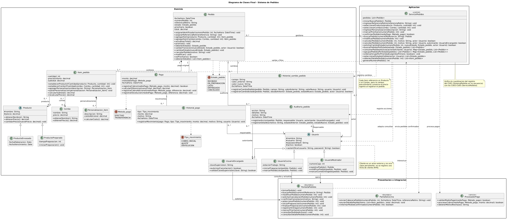

# Diagrama de Clases Final - Sistema de Pedidos

---

## 1. Versión del Diagrama

| Versión | Casos de uso integrados | Fecha |
|---------|------------------------|-------|
| v1 | CU1 | [completar fecha] |
| v2 | CU1, CU2, CU3 | [completar fecha] |
| v3 | CU1, CU2, CU3, CU4, CU5 | 2026-11-11 |

---

## 2. Diagrama

---

## 3. Clases del Sistema

| Clase | Responsabilidad (según tarjeta CRC) | Aparece en CU |
|-------|-------------------------------------|---------------|
| Usuario | Autentificar el acceso al sistema | CU1, CU2, CU3, CU4, CU5 |
| UsuarioMostrador | Registrar y modificar pedidos, y marcarlos como entregados | CU1, CU2, CU3, CU4, CU5 |
| UsuarioCocina | Comenzar preparaciones y marcar pedidos como listos | CU4, CU5 |
| UsuarioEncargado | Autorizar cancelaciones y devoluciones manuales | CU3 |
| Pedido | Agregar, modificar y cancelar la orden; cambiar mi estado operativo y gestionar la prioridad del pedido | CU1, CU2, CU3, CU4, CU5 |
| Item_pedido | Calcular mi subtotal y recalcular el precio si sufro modificaciones; agregar o quitar personalizaciones | CU1, CU2 |
| Personalizacion_item | Calcular el costo de la modificación que represento | CU1, CU2 |
| Producto | Proveer el precio base y el nombre para la venta comercial; cambiar mi precio en el catálogo general | CU1, CU2 |
| ProductoPreparado | Iniciar la preparación e indicar su duración | CU1, CU2 (como Producto) |
| ProductoEnvasado | Proveer información de caducidad | CU1, CU2 (como Producto) |
| Combo | Agregar y eliminar combos del catálogo | CU1 |
| Pago | Registrar el cobro efectuado; calcular diferencias de dinero asociadas a la transacción | CU1, CU2 |
| Historial_pago | Registrar los movimientos de dinero | CU2 |
| Auditoria_pedido | Registrar las acciones generales sobre la orden | CU3 |
| Historial_cambio_pedido | Registrar alteraciones específicas de campos | CU2, CU4 |
| ServicioPedidos | Sin tarjeta CRC. Según las secuencias de A3: unifica la coordinación de los CU1 a CU5 (carga, modificación, cancelación, cambio de estado y consulta de pedidos), genera el número de pedido y notifica a Cocina | CU1, CU2, CU3, CU4, CU5 |
| PantallaPedidos | Sin tarjeta CRC. Según las secuencias de A3: interfaz con la que operan mostrador, cocina y encargado para consultar y actualizar pedidos | CU1, CU2, CU3, CU4, CU5 |
| PantallaCocina | Sin tarjeta CRC. Según la secuencia del CU1: recibe cabecera y detalle del pedido y confirma la recepción | CU1 |
| ProcesadorPago | Sin tarjeta CRC. Según la secuencia del CU1: valida el medio de pago y procesa el cobro | CU1, CU2 |

---

## 4. Decisiones de Integración

| Inconsistencia encontrada | Issue creada | Rama fix/ | Decisión tomada | Justificación |
|--------------------------|--------------|-----------|-----------------|---------------|
| La clase de servicio se llama SistemaPedidos en CU1 y ServicioPedidos en CU3 a CU5; la interfaz es InterfazPedido o PantallaPedidos | [completar link de la issue] | fix/[completar nombre de la rama] | Se unifica como ServicioPedidos (control) y PantallaPedidos (boundary) | Es el nombre usado en la mayoría de las secuencias, y el diagrama final lo muestra como una única clase de control que unifica los CU1 a CU5 |
| Historial_cambio_pedido usa dos métodos distintos en CU2 y CU4 | [completar link de la issue] | fix/[completar nombre de la rama] | Se conservan `registrarCambioPedido` (campos) y `registrarCambioEstado` (estados) | Cada método registra un tipo distinto de cambio, y ambos coinciden con la tarjeta CRC |
| Cliente tiene tarjeta CRC pero el CU1 decidió no modelarlo | [completar link de la issue] | fix/[completar nombre de la rama] | Cliente queda fuera del diagrama final | El RF6 excluye la ficha de cliente; el diagrama lo aclara con una nota |

El resto de las inconsistencias detectadas (firmas de Auditoria_pedido, métodos de prioridad en Pedido, responsabilidad de validar el medio de pago, enumeración Tipo_movimiento, tarjetas CRC de las clases de control y métodos de UsuarioCocina y UsuarioEncargado) se gestionan con el mismo flujo. Para verificar la coherencia se comparó cada clase del diagrama final contra las tarjetas CRC y contra los participantes y mensajes de las cinco secuencias de A3.

---

## 5. Coherencia con Artefactos Previos

**Coherencia con boceto inicial (A1):**

El diagrama final parte de las clases del boceto de A1: `Pedido`, `Item_pedido`, `Producto` (abstracta) con sus subclases, `Combo`, `Personalizacion_item`, `Pago`, `Usuario` con sus tres subclases, los historiales y las enumeraciones `Estado_pedido` y `Metodo_pago`. Lo que cambió fue que se tipificaron los atributos, se agregaron visibilidades y multiplicidades, y se incorporaron `ServicioPedidos`, `PantallaPedidos`, `PantallaCocina` y `ProcesadorPago`, organizadas en los paquetes Dominio, Aplicacion y Presentacion e integracion, que el análisis de A3 mostró necesarias para coordinar la carga, notificar a Cocina y validar el cobro. `Cliente` se dejó afuera porque el RF6 excluye la ficha de cliente.

**Coherencia con tarjetas CRC (A2):**

Las responsabilidades de cada tarjeta se reflejan en los métodos del diagrama. Por ejemplo, la responsabilidad "Calcular mi subtotal" de `Item_pedido` es `calcularSubtotal`, la de "Cambiar mi estado" de `Pedido` es `cambiarEstado`, y la de "Registrar el cobro efectuado" de `Pago` es `registrarCobro`. Las colaboraciones de las tarjetas se convirtieron en relaciones, como `Pedido` con `Item_pedido` (composición) y `Pago` con `Metodo_pago` (dependencia). Los métodos que pedían las tarjetas de `Pedido` para gestionar la prioridad quedaron como `priorizar()` y `esPrioritario()`.

**Coherencia con diagramas de secuencia (A3):**

Los mensajes de las secuencias justifican los métodos de cada clase: `asignarReferenciaRetiro` y `registrarPedido` surgen de la secuencia de Tomar Pedido, y `calcularDiferencia` de la de Modificar Pedido. Las diferencias que aparecieron entre las secuencias (nombres de servicio e interfaz, firmas de métodos de los historiales) se registraron como issues y se resuelven en ramas `fix/` antes de actualizar el diagrama.
