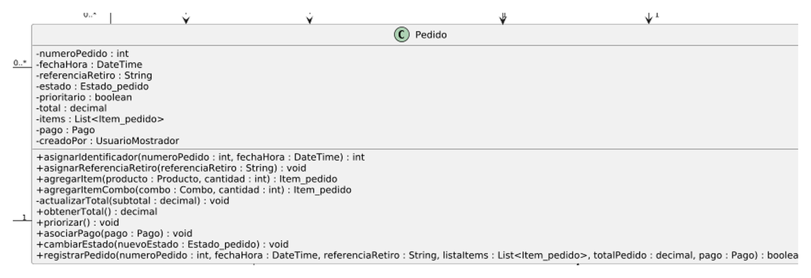
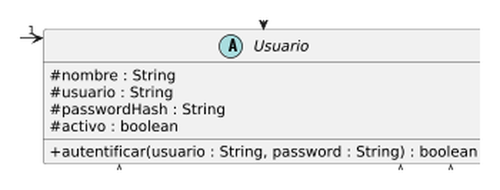
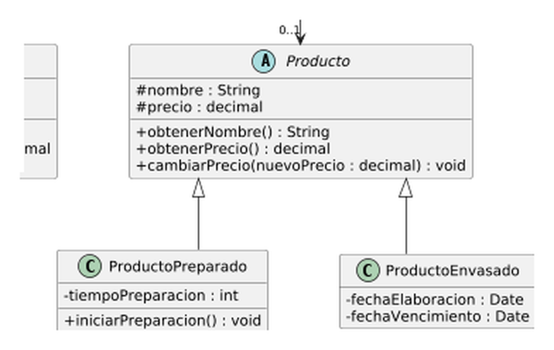
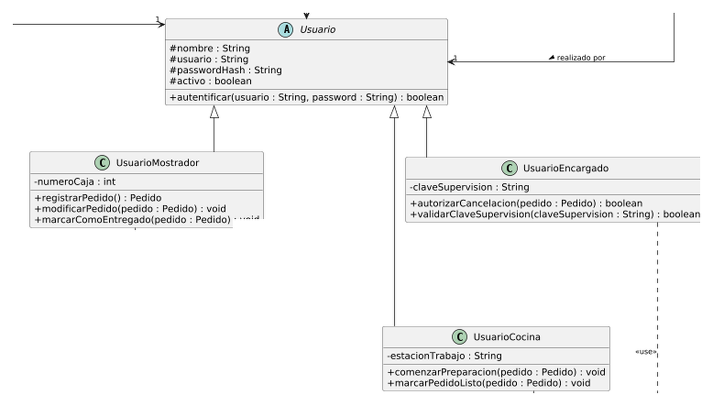
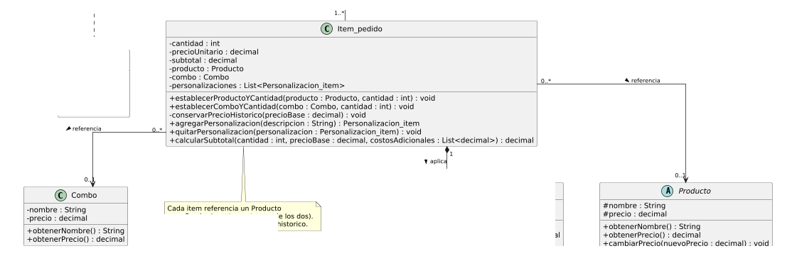
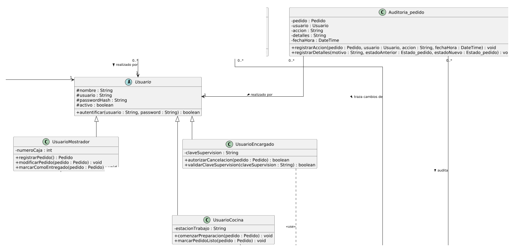
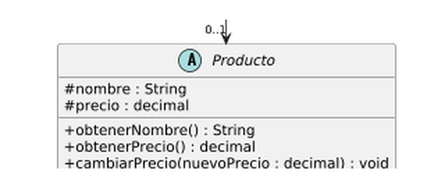
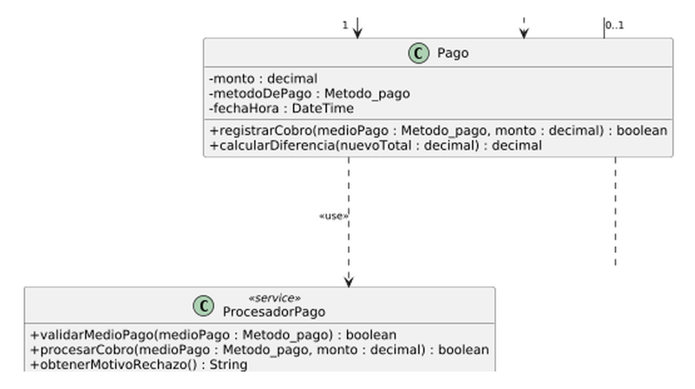

# Los Cuatro Pilares del Paradigma Orientado a Objetos

Este anexo analiza cómo el diagrama de clases final del Sistema de Pedidos ([ver diagrama](../../diagramas/01-diagrama-clases/06-clases-diagrama-final.png)) aplica los cuatro fundamentos de la programación orientada a objetos. Cada ejemplo surge de clases, atributos y métodos que existen en ese diagrama.

---

## 1. Encapsulamiento

**Definición:** El encapsulamiento consiste en ocultar el estado interno de un objeto y permitir que se acceda a él únicamente mediante métodos públicos, para que ninguna otra clase pueda dejarlo en un estado inválido.

**Ejemplo 1 — Pedido:**

`Pedido` declara `total` y `items` como atributos privados y mantiene `actualizarTotal(subtotal)` como método privado. Hacia afuera solo expone `agregarItem`, `agregarItemCombo` y `obtenerTotal()`. Ninguna otra clase puede fijar el total a mano: el valor se recalcula siempre que cambia un ítem. Esto protege el RF1, que exige que el precio total se recalcule de forma precisa al registrar el pedido, y evita que `UsuarioMostrador` o la pantalla guarden un total que no coincide con la suma de los subtotales.

**Ejemplo 2 — Usuario:**

`Usuario` mantiene `passwordHash` como atributo protegido y solo expone `autentificar(usuario, password) : boolean`. Quien usa la clase obtiene un sí o un no, nunca el hash guardado. Además, al ser protegido, solo las subclases (`UsuarioMostrador`, `UsuarioCocina`, `UsuarioEncargado`) pueden acceder a él. Tiene sentido en un sistema donde distintos empleados comparten las mismas pantallas y las credenciales no deben viajar por las demás clases.

---

## 2. Herencia

**Definición:** La herencia permite que una clase (subclase) reutilice los atributos y métodos de otra más general (superclase) y agregue solo lo que la distingue.

**Ejemplo 1 — Producto → ProductoPreparado:**

`ProductoPreparado` hereda de la clase abstracta `Producto` los atributos `nombre` y `precio` y los métodos `obtenerNombre()`, `obtenerPrecio()` y `cambiarPrecio(nuevoPrecio)`. Solo agrega `tiempoPreparacion` e `iniciarPreparacion()`. La otra subclase, `ProductoEnvasado`, agrega `fechaElaboracion` y `fechaVencimiento`. La jerarquía es correcta porque todos los productos se venden con nombre y precio, pero se diferencian en cómo se obtienen: los preparados requieren elaboración en cocina y los envasados vienen listos.

**Ejemplo 2 — Usuario → UsuarioMostrador:**

`UsuarioMostrador` hereda de `Usuario` las credenciales (`nombre`, `usuario`, `passwordHash`, `activo`) y el método `autentificar`, y agrega `numeroCaja` junto con `registrarPedido()`, `modificarPedido(pedido)` y `marcarComoEntregado(pedido)`. `UsuarioCocina` y `UsuarioEncargado` heredan de la misma superclase. Lo que comparten es la identidad del personal que accede al sistema, y cada rol suma las operaciones que le corresponden.

---

## 3. Polimorfismo

**Definición:** El polimorfismo permite que objetos de distintas clases respondan al mismo mensaje, cada uno a su manera, de modo que quien los usa no necesita conocer su clase concreta.

**Ejemplo 1 — obtenerPrecio() en Producto vs Combo:**

Tanto `Producto` como `Combo` responden a `obtenerNombre()` y `obtenerPrecio()`, y `Item_pedido` los usa de la misma forma, ya que referencia uno u otro (exactamente uno de los dos). El comportamiento difiere: `Producto` devuelve su precio base, mientras que `Combo` devuelve su precio propio, que según el RF1 no es la suma de sus partes. En este diagrama `Combo` no hereda de `Producto`, por lo que se trata de polimorfismo por contrato común y no por jerarquía. Una mejora futura sería extraer una interfaz compartida.

**Ejemplo 2 — autentificar() y el atributo usuario : Usuario en Auditoria_pedido:**

`Auditoria_pedido`, `Historial_cambio_pedido` e `Historial_pago` guardan al responsable de la acción como un `Usuario`. En ese atributo puede haber un `UsuarioMostrador`, un `UsuarioCocina` o un `UsuarioEncargado`, y las tres clases de registro funcionan igual sin saber de qué subclase se trata, porque todos comparten el tipo `Usuario`. Así, el mismo método `registrarAccion(pedido, usuario, accion, fechaHora)` sirve para una cancelación iniciada por el mostrador o por el encargado.

---

## 4. Abstracción

**Definición:** La abstracción consiste en representar solo las características esenciales de un concepto, ocultando los detalles que no necesitan conocer quienes lo usan.

**Ejemplo 1 — Producto:**

`Producto` es una clase abstracta que modela la idea de artículo del catálogo con solo `nombre` y `precio`, y oculta si se trata de algo preparado en cocina o de algo envasado. `Item_pedido` solo necesita pedirle `obtenerNombre()` y `obtenerPrecio()` para calcular su subtotal; no le importa cómo se elaboró el artículo. Esa simplificación evita que la lógica del pedido dependa de cada tipo de producto.

**Ejemplo 2 — ProcesadorPago:**

`ProcesadorPago` oculta cómo se valida y se procesa un cobro y expone solo tres operaciones: `validarMedioPago(medioPago)`, `procesarCobro(medioPago, monto)` y `obtenerMotivoRechazo()`. `Pago` las usa sin saber qué pasa detrás, de modo que un cambio en la forma de cobrar (por ejemplo, agregar un nuevo medio más adelante) no obliga a modificar a las clases que colaboran con ella.

