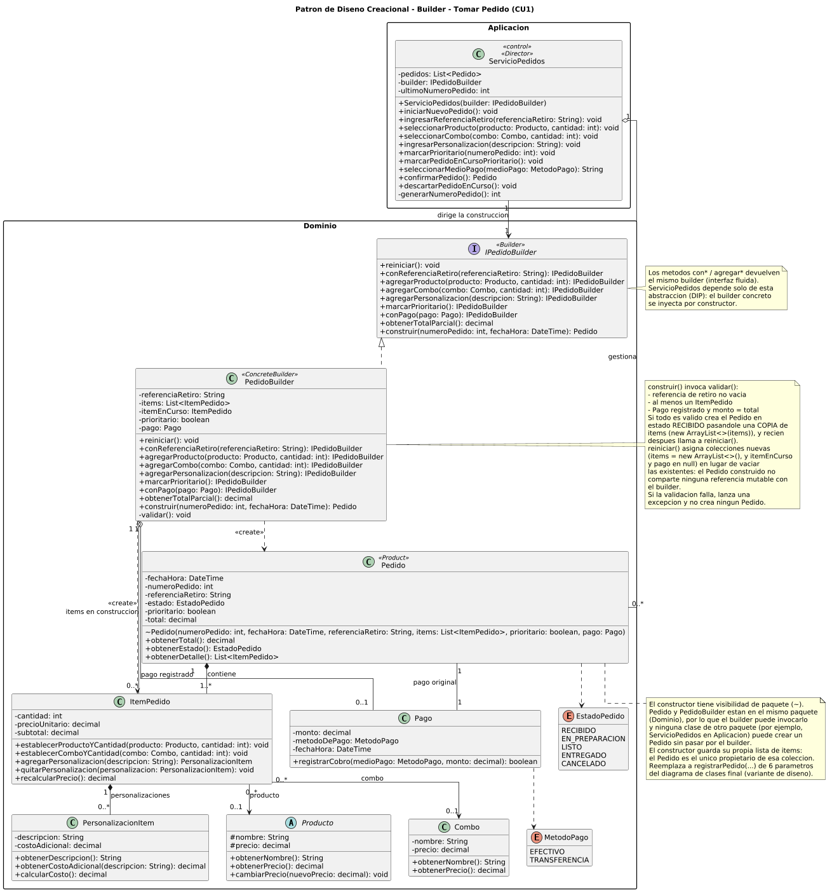

# Anexo – Aplicación de Patrón de Diseño Creacional – Builder

## Patrones de Diseño Creacionales y su relación con SOLID

Los patrones de diseño creacionales abstraen el proceso de instanciación de objetos. Su finalidad consiste en separar la lógica que crea y compone una entidad de la lógica que posteriormente la utiliza. En el catálogo GoF, la categoría creacional incluye Singleton, Factory Method, Abstract Factory, Builder y Prototype. Cada patrón resuelve una necesidad distinta de creación; en el presente sistema, la alternativa seleccionada se fundamenta en la complejidad progresiva de la construcción de un pedido.

La aplicación de estos patrones se relaciona con SOLID de la siguiente manera:

- **SRP:** asigna la responsabilidad de construir y validar el pedido a una clase especializada, separándola de la gestión general de pedidos.
- **OCP:** permite incorporar otro ConcreteBuilder sin modificar el Director ni el contrato que utiliza el cliente.
- **LSP:** toda implementación compatible con `IPedidoBuilder` puede sustituir a otra porque conserva el comportamiento esperado por `ServicioPedidos`.
- **ISP:** `IPedidoBuilder` concentra exclusivamente las operaciones necesarias para construir pedidos.
- **DIP:** `ServicioPedidos`, como clase de alto nivel, depende de `IPedidoBuilder` y recibe su implementación concreta por constructor.

## Propósito y Tipo del Patrón

**Propósito:**

Construir el objeto complejo `Pedido` paso a paso durante el caso de uso CU1 – Tomar pedido, evitando que exista un pedido incompleto o que las reglas de construcción queden repartidas entre varias clases.

La construcción original del diagrama de clases final muestra una configuración progresiva:

- `ServicioPedidos` conserva `pedidoEnCurso` e `itemEnCurso`.
- `Pedido` se completa mediante operaciones dispersas y un método `registrarPedido(...)` con seis parámetros.
- `ItemPedido` contiene la cantidad, el precio unitario y el subtotal, y puede incorporar personalizaciones.
- `Producto` y `Combo` representan los elementos seleccionados para cada ítem.
- `Pago` representa el cobro asociado al pedido.

El Builder separa estos datos parciales del producto final y garantiza que el pedido solo pueda instanciarse cuando se verifica su integridad.

**Tipo:**

Patrón de diseño **creacional – Builder**.

El patrón Builder corresponde a la categoría creacional porque controla cuándo y cómo se instancia un objeto. Además, permite que el mismo proceso de construcción incorpore datos en sucesivas etapas y produzca un objeto final válido. En este diseño:

- `ServicioPedidos` actúa como Director.
- `IPedidoBuilder` define el contrato del Builder.
- `PedidoBuilder` implementa el ConcreteBuilder.
- `Pedido` es el Product.

El patrón es preferible a los demás creacionales en este caso porque la clase de resultado siempre es `Pedido`, no se requieren familias de objetos y el objeto no se obtiene clonando una instancia existente. Su dificultad principal no consiste en seleccionar una clase concreta, sino en ensamblar un objeto complejo mediante pasos sucesivos y validarlo antes de crear la instancia final.

## Motivación

### Funcionamiento original y limitaciones

En el diagrama de clases final, el proceso de tomar un pedido combina coordinación, estado temporal y construcción del dominio dentro de `ServicioPedidos`. El servicio mantiene `pedidoEnCurso` e `itemEnCurso` y ofrece operaciones para ingresar la referencia de retiro, seleccionar productos o combos, cargar personalizaciones y asociar el pago.

Al finalizar, `Pedido` dispone de `registrarPedido(numeroPedido, fechaHora, referenciaRetiro, listaItems, totalPedido, pago)` para recibir los datos completos en una única operación. Esta forma de construir el pedido presenta las siguientes limitaciones:

1. **Estado intermedio dentro del Director:** `pedidoEnCurso` e `itemEnCurso` mantienen temporalmente el objeto a medio construir y hacen que el controlador también administre datos internos de creación.
2. **Responsabilidad excesiva:** `ServicioPedidos` concentra la coordinación de numerosos casos de uso junto con el armado del pedido.
3. **Construcción dependiente del orden:** si el objeto se modifica directamente desde varios métodos, la integridad final depende de que cada llamada se produzca en la secuencia correcta.
4. **Método con muchos parámetros:** `registrarPedido(...)` recibe seis datos relacionados y exige que el llamador haya construido previamente un estado consistente.
5. **Posibilidad de pedidos incompletos:** antes de confirmar la construcción podrían existir referencias, ítems o pagos ausentes o incoherentes.

### Clases involucradas originalmente

- `ServicioPedidos` orquesta el caso de uso y administraba el estado temporal.
- `Pedido` representaba el producto y ofrecía el método monolítico de registro.
- `ItemPedido` representaba una línea del pedido.
- `PersonalizacionItem` representaba una modificación con costo adicional.
- `Producto` y `Combo` eran los elementos que podían formar un ítem.
- `Pago` contenía el método y el monto asociado al pedido.
- `EstadoPedido` representaba el estado del pedido.

### Problemas de mantenibilidad

Mantener el armado dentro de `ServicioPedidos` aumenta su acoplamiento y reduce su cohesión. Si se incorpora un dato nuevo al pedido, se modificarían simultáneamente el estado temporal del servicio, el método de registro y el llamador. Las validaciones también podrían quedar dispersas e impedir que el sistema garantice que toda instancia de `Pedido` sea válida desde el momento de su creación.

La construcción también sería difícil de extender: sin una clase que encapsule la secuencia de armado, cualquier paso o dato nuevo obligaría a modificar el proceso completo.

### Nuevas clases y reorganización de la arquitectura

Las únicas nuevas clases que introduce el patrón son:

- `IPedidoBuilder`: establece el contrato de construcción y permite que `ServicioPedidos` dependa de una abstracción.
- `PedidoBuilder`: implementa los pasos, reúne el estado temporal y ejecuta la validación antes de instanciar `Pedido`.

Las responsabilidades existentes cambian de esta manera:

- `ServicioPedidos` deja de conservar `pedidoEnCurso` e `itemEnCurso` y pasa a ser el Director.
- `Pedido` pasa a ser el Product y su constructor de paquete reemplaza a `registrarPedido(...)`. `Pedido`, `IPedidoBuilder` y `PedidoBuilder` se ubican en el mismo paquete (`Dominio`), de modo que el builder puede invocar ese constructor y ninguna clase de otro paquete puede crear un `Pedido` directamente.
- `PedidoBuilder` pasa a crear temporalmente los `ItemPedido` y a agrupar el `Pago` como parte de la construcción.
- `ItemPedido`, `PersonalizacionItem`, `Producto`, `Combo` y `EstadoPedido` conservan sus responsabilidades de dominio dentro del objeto construido.

#### Firmas que cambian respecto del diagrama de clases final

| Clase | Diagrama de clases final | Con el patrón Builder | Motivo |
|---|---|---|---|
| `ServicioPedidos` | `iniciarNuevoPedido(): Pedido` | `iniciarNuevoPedido(): void` | Con Builder, el `Pedido` todavía no existe al iniciar la toma: la operación solo invoca `builder.reiniciar()`, por lo que no hay objeto que devolver. |
| `ServicioPedidos` | — | `marcarPedidoEnCursoPrioritario(): void` | Operación nueva: marca como prioritario el pedido **en construcción** delegando en `builder.marcarPrioritario()`. Convive con `marcarPrioritario(numeroPedido: int): void`, que se mantiene sin cambios para marcar un pedido **ya registrado** (invocada desde `PantallaPedidos`). |
| `ServicioPedidos` | — | `confirmarPedido(): Pedido` | Operación nueva: genera el número, invoca `construir()` y devuelve el `Pedido` creado. Hace explícito el paso final del Director. |
| `ServicioPedidos` | `descartarPedidoEnCurso(): void` | `descartarPedidoEnCurso(): void` | Misma firma; cambia su implementación: ya no limpia `pedidoEnCurso` e `itemEnCurso`, sino que invoca `builder.reiniciar()`. |
| `ServicioPedidos` | `ServicioPedidos()` (implícito) | `ServicioPedidos(builder: IPedidoBuilder)` | Constructor nuevo para inyectar el builder (DIP). |
| `Pedido` | `registrarPedido(numeroPedido, fechaHora, referenciaRetiro, listaItems, totalPedido, pago): boolean` | `~Pedido(numeroPedido, fechaHora, referenciaRetiro, items, prioritario, pago)` | El constructor de visibilidad de paquete reemplaza al método de registro. Como `PedidoBuilder` comparte el paquete `Dominio` con `Pedido`, es la única clase del flujo que crea instancias. |

Las demás operaciones de `ServicioPedidos` que figuran en el diagrama final (búsqueda, modificación, cancelación, cambio de estado y consulta de pedidos activos) no participan del patrón y se mantienen sin cambios, por lo que no se muestran en el diagrama del patrón.

La arquitectura se reorganiza de modo que el estado intermedio queda encapsulado en `PedidoBuilder`. El pedido no se instancia hasta que el Director solicita `construir()` y el ConcreteBuilder comprueba que el pedido esté completo.

### Alcance: variante de diseño

El patrón Builder se presenta como una **variante de diseño** sobre el diagrama de clases final, no como un reemplazo ya integrado en los artefactos de la Parte 1. Por eso, el diagrama de clases final (`06-clases-diagrama-final.puml`), el anexo del CU1, el pseudocódigo del happy path global y la secuencia del CU1 conservan la interfaz anterior: `iniciarNuevoPedido(): Pedido`, `pedidoEnCurso`/`itemEnCurso` en `ServicioPedidos` y `Pedido.registrarPedido(...)`.

La tabla "Firmas que cambian respecto del diagrama de clases final" funciona como mapa entre las dos interfaces. Adoptar la variante implicaría actualizar esos consumidores de la siguiente manera:

| Artefacto | Interfaz actual | Con la variante Builder |
|---|---|---|
| Secuencia y anexo del CU1 | `ServicioPedidos.iniciarNuevoPedido()` devuelve el `Pedido` en curso y `Pedido.registrarPedido(...)` lo registra al confirmar | `iniciarNuevoPedido()` invoca `builder.reiniciar()`, los pasos se delegan en `IPedidoBuilder` y `confirmarPedido()` obtiene el `Pedido` con `construir(...)` |
| Happy path global | Crea el pedido con `iniciarNuevoPedido()` y lo registra con `registrarPedido(...)` | Encadena los pasos del builder y obtiene el pedido con `confirmarPedido()` |
| Diagrama de clases final | `ServicioPedidos` con `pedidoEnCurso` e `itemEnCurso`; `Pedido.registrarPedido(...)` | `ServicioPedidos` con `builder: IPedidoBuilder`; constructor de paquete `~Pedido(...)` |

Los demás casos de uso (CU2 a CU5) operan sobre pedidos ya registrados y no dependen de cómo se creó el `Pedido`, por lo que no se ven afectados por la variante.

## Estructura de Clases

El diagrama incluye únicamente las clases que participan en la aplicación del patrón al CU1.

[Ver diagrama en tamaño completo](../../diagramas/01-diagrama-clases/01-patron-creacional-builder.png)

## Justificación Técnica de la Estructura de Clases

### Descripción de cada clase

**`ServicioPedidos` – Director**

`ServicioPedidos` pertenece a la capa de aplicación y coordina el flujo de CU1. En el diagrama conserva la colección `pedidos`, una referencia al builder y el número del último pedido.

Su constructor recibe `IPedidoBuilder`, de modo que el Director depende de una abstracción y no de `PedidoBuilder`. También mantiene `generarNumeroPedido()` para asignar el identificador que se entrega al construir el pedido.

Inicia y controla las operaciones `iniciarNuevoPedido()`, `ingresarReferenciaRetiro()`, `seleccionarProducto()`, `seleccionarCombo()`, `ingresarPersonalizacion()`, `marcarPedidoEnCursoPrioritario()`, `seleccionarMedioPago()`, `confirmarPedido()` y `descartarPedidoEnCurso()`. Las operaciones de construcción se delegan al builder; por ello, la clase ya no contiene `pedidoEnCurso` ni `itemEnCurso`. Además conserva `marcarPrioritario(numeroPedido: int)` del diagrama final para marcar pedidos ya registrados, que no forma parte de la construcción.

**`IPedidoBuilder` – Builder**

`IPedidoBuilder` es la interfaz que establece el contrato de construcción. Define `reiniciar()`, los pasos para agregar los datos del pedido, `obtenerTotalParcial()` y `construir()`.

Es implementada por `PedidoBuilder`. Esta relación permite sustituir la implementación concreta y mantiene en `ServicioPedidos` una dependencia dirigida hacia una abstracción. Los métodos con prefijos `con*` y `agregar*` devuelven `IPedidoBuilder`, lo que permite encadenar el proceso de construcción.

**`PedidoBuilder` – ConcreteBuilder**

`PedidoBuilder` es la implementación concreta del Builder. Reúne la referencia de retiro, la lista de ítems, el ítem en curso, la prioridad y el pago. También contiene el método privado `validar()`, que concentra las reglas necesarias antes de crear el producto.

Implementa `IPedidoBuilder`, crea instancias de `Pedido` e `ItemPedido`, agrega temporalmente cero o más ítems y registra un pago opcional durante la construcción. Esta clase es necesaria porque encapsula el estado mutable del armado y evita que dicho estado pertenezca a `ServicioPedidos`.

Está en el mismo paquete que `Pedido`, lo que le permite invocar su constructor de paquete. Para que el builder pueda reutilizarse sin afectar los pedidos ya creados, `construir()` le entrega al `Pedido` una **copia** de la lista de ítems (`new ArrayList<>(items)`) y recién después llama a `reiniciar()`. A su vez, `reiniciar()` asigna una colección nueva a `items` y deja `itemEnCurso` y `pago` en `null`, en lugar de vaciar la colección anterior. Así, el `Pedido` construido no comparte ninguna referencia mutable con el builder.

**`Pedido` – Product**

`Pedido` representa el objeto complejo obtenido al finalizar la construcción. Contiene `fechaHora`, `numeroPedido`, `referenciaRetiro`, `estado`, `prioritario` y `total`.

Su constructor tiene visibilidad de paquete (`~`) y recibe el identificador, la fecha, la referencia, la lista de ítems, la prioridad y el pago. `Pedido` y `PedidoBuilder` comparten el paquete `Dominio`, por lo que el builder puede invocar el constructor, mientras que `ServicioPedidos`, ubicado en el paquete `Aplicacion`, no puede crear pedidos sin pasar por el Builder. El constructor reemplaza a `registrarPedido(...)` del diagrama de clases final.

El constructor guarda como propia la lista de ítems recibida: el `Pedido` es el único propietario de esa colección, y un reinicio posterior del builder no la vacía ni la modifica.

El pedido compone entre uno y muchos `ItemPedido`, mantiene un único `Pago` original y utiliza `EstadoPedido` para representar su estado. Expone métodos para obtener el total, el estado y el detalle de ítems.

**`ItemPedido`**

`ItemPedido` representa una línea del pedido. Sus atributos son `cantidad`, `precioUnitario` y `subtotal`.

El builder lo crea al agregar un producto o un combo. Puede establecer un producto individual o un combo, agregar o quitar personalizaciones y recalcular su precio. Cada ítem contiene cero o más `PersonalizacionItem` y referencia cero o un `Producto` o `Combo`; de acuerdo con la composición de la línea, uno de los dos elementos debe estar asociado.

**`PersonalizacionItem`**

`PersonalizacionItem` representa una modificación aplicada a un ítem. Define `descripcion` y `costoAdicional`, y permite obtener ambos datos y calcular su costo.

Es necesaria porque una personalización forma parte de la construcción del `ItemPedido`, no del pedido completo. El ConcreteBuilder conserva el `itemEnCurso` para delegarle la incorporación de cada personalización.

**`Producto`**

`Producto` representa un elemento individual del menú. En el diagrama es una clase abstracta con `nombre` y `precio`, y proporciona operaciones para obtener ambos datos y cambiar el precio.

Es una entrada de construcción: `PedidoBuilder.agregarProducto(...)` utiliza el producto y la cantidad para crear un `ItemPedido`. La multiplicidad cero a muchos indica que un producto puede aparecer en distintos ítems.

**`Combo`**

`Combo` representa un conjunto comercializado como una sola opción del menú. Contiene `nombre` y `precio`, y ofrece operaciones para obtenerlos.

Al igual que `Producto`, no conoce el proceso de creación del pedido. El Builder recibe el combo seleccionado y delega en `ItemPedido.establecerComboYCantidad(...)` la creación de la línea correspondiente.

**`Pago`**

`Pago` representa el pago original asociado al pedido. Contiene `monto`, `metodoDePago` y `fechaHora`, y ofrece `registrarCobro(...)`.

`PedidoBuilder` recibe el pago mediante `conPago(pago)`. El pago es necesario para validar que su monto coincida con el total construido y, una vez creado el pedido, se mantiene como su pago original.

**`EstadoPedido`**

`EstadoPedido` es una enumeración que establece los estados posibles: `RECIBIDO`, `EN_PREPARACION`, `LISTO`, `ENTREGADO` y `CANCELADO`.

En el Builder, un pedido creado por `construir()` debe quedar en estado `RECIBIDO`. La enumeración permite que `Pedido` represente ese estado y los estados posteriores sin incorporar cadenas de texto en sus atributos.

### Flujo de creación del objeto final

El flujo comienza en `ServicioPedidos`, que actúa como Director:

1. **Inicio:** `iniciarNuevoPedido()` llama a `builder.reiniciar()` y prepara un nuevo proceso de construcción. A diferencia del diagrama final, no devuelve un `Pedido`, porque este todavía no existe.
2. **Datos básicos:** `ingresarReferenciaRetiro()` delega en `IPedidoBuilder.conReferenciaRetiro(...)`.
3. **Armado de ítems:** `seleccionarProducto(...)` delega en `agregarProducto(...)`; `seleccionarCombo(...)` delega en `agregarCombo(...)`. `PedidoBuilder` crea un `ItemPedido` en cada operación.
4. **Personalización:** `ingresarPersonalizacion(...)` delega en `agregarPersonalizacion(...)`. `PedidoBuilder` aplica la personalización al `itemEnCurso`.
5. **Opciones finales y pago:** `marcarPedidoEnCursoPrioritario()` delega en `builder.marcarPrioritario()`. En `seleccionarMedioPago(...)`, `ServicioPedidos` consulta `builder.obtenerTotalParcial()` para procesar el cobro por ese monto. Aprobado el cobro, `ServicioPedidos` registra el `Pago` y lo entrega al builder con `conPago(pago)`; el monto se valida contra `obtenerTotalParcial()` cuando `construir()` ejecuta `validar()`.
6. **Total y confirmación:** en `confirmarPedido()`, `ServicioPedidos` genera el número con `generarNumeroPedido()`, toma la fecha y hora actuales e invoca `construir(numeroPedido, fechaHora)`.
7. **Validación e instanciación:** `PedidoBuilder.construir(...)` ejecuta `validar()`. Comprueba que la referencia de retiro no esté vacía, que exista al menos un `ItemPedido` y que el `Pago` esté registrado con un monto igual al total. Si todas las condiciones se cumplen, instancia `Pedido` en estado `RECIBIDO` y le pasa una copia de la lista de ítems.
8. **Reinicio y entrega del resultado:** después de instanciar el pedido, `construir()` llama a `reiniciar()`, que asigna colecciones nuevas al builder sin tocar la lista que ya pertenece al `Pedido`. Luego devuelve el `Pedido` final a `ServicioPedidos`, que lo agrega a `pedidos`.
9. **Descarte:** si el usuario abandona la toma antes de confirmar, `descartarPedidoEnCurso()` solo invoca `builder.reiniciar()`; como el `Pedido` nunca llegó a instanciarse, no queda ningún objeto incompleto.

En resumen, **`ServicioPedidos` inicia y ordena el flujo, `IPedidoBuilder` define el contrato de construcción, `PedidoBuilder` reúne los datos parciales y valida las reglas, y `Pedido` es instanciado por `PedidoBuilder` como objeto final**.