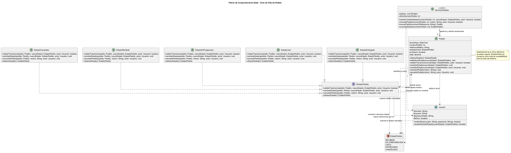

# Anexo – Aplicación de Patrón de Diseño de Comportamiento – State

## Patrones de Diseño de Comportamiento y su relación con SOLID

Los patrones de diseño de comportamiento definen formas de organizar la interacción, la delegación y la distribución de responsabilidades entre objetos. Estos patrones permiten que el sistema pueda realizar operaciones variables sin que sus clientes conozcan todas las implementaciones posibles, reduciendo el acoplamiento y facilitando cambios controlados.

La aplicación de State mantiene una relación directa con los principios SOLID:

- **SRP:** separa las reglas propias de cada estado del almacenamiento y de las operaciones generales de `Pedido`.
- **OCP:** permite incorporar o modificar comportamientos para un estado mediante nuevas implementaciones de `IEstadoPedido`, sin reemplazar toda la lógica central.
- **LSP:** cada estado concreto puede sustituir a `IEstadoPedido` siempre que respete el contrato de validación, transición, cancelación y consulta del estado.
- **ISP:** la interfaz `IEstadoPedido` contiene únicamente operaciones relacionadas con el ciclo de vida de `Pedido`; no obliga a las clases consumidoras a implementar responsabilidades ajenas.
- **DIP:** `Pedido` depende de la abstracción `IEstadoPedido` en lugar de acoplarse a las clases concretas de estado, mientras que `ServicioPedidos`, `Pedido` e `IEstadoPedido` operan sobre la abstracción `Usuario` sin depender de subclases de roles específicos. `Usuario.puedeSolicitarEstado(nuevoEstado: EstadoPedido): boolean` permite delegar la autorización por rol de forma polimórfica.

---

## Propósito y Tipo del Patrón

- **Propósito:** resolver el problema concreto del ciclo de vida de `Pedido`, separando las reglas de transición y cancelación que dependen del estado interno de la entidad.
- **Tipo:** patrón de comportamiento **State**.

State encaja de forma natural porque `Pedido` posee estados explícitos definidos por `EstadoPedido`: `RECIBIDO`, `EN_PREPARACION`, `LISTO`, `ENTREGADO` y `CANCELADO`. Cada estado determina qué transiciones son válidas y qué operaciones pueden ejecutarse.

Este patrón resulta más adecuado que:

- **Observer:** su propósito es comunicar cambios uno-a-muchos, no determinar qué transición puede realizarse.
- **Strategy:** ya se aplica conceptualmente en el diagrama OCP para estrategias de pago; repetirlo en el ciclo de vida dividiría comportamientos que representan estados internos.
- **Command:** encapsularía operaciones solicitadas, pero no resolvería directamente la variación del comportamiento por estado.
- **Template Method:** exigiría un esqueleto fijo compartido por estados que no existe como necesidad principal en este diseño.
- **Chain of Responsibility:** permitiría procesar una solicitud a través de responsables consecutivos, pero no representa el estado interno ni el conjunto de operaciones válidas de `Pedido`.

---

## Motivación

En el diseño original de `06-clases-diagrama-final.puml`, `Pedido` contenía su atributo `estado: EstadoPedido`, junto con `validarTransicion(nuevoEstado: EstadoPedido, actor: Usuario)`, `cambiarEstado(nuevoEstado: EstadoPedido)` y `cancelarPedido(motivo: String)`. `ServicioPedidos` iniciaba cambios y cancelaciones, mientras que `UsuarioMostrador`, `UsuarioCocina` y `UsuarioEncargado` realizaban operaciones desde sus respectivos roles.

Este diseño concentraba reglas distintas en la entidad `Pedido` o las dejaba condicionadas por el enum `EstadoPedido`. Cada nueva transición podría requerir modificar la validación central y aplicar nuevos condicionales según el estado actual y el actor. Esa organización produce una acumulación de reglas, dificulta incorporar restricciones adicionales y aumenta el riesgo de que una transición inválida cambie el estado sin mantener sus responsabilidades separadas.

State introduce `IEstadoPedido` y las implementaciones reales `EstadoRecibido`, `EstadoEnPreparacion`, `EstadoListo`, `EstadoEntregado` y `EstadoCancelado`. Cada clase encapsula las restricciones válidas para su estado. El enum `EstadoPedido` se conserva para compatibilidad con `ServicioPedidos`, consultas y vistas del sistema. `obtenerEstado()` vincula cada estado concreto con su valor correspondiente del enum; el mismo enum se utiliza como destino de transición sin duplicar un atributo de estado en `Pedido`.

La arquitectura delega las operaciones al objeto actual:

- `Pedido.estadoActual: IEstadoPedido` conserva la instancia State vigente y es la única referencia al estado mutable.
- `Pedido.establecerEstado(nuevoEstado: IEstadoPedido): void` actualiza la instancia después de una transición válida.
- `Pedido.validarTransicion(...)`, `Pedido.cambiarEstado(...)` y `Pedido.cancelarPedido(...)` delegan el comportamiento en `estadoActual`.
- `IEstadoPedido` recibe `pedido: Pedido` en los métodos de transición, permitiendo que el State concreto solicite a `Pedido` el cambio de su instancia actual.

Las restricciones por rol continúan perteneciendo al dominio mediante `Usuario` y sus especializaciones:

- `UsuarioMostrador` puede operar pedidos desde atención y marcarlos como entregados.
- `UsuarioCocina` puede iniciar la preparación y marcar el pedido como listo.
- `UsuarioEncargado` puede intervenir en cancelaciones o autorizaciones especiales.

Los estados terminales `ENTREGADO` y `CANCELADO` rechazan transiciones y cancelaciones posteriores. Los demás estados pueden restringir operaciones por estado y tipo de usuario.

---

## Estructura de Clases

El diagrama representa únicamente las clases e interfaces directamente implicadas en la aplicación de State, manteniendo el contexto necesario para comprender la delegación sin incluir actores concretos adicionales.

[Ver diagrama en tamaño completo](../../diagramas/01-diagrama-clases/01-patron-comportamiento-state.png)

---

## Justificación Técnica de la Estructura de Clases

### ServicioPedidos

`ServicioPedidos` actúa como cliente del patrón. Inicia cambios de estado y cancelaciones a través de operaciones como `solicitarCambioEstado(numeroPedido: int, nuevoEstado: EstadoPedido, actor: Usuario): boolean` y `cancelarPedido(numeroPedido: int, motivo: String, actor: Usuario): boolean`. Localiza el `Pedido`, conserva el actor y el estado solicitado, y delega la operación sin conocer las clases concretas de estado. Esta separación mantiene a la aplicación desacoplada de las implementaciones concretas.

### Pedido

`Pedido` es el contexto State. Conserva los datos propios de la orden y sustituye el atributo redundante `estado: EstadoPedido` por `estadoActual: IEstadoPedido`. Expone `obtenerEstado(): EstadoPedido`, `establecerEstado(nuevoEstado: IEstadoPedido): void`, `validarTransicion(nuevoEstado: EstadoPedido, actor: Usuario): boolean`, las variantes `cambiarEstado(nuevoEstado: EstadoPedido): void` y `cambiarEstado(nuevoEstado: EstadoPedido, actor: Usuario): void`, y las variantes `cancelarPedido(motivo: String): void` y `cancelarPedido(motivo: String, actor: Usuario): void`.

Sus métodos delegan en `estadoActual`; `establecerEstado(...)` permite a un estado concreto actualizar al siguiente estado sin que `Pedido` conozca la implementación. `Pedido.obtenerEstado()` consulta `estadoActual.obtenerEstado()` y proporciona al resto del sistema el enum compatible.

Se conservan las firmas originales `cambiarEstado(nuevoEstado: EstadoPedido): void` y `cancelarPedido(motivo: String): void`, junto con sus sobrecargas que reciben `actor: Usuario`, para mantener compatibilidad con los artefactos previos del sistema y habilitar la validación por rol en la delegación al estado actual.

La sobrecarga `cancelarPedido(numeroPedido: int, motivo: String, actor: Usuario, autorizante: UsuarioEncargado): boolean` del diagrama final también delega la cancelación en el estado actual, conservando al autorizante como actor responsable de la operación especial.

### IEstadoPedido

`IEstadoPedido` es la interfaz común del patrón State. Define `validarTransicion(pedido: Pedido, nuevoEstado: EstadoPedido, actor: Usuario): boolean`, `cambiarEstado(pedido: Pedido, nuevoEstado: EstadoPedido, actor: Usuario): void`, `cancelarPedido(pedido: Pedido, motivo: String, actor: Usuario): void` y `obtenerEstado(): EstadoPedido`.

Los métodos que provocan transición reciben `pedido` para que el objeto concreto pueda invocar `pedido.establecerEstado(...)`. El contrato depende de las abstracciones existentes `Pedido`, `EstadoPedido` y `Usuario`, evitando que el contexto dependa directamente de las implementaciones concretas.

### EstadoRecibido

`EstadoRecibido` encapsula el comportamiento mientras el pedido está en `RECIBIDO`. Puede aceptar el paso a `EN_PREPARACION`, cuando corresponde al rol autorizado, y puede permitir cancelación cuando las reglas del sistema lo admitan. Implementa `obtenerEstado()` devolviendo `EstadoPedido.RECIBIDO`.

### EstadoEnPreparacion

`EstadoEnPreparacion` representa que el pedido está siendo preparado. Puede validar el paso a `LISTO`, normalmente iniciado por `UsuarioCocina`, y restringir modificaciones o cancelaciones según las reglas vigentes. Implementa `obtenerEstado()` devolviendo `EstadoPedido.EN_PREPARACION`.

### EstadoListo

`EstadoListo` representa el pedido preparado y disponible para entrega. Puede validar la transición a `ENTREGADO`, realizada por el flujo de atención, y rechazar nuevas solicitudes de preparación. Implementa `obtenerEstado()` devolviendo `EstadoPedido.LISTO`.

### EstadoEntregado

`EstadoEntregado` es un estado terminal. `validarTransicion(...)` rechaza cambios posteriores y `cancelarPedido(...)` impide devoluciones o cancelaciones mediante el cambio de estado ordinario. Esta restricción conserva la integridad del pedido una vez entregado. Implementa `obtenerEstado()` devolviendo `EstadoPedido.ENTREGADO`.

### EstadoCancelado

`EstadoCancelado` es el otro estado terminal. No permite transiciones ni cancelaciones adicionales, independientemente del actor recibido. Implementa `obtenerEstado()` devolviendo `EstadoPedido.CANCELADO`.

### EstadoPedido

`EstadoPedido` es el enum existente del repositorio. Conserva los valores `RECIBIDO`, `EN_PREPARACION`, `LISTO`, `ENTREGADO` y `CANCELADO` para mantener compatibilidad con `ServicioPedidos`, las pantallas y las consultas existentes. Los estados concretos traducen su comportamiento interno a este enum mediante `obtenerEstado()` y reciben valores del enum como estado destino.

No mantiene atributos paralelos en `Pedido`; por tanto, el enum no duplica ni sustituye `estadoActual`, sino que funciona como representación pública compatible del estado.

### Usuario

`Usuario` es la abstracción utilizada para validar quién solicita una operación. La operación `puedeSolicitarEstado(nuevoEstado: EstadoPedido): boolean` permite que cada tipo de usuario concrete las operaciones de estado que puede solicitar, de modo que los estados consulten la autorización mediante la abstracción y sin utilizar verificaciones sobre tipos concretos. Cada subclase redefine este comportamiento según su rol. Aunque `UsuarioMostrador`, `UsuarioCocina` y `UsuarioEncargado` no aparecen en el diagrama de detalle, sus responsabilidades se aplican conceptualmente:

- `UsuarioMostrador`: operación desde atención y entrega.
- `UsuarioCocina`: inicio y finalización de preparación.
- `UsuarioEncargado`: autorización especial y supervisión.

Esto reduce el acoplamiento a implementaciones concretas y respeta DIP.

### Descripción del flujo del comportamiento

#### Escenario 1: transición válida de `RECIBIDO` a `EN_PREPARACION`

1. `ServicioPedidos.solicitarCambioEstado(...)` recibe el número del pedido, `EN_PREPARACION` y un `UsuarioCocina` que actúa como actor.
2. `ServicioPedidos` obtiene el `Pedido` correspondiente y solicita `Pedido.validarTransicion(EN_PREPARACION, actor)`.
3. `Pedido` delega la validación a `estadoActual`, que en este momento es una instancia de `EstadoRecibido`.
4. `EstadoRecibido` verifica el estado destino y solicita `actor.puedeSolicitarEstado(EN_PREPARACION)`. Esta operación polimórfica permite que la subclase concreta del usuario indique si puede iniciar preparación sin que `EstadoRecibido` conozca su tipo. Si la operación es válida, devuelve `true`.
5. `ServicioPedidos` solicita `Pedido.cambiarEstado(EN_PREPARACION, actor)`.
6. `Pedido.cambiarEstado(...)` delega en `estadoActual.cambiarEstado(pedido, EN_PREPARACION, actor)`.
7. `EstadoRecibido` solicita `Pedido.establecerEstado(...)`, pasando una nueva instancia de `EstadoEnPreparacion`.
8. `Pedido` reemplaza `estadoActual` y el mismo pedido pasa a exponer `EstadoPedido.EN_PREPARACION` mediante `obtenerEstado()`.

#### Escenario 2: cancelación desde `ENTREGADO`

1. `ServicioPedidos.cancelarPedido(...)` recibe un pedido, un motivo y un actor.
2. `ServicioPedidos` obtiene el pedido y solicita `Pedido.cancelarPedido(motivo, actor)`.
3. `Pedido` delega la operación a `estadoActual`, que en ese momento es una instancia de `EstadoEntregado`.
4. `EstadoEntregado` determina que el pedido ya fue entregado y rechaza la cancelación ordinaria mediante el cambio de estado.
5. Como no se alcanza `Pedido.establecerEstado(...)`, `estadoActual` permanece como `EstadoEntregado` y `Pedido.obtenerEstado()` continúa devolviendo `EstadoPedido.ENTREGADO`.
6. El flujo evita condicionales globales dentro de `Pedido` y garantiza que no se pueda cancelar un pedido desde un estado terminal.