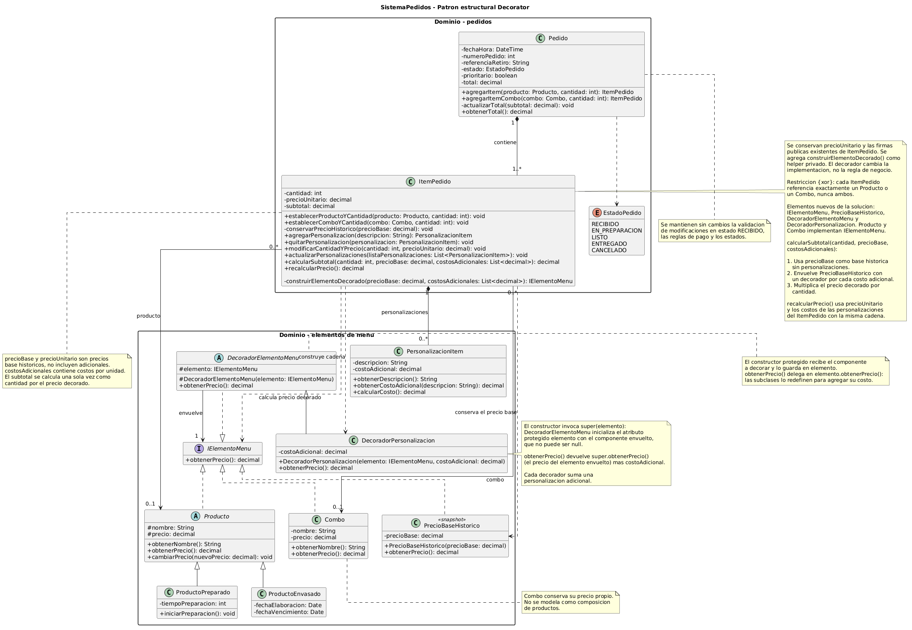

# Anexo – Aplicación de Patrón de Diseño Estructural – Decorator

**Proyecto:** SistemaPedidos  
**Materia:** Diseño Orientado a Objetos (DOO)  
**Rol:** Especialista en Patrón de Diseño Estructural  
**Patrón seleccionado:** Decorator (Decorador)  
**Clasificación:** Patrón estructural GoF

---

## Patrones de Diseño Estructurales y su relación con SOLID

Los patrones de diseño estructurales son soluciones reutilizables a problemas frecuentes relacionados con la organización y composición de clases y objetos dentro de un sistema orientado a objetos.

Su objetivo es facilitar la construcción de estructuras flexibles, reducir el acoplamiento entre componentes y permitir que el software evolucione sin requerir modificaciones extensas en las clases existentes.

Dentro de los patrones estructurales definidos por GoF (Gang of Four) se encuentran Adapter, Bridge, Composite, Decorator, Facade, Flyweight y Proxy.

Estos patrones se relacionan con los principios SOLID, ya que ambos buscan mejorar la mantenibilidad, extensibilidad y organización del código.

En particular, el patrón Decorator puede favorecer los siguientes principios:

- **SRP (Principio de Responsabilidad Única):** permite separar la lógica de incorporación de funcionalidades adicionales de las responsabilidades principales de los objetos.
- **OCP (Principio Abierto/Cerrado):** facilita extender el comportamiento de un objeto mediante decoradores, sin modificar sus clases originales.
- **LSP (Principio de Sustitución de Liskov):** los decoradores implementan la misma interfaz que los objetos decorados, permitiendo utilizarlos de manera intercambiable siempre que respeten su contrato.
- **DIP (Principio de Inversión de Dependencias):** los decoradores trabajan con una abstracción común en lugar de depender directamente de clases concretas.

La utilización de estos principios no se garantiza automáticamente por aplicar el patrón; depende de que las clases y sus implementaciones respeten las responsabilidades y contratos establecidos.

## Propósito y Tipo del Patrón

**Propósito:**

El propósito de Decorator es agregar responsabilidades o comportamientos a un objeto de forma dinámica, envolviéndolo en otro objeto que implementa la misma interfaz.

De esta manera, pueden incorporarse nuevas funcionalidades sin modificar directamente la clase original y sin generar múltiples subclases para representar cada combinación posible de comportamientos.

En SistemaPedidos, el patrón se propone para organizar el cálculo de precios de productos y combos que incluyen personalizaciones con costos adicionales.

Por ejemplo, un cliente puede seleccionar una hamburguesa y agregar queso extra o panceta. Cada personalización incrementa el precio unitario del producto.

Con Decorator, cada costo adicional se representa mediante un decorador que envuelve al elemento anterior y agrega su importe al precio acumulado.

Esto permite construir una cadena de decoradores y obtener el precio unitario final mediante una única operación: `obtenerPrecio()`.

**Tipo:**

Se seleccionó el patrón **Decorator (Decorador)**, perteneciente a la categoría de patrones estructurales GoF.

Decorator es adecuado porque cada personalización agrega un costo al precio de un ítem de forma acumulativa y combinable, sin necesidad de crear una subclase por cada combinación posible de adicionales.

## Motivación

### Situación del modelo original

El análisis se realizó tomando como referencia el archivo:

[06-clases-diagrama-final.puml](../../diagramas/01-diagrama-clases/06-clases-diagrama-final.puml)

En el modelo original, la clase `ItemPedido` contiene los siguientes atributos:

- `cantidad: int`
- `precioUnitario: decimal`
- `subtotal: decimal`

Además, dispone de operaciones relacionadas con las personalizaciones y el cálculo del precio:

- `agregarPersonalizacion(descripcion: String)`
- `quitarPersonalizacion(personalizacion: PersonalizacionItem)`
- `actualizarPersonalizaciones(listaPersonalizaciones)`
- `calcularSubtotal(cantidad, precioBase, costosAdicionales)`
- `recalcularPrecio()`

Por su parte, `PersonalizacionItem` contiene la descripción y el costo adicional de cada personalización.

El diagrama original establece que cada `ItemPedido` referencia un `Producto` o un `Combo`, pero nunca ambos. También indica que `precioUnitario` conserva el precio vigente al registrar el pedido.

### Problema identificado

En el modelo original de SistemaPedidos, la clase `ItemPedido` concentra la administración de personalizaciones y el cálculo del subtotal mediante el método `calcularSubtotal(cantidad, precioBase, costosAdicionales)`.

Este método recibe una lista de importes adicionales y los incorpora al precio base del producto o combo.

El problema estructural es que los costos adicionales se manejan como valores individuales, sin representar cada personalización como un componente independiente que comparta una interfaz común.

Esto limita la posibilidad de incorporar comportamientos de cálculo más complejos mediante composición de objetos y mantiene la responsabilidad del cálculo dentro de `ItemPedido`.

Para mejorar esta estructura, se propone aplicar el patrón **Decorator**, separando el precio base de los costos adicionales y permitiendo combinar dinámicamente los decoradores mediante la interfaz `IElementoMenu`.

De esta manera, se favorece la separación de responsabilidades y la extensibilidad del diseño, en relación con los principios SRP y OCP.

### Solución propuesta

Se propone aplicar Decorator para encapsular la incorporación de los costos adicionales.

La solución introduce una interfaz común denominada `IElementoMenu`, que declara el método:

`obtenerPrecio(): decimal`

A partir de esta interfaz se incorporan los siguientes componentes:

**PrecioBaseHistorico:** representa el precio base registrado para un ítem. Permite iniciar el cálculo sin consultar nuevamente el precio actual del catálogo.

**DecoradorElementoMenu:** clase abstracta que implementa `IElementoMenu` y mantiene una referencia a otro elemento de la misma interfaz.

**DecoradorPersonalizacion:** clase concreta que hereda de `DecoradorElementoMenu` y agrega un costo adicional al precio del elemento envuelto.

La clase `ItemPedido` incorpora el método privado:

`construirElementoDecorado(precioBase, costosAdicionales): IElementoMenu`

Este método construye la cadena de decoradores utilizando el precio base y los costos adicionales recibidos.

La operación `calcularSubtotal()` mantiene su firma original y utiliza el resultado de la cadena para calcular el subtotal.

## Estructura de Clases

### Diagrama de clases

La siguiente imagen representa la propuesta de aplicación del patrón Decorator al cálculo de personalizaciones de SistemaPedidos.

[Ver diagrama en tamaño completo](../../diagramas/01-diagrama-clases/01-patron-estructural-decorator.png)

### Participantes del patrón

| Participante GoF | Clase del proyecto | Responsabilidad |
|---|---|---|
| Component | `IElementoMenu` | Define la operación común `obtenerPrecio()`. |
| ConcreteComponent | `PrecioBaseHistorico` | Proporciona el precio base utilizado en el cálculo del pedido. |
| Decorator | `DecoradorElementoMenu` | Mantiene la referencia al elemento que se está decorando. |
| ConcreteDecorator | `DecoradorPersonalizacion` | Suma un costo adicional al precio del elemento envuelto. |
| Client | `ItemPedido` | Construye la cadena y obtiene el precio resultante. |

Las clases `Producto` y `Combo` también implementan `IElementoMenu` en la propuesta, aunque el cálculo histórico del pedido comienza desde `PrecioBaseHistorico`.

### Relaciones principales

- `Producto`, `Combo`, `PrecioBaseHistorico` y `DecoradorElementoMenu` implementan `IElementoMenu`.
- `DecoradorPersonalizacion` hereda de `DecoradorElementoMenu`.
- `DecoradorElementoMenu` contiene una referencia a `IElementoMenu`, permitiendo envolver otros elementos o decoradores.
- `ItemPedido` utiliza `PrecioBaseHistorico` y `DecoradorPersonalizacion` para construir el cálculo.
- `ItemPedido` conserva su relación de composición con `PersonalizacionItem`.
- `Pedido` mantiene su composición con `ItemPedido`.

### Cambios respecto del modelo original

Se agregaron los siguientes elementos:

| Elemento | Tipo de cambio |
|---|---|
| `IElementoMenu` | Nueva interfaz |
| `PrecioBaseHistorico` | Nueva clase |
| `DecoradorElementoMenu` | Nueva clase abstracta |
| `DecoradorPersonalizacion` | Nueva clase concreta |
| `construirElementoDecorado()` | Nuevo método privado de `ItemPedido` |
| Implementación de `IElementoMenu` en `Producto` y `Combo` | Nuevas relaciones de realización |

Se conservaron los atributos originales de `ItemPedido`:

- `cantidad`
- `precioUnitario`
- `subtotal`

También se conservaron las firmas públicas de sus métodos, incluyendo `calcularSubtotal()`, `recalcularPrecio()` y `modificarCantidadYPrecio()`.

La propuesta modifica el mecanismo interno de cálculo, sin plantear cambios en las reglas de pagos, estados o autorización de modificaciones.

## Justificación Técnica de la Estructura de Clases

### Reducción del acoplamiento

La utilización de `IElementoMenu` permite que los decoradores dependan de una interfaz común y no de una implementación concreta de `Producto` o `Combo`.

Esto facilita la incorporación de nuevos comportamientos relacionados con el cálculo del precio sin modificar la estructura de las clases base.

### Separación de responsabilidades

La propuesta distribuye las responsabilidades de la siguiente manera:

- `PrecioBaseHistorico` proporciona el precio base registrado.
- `DecoradorPersonalizacion` agrega un costo adicional.
- `DecoradorElementoMenu` define la estructura de envoltura.
- `ItemPedido` administra los datos del ítem, construye la cadena y calcula el subtotal según la cantidad.
- `Pedido` mantiene la responsabilidad de administrar los ítems y el total general.

Esta distribución favorece la separación de responsabilidades, aunque `ItemPedido` continúa coordinando la construcción del cálculo.

### Extensibilidad mediante OCP

Decorator permite incorporar nuevos tipos de comportamiento mediante clases adicionales que implementen `IElementoMenu` o extiendan `DecoradorElementoMenu`.

Por ejemplo, si en el futuro se requieren reglas de precio más complejas, podrían diseñarse decoradores específicos sin modificar las clases originales de productos.

No obstante, agregar nuevos tipos de decoradores podría requerir adaptar el mecanismo que construye la cadena. Por lo tanto, la extensibilidad depende también de cómo se implemente esa construcción.

### Sustitución mediante LSP

Todos los decoradores implementan `IElementoMenu` y exponen `obtenerPrecio()`.

Esto permite que un decorador pueda utilizarse donde se espera un elemento de menú, siempre que respete el contrato de cálculo definido.

### Inversión de dependencias mediante DIP

La clase `DecoradorElementoMenu` depende de `IElementoMenu`, una abstracción común.

De esta manera, puede envolver distintos elementos sin depender directamente de las clases concretas que proporcionan el precio.

### Compatibilidad con el modelo existente

La propuesta conserva las firmas públicas originales de `ItemPedido`, evitando introducir cambios innecesarios en las operaciones utilizadas por otros componentes del sistema.

El método `calcularSubtotal()` continúa recibiendo la cantidad, el precio base y los costos adicionales.

Internamente, utiliza esos valores para construir la cadena de decoradores y obtener el precio unitario final.

El método `recalcularPrecio()` utiliza el precio histórico y los costos de las personalizaciones registradas para aplicar el mismo mecanismo de cálculo.

De esta manera, se busca mantener un único criterio de cálculo y evitar sumar los costos adicionales dos veces.

### Explicación del flujo estructural

El patrón Decorator permite calcular el precio de un `ItemPedido` mediante una cadena de objetos que agregan costos adicionales al precio base.

El proceso funciona de la siguiente manera:

1. `ItemPedido` recibe el precio base, la cantidad y los costos adicionales.
2. Se crea un objeto `PrecioBaseHistorico` que conserva el precio original del ítem.
3. Por cada costo adicional, se crea un `DecoradorPersonalizacion` que envuelve al elemento anterior.
4. Al ejecutar `obtenerPrecio()`, cada decorador suma su costo al precio del objeto envuelto.
5. Finalmente, `ItemPedido` multiplica el precio unitario obtenido por la cantidad para calcular el subtotal.

**Ejemplo:**

Un cliente solicita dos hamburguesas con queso extra y panceta.

- Precio base: $5.000
- Queso extra: $500
- Panceta: $800
- Cantidad: 2

El cálculo se realiza mediante la siguiente cadena:

`PrecioBaseHistorico(5000)` → `DecoradorPersonalizacion(+500)` → `DecoradorPersonalizacion(+800)`

**Precio unitario:** $6.300

**Subtotal:** $6.300 × 2 = $12.600

De esta manera, cada decorador incorpora una responsabilidad adicional sin modificar el objeto base.

