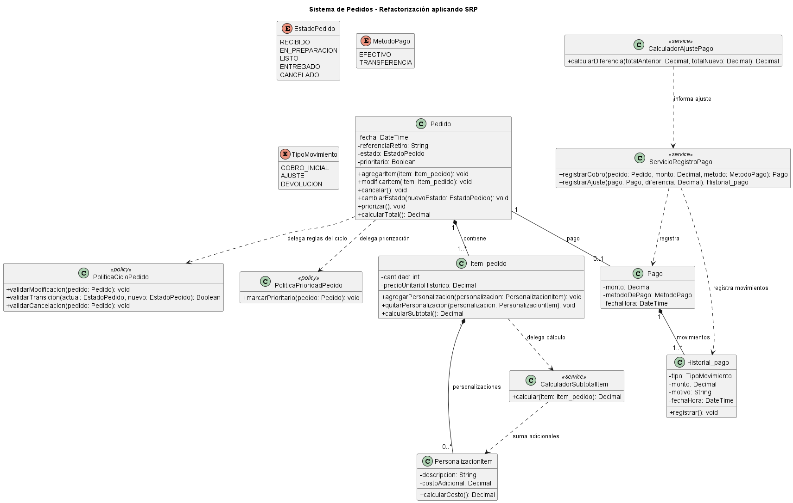

# Principio de Responsabilidad Única (SRP)
## Propósito y Tipo de Principio SOLID
En el diseño inicial del Sistema de Pedidos, clases principales como **Pedido**, **Pago** e **Item_pedido** acumulaban **múltiples responsabilidades no relacionadas** dentro de una misma estructura. esto es un problema ya que hacía que el sistema fuera frágil y difícil de mantener (al modificar algo podías romper la estructura del pedido).

La aplicación del **Principio de Responsabilidad Única (SRP)** soluciona el problema de diseño porque **elimina la fragilidad del sistema al garantizar que cada clase tenga una y solo una razón para cambiar**, debido a que si se realiza algun cambio se modifica la clase especialista encargada, sin riesgo de romper los datos principales del pedido.


 ---
  ## Motivación 
  En el boceto inicial del **Sistema de Pedidos**, la clase **Pedido** actuaba como una "clase Dios" (*God Class*), concentrando múltiples responsabilidades que respondían a motivos de cambio totalmente independientes
  #### Responsabilidades mezcladas en `Pedido`:

- **Gestión de la Estructura de la Orden**: Almacenar y administrar la información propia de la orden (identificador, fecha, referencia de retiro y la colección de ítems).
- **Control del Ciclo de Vida y Transiciones de Estado**: El pedido puede cambiar de estado (de `RECIBIDO` a `EN_PREPARACION`, `LISTO`, `ENTREGADO` o `CANCELADO`) y aplicar reglas de como **bloquear modificaciones si el estado es posterior a** **RECIBIDO**.
- **Priorización del Pedido**: La operación para marcar un pedido como prioritario estaba mezclada con las demás operaciones de `Pedido`. Según el requisito RF7, la marca es manual; no se definen criterios automáticos de prioridad.

#### ¿Por qué esto es un problema?

- **Violación de la Cohesión**: La clase `Pedido` hacía "demasiadas cosas heterogéneas".
* **Alto Acoplamiento y Fragilidad**: Si el equipo comercial decidía cambiar alguna regla, ese cambio arriesgaba romper la estructura básica de almacenamiento de los ítems o la fecha.
* **Dificultad de Testeo**: Para probar unitariamente la regla de si un pedido se puede cancelar en estado `RECIBIDO`, era obligatorio crear un objeto `Pedido` completo con todos sus ítems, cliente y datos adicionales.


  #### ¿Cómo el Principio de Responsabilidad Única (SRP) Soluciona el Problema?

El **Principio de Responsabilidad Única (SRP)** establece formalmente que **una clase debe tener una y solo una razón para cambiar**.

SRP ayuda a separar las responsabilidades que tienen razones de cambio distintas, manteniendo el estado y las operaciones propias del pedido en `Pedido` y delegando la validación del ciclo de vida a una política especializada.


Para resolver el problema en el **Sistema de Pedidos**, se distribuyen las responsabilidades entre la entidad `Pedido`, sus entidades relacionadas y servicios especializados:

```
[ DISEÑO ORIGINAL (SIN SRP) ]
┌────────────────────────────────────────────────────────┐
│ Pedido                                                 │
├────────────────────────────────────────────────────────┤
│ - numeroPedido, fecha, referenciaRetiro, estado                      │
├────────────────────────────────────────────────────────┤
│ + agregarItem(), cancelar()                            │  &lt;-- Estructura
│ + cambiarEstado(), validarModificacionEnRecibido()     │  &lt;-- Ciclo de Vida
│ + priorizar()                                         │  &lt;-- Marcado manual de prioridad
└────────────────────────────────────────────────────────┘

```

 **Refactorización aplicando SRP**:

```
[ DISEÑO REFACTORIZADO (CON SRP) ]

Pedido
  - mantiene sus datos, estado y marca manual de prioridad
  - calcula el total sumando los subtotales de sus ítems
  - delega la validación del ciclo de vida a PoliticaCicloPedido
  - contiene Item_pedido

Item_pedido
  - mantiene la cantidad y el precio unitario histórico
  - calcula su subtotal considerando sus personalizaciones
  - contiene Personalizacion_item

ServicioRegistroPago
  - registra cobros y ajustes en Pago e Historial_pago
CalculadorAjustePago
  - calcula la diferencia entre el total anterior y el nuevo

```


**Desglose de las Clases Refactorizadas**

 **Pedido** :
  * **Responsabilidad**: Representar la orden y mantener la coherencia de sus datos y estado, incluida la marca manual de prioridad; calcula el total a partir de sus ítems.
  * **Razón para Cambiar**: Cambios en los datos y las operaciones propias de una orden.
 **PoliticaCicloPedido** **(Componente/Servicio de Dominio)**:
  * **Responsabilidad Única**: Validar las reglas de negocio asociadas a las modificaciones, transiciones y cancelaciones del pedido. `Pedido` aplica el cambio de estado después de la validación.
  * **Única Razón para Cambiar**: Que cambien las reglas del negocio sobre el flujo de trabajo (por ejemplo, si se habilita modificar un pedido en estado `EN_PREPARACION` o si cambian los requisitos de cancelación).
 **Priorización manual**:
  * `Pedido` expone `marcarPrioritario()` para actualizar su marca de prioridad de forma controlada. No se incluye `PoliticaPrioridadPedido`, ya que el requisito establece una decisión manual y no define reglas automáticas que evaluar.

   ### Estructura de clases

   #### Diagrama UML SRP

   


   ## Justificación Técnica  
   En el diagrama de clases refactorizado se observa una organización estructurada en **tres módulos principales del dominio** (**Módulo Pedido**, **Módulo Pago** y **Módulo Ítem Pedido**):

Las clases y sus relaciones distribuyen las responsabilidades entre componentes enfocados, evitando atribuir a un servicio una decisión de prioridad que el requisito define como manual.

En el **Módulo Pedido**, la entidad **Pedido** mantiene la estructura de la orden, sus ítems, su estado y su marca manual de prioridad. `Pedido` ofrece las operaciones que actualizan su propio estado; antes de las transiciones y cancelaciones, **PoliticaCicloPedido** valida si las reglas del dominio las permiten. No hay una política de prioridad, porque el requisito pide que el usuario marque manualmente el pedido como prioritario.

En el **Módulo Pago**, la clase **Pago** representa el cobro asociado al pedido. **ServicioRegistroPago** registra los cobros y ajustes, y **CalculadorAjustePago** calcula la diferencia entre el total anterior y el nuevo; el servicio registra el movimiento correspondiente en **Historial_pago**.
 
  En el **Módulo Ítem Pedido**, **Item_pedido** mantiene la cantidad y el precio unitario histórico acordado y calcula su propio subtotal, considerando las personalizaciones de **Personalizacion_item**. **Pedido** calcula el total sumando los subtotales de sus ítems. Así, el cálculo del subtotal y el del total tienen alcances distintos, sin duplicar el cálculo del subtotal en un servicio aparte.

Desde un punto de vista técnico, las reglas del ciclo de vida y el cálculo de ajustes se mantienen en componentes especializados, mientras que cada entidad protege la coherencia de sus propios datos. Esta separación facilita probar las reglas y los cálculos de forma aislada y conserva el precio histórico acordado para los ítems.