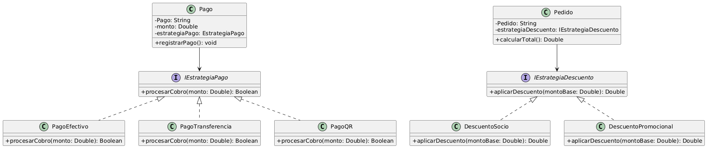

# Principio Abierto/Cerrado (OCP)

## Propósito y Tipo del Principio SOLID
El Principio Abierto/Cerrado (Open/Closed Principle) es un principio de diseño fundamental que establece que las entidades de software (clases, módulos, funciones) deben estar **abiertas para su extensión, pero cerradas para su modificación**. Su propósito principal es permitir que el sistema incorpore nuevos comportamientos o características en el futuro sin riesgo de introducir errores o alterar el código existente que ya ha sido probado y está en funcionamiento.

## Motivación
En el diseño original del sistema, se detectó una fuerte dependencia de estructuras condicionales estáticas en una clase clave del dominio:

1. **Clase `Pago`**: Gestiona el cobro basándose en el atributo `metodoDePago` de tipo `Metodo_pago` (un enum). El Requisito Funcional RF8 establece claramente que **el alcance actual del MVP admite únicamente pagos en EFECTIVO y TRANSFERENCIA**. Sin embargo, los métodos originales `registrarPago()` y `calcularDiferencia()` utilizaban bloques condicionales (`if/else` o `switch`) para procesar el cobro. El problema de este enfoque es que el negocio es dinámico; si en el futuro se desea escalar el sistema, esta estructura obligaría a modificar el código fuente de `Pago` cada vez que se agregue un nuevo medio de pago.

Este caso representa una clara violación del principio OCP, ya que las variaciones futuras fuerzan la modificación directa de clases estables.

## Explicación de Herencia
La herencia es un mecanismo de la Programación Orientada a Objetos que permite a una clase (subclase) derivar atributos y comportamientos de otra (superclase), estableciendo una relación de tipo "es-un". 

Para cumplir con OCP, la herencia (o la implementación de interfaces) se utiliza para crear **abstracciones**. En lugar de que la lógica principal del sistema dependa de clases concretas o enumeraciones llenas de condicionales, depende de superclases abstractas o interfaces estables. Cuando se requiere extender el sistema, simplemente se crea una nueva subclase que hereda de la abstracción e inyecta su propio comportamiento polimórfico, dejando la clase principal y el código existente completamente intactos.

## Estructura de Clases

## Justificación Técnica
El diagrama UML asociado demuestra la aplicación del patrón **Strategy** para resolver las violaciones de OCP en el sistema, respetando el alcance del proyecto:

1. **Estrategia de Pagos**: Se extrajo la lógica condicional de la clase `Pago` hacia una abstracción llamada `IEstrategiaPago`. Alineado con el RF8, derivan las **únicas dos subclases del MVP actual**: `PagoEfectivo` y `PagoTransferencia`. La clase `Pago` delega la ejecución invocando el método polimórfico `procesarCobro()`. Si mañana el negocio decide incorporar extensiones futuras fuera del alcance del MVP (como `PagoQR` o `PagoTarjeta`), solo bastará con crear nuevas subclases sin alterar la clase `Pago`.

2. **Estrategia de Descuentos**: Se aisló el cálculo del total de la clase `Pedido` eliminando los condicionales internos y delegando la responsabilidad a la interfaz `IEstrategiaDescuento`. Las subclases como `DescuentoSocio` y `DescuentoPromocional` implementan el método `aplicarDescuento(montoBase)`. Técnicamente, el sistema está **cerrado a modificaciones** porque para agregar un nuevo tipo de cliente o promoción mañana, bastará con crear una nueva subclase de estrategia de descuento, manteniendo la clase `Pedido` intacta y **abierta a la extensión**.

## Validación mediante Tests
Para garantizar que el sistema cumple verdaderamente con el OCP y prevenir regresiones futuras, el diseño propuesto permite la incorporación de **pruebas unitarias aisladas**. Al testear las lógicas concretas instanciando directamente `PagoEfectivo`, `PagoTransferencia`, `DescuentoSocio` y `DescuentoPromocional` (como implementaciones de sus respectivas interfaces), se demuestra a nivel de código que es posible agregar y validar nuevas reglas de negocio de forma independiente, sin necesidad de instanciar o modificar las clases base `Pago` o `Pedido`.