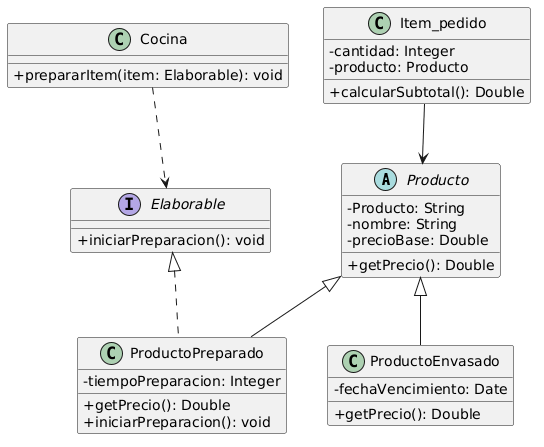

# Principio de Sustitución de Liskov (LSP)

## Propósito y Tipo del Principio SOLID
El Principio de Sustitución de Liskov (Liskov Substitution Principle) es un principio fundamental del diseño orientado a objetos que establece que las clases derivadas (subclases) deben poder sustituir a sus clases base (superclases) sin alterar el funcionamiento correcto del programa ni romper las expectativas del código cliente. Su propósito principal es garantizar que la jerarquía de herencia respete el "Diseño por Contrato", evitando comportamientos inesperados, excepciones en tiempo de ejecución o la necesidad de realizar comprobaciones de tipo explícitas (como `instanceof`) en el cliente.

## Motivación
En nuestro boceto inicial y tarjetas CRC, analizamos la jerarquía donde `ProductoPreparado` y `ProductoEnvasado` heredan de la superclase `Producto`. El problema operativo surge al analizar las responsabilidades en el área de cocina. Si la superclase `Producto` forzara un contrato con el método `iniciarPreparacion()`, la subclase `ProductoPreparado` podría cumplirlo sin problemas. Sin embargo, un `ProductoEnvasado` (que ya está listo para ser entregado) no puede ser "preparado". Si una lista genérica de objetos `Producto` se procesa en la cocina, al intentar invocar `iniciarPreparacion()` sobre un producto envasado, este se vería forzado a arrojar una excepción (ej. `NotImplementedException`) o realizar una operación vacía, rompiendo el flujo del programa y violando el principio LSP.

## Explicación de Herencia
La herencia es un mecanismo de la Programación Orientada a Objetos que crea una relación jerárquica de tipo "es-un" entre una superclase y sus subclases. Para garantizar la sustituibilidad (LSP), no basta con que una clase hija herede la firma de los métodos; debe respetar estrictamente las precondiciones, postcondiciones e invariantes del comportamiento esperado por el cliente. Si un componente del sistema espera interactuar con la superclase `Producto`, debe poder recibir cualquier subclase derivada (`ProductoPreparado` o `ProductoEnvasado`) de manera transparente, sin tener que consultar qué tipo específico es (evitando el uso de condicionales o `instanceof`) y sin recibir respuestas inesperadas.

## Estructura de Clases

## Justificación Técnica
El diagrama UML ilustra la corrección estructural para separar claramente los contratos y garantizar el cumplimiento del LSP:

1. **Contrato Comercial (Precio)**: Entidades como `Producto` (o agrupaciones como `Combo`) se rigen por un contrato estrictamente comercial a través de interfaces como `IElementoMenu` (la cual define `getPrecio()`). Esto garantiza que, desde el punto de vista de la clase `Item_pedido` o la Caja, cualquier elemento de compra pueda ser sustituido perfectamente para calcular subtotales, sin importar su naturaleza.

2. **Contrato Operativo (Preparación)**: Se establece una frontera conceptual clara respecto a la cocina. La capacidad de ser cocinado se ha extraído a una interfaz específica llamada `IElaborable` (que define `iniciarPreparacion()`). Esta interfaz **solo** es implementada por `ProductoPreparado`. Un `Combo` o un `ProductoEnvasado` pueden ser elementos del menú para ser cobrados, pero no son elementos preparables.

3. **Garantía para el Cliente**: La entidad `Cocina` u otros módulos operativos del sistema interactúan únicamente con objetos que implementan `IElaborable`, no con `IElementoMenu`. Esto asegura que los clientes del código operen sobre contratos que los objetos realmente pueden cumplir, protegiendo al sistema de excepciones en tiempo de ejecución y garantizando la sustituibilidad exacta en cada contexto.

## Validación mediante Tests
Para asegurar la correcta sustituibilidad de las clases en el entorno operativo y evitar fallos en producción, este diseño facilita la creación de **pruebas de integración** enfocadas en el módulo `Cocina`. Estos tests deben validar que las dependencias de la `Cocina` aceptan exclusivamente colecciones de objetos `IElaborable`. Esto blinda el sistema y asegura a nivel de pruebas automatizadas que nunca se intentará encolar o preparar un `ProductoEnvasado` o un `Combo` genérico, erradicando definitivamente el riesgo de disparar una `NotImplementedException` por un mal uso de la jerarquía.