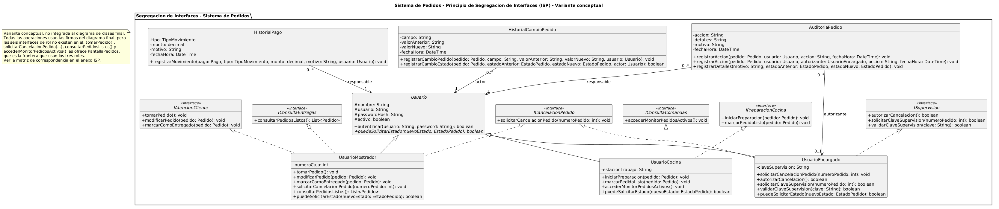

# Principio de Segregación de Interfaces (ISP)

> **Alcance:** este anexo presenta una **variante conceptual no integrada** al diagrama de clases final (`06-clases-diagrama-final.puml`). Todas las operaciones del diagrama ISP usan las mismas firmas que el diagrama final, pero las seis interfaces de rol no forman parte del modelo entregado. La sección [Correspondencia con el diagrama de clases final](#correspondencia-con-el-diagrama-de-clases-final) indica dónde está cada operación en ese modelo.

## Propósito y Tipo del Principio SOLID
El **Principio de Segregación de Interfaces (Interface Segregation Principle - ISP)** es el cuarto principio dentro de los principios SOLID de diseño orientado a objetos.
Su propósito principal es establecer que **ninguna clase debe verse obligada a depender de métodos o interfaces que no utiliza**. En lugar de diseñar interfaces monolíticas ("gordas" o *fat interfaces*), el principio promueve la creación de interfaces pequeñas, cohesivas y especializadas por rol.

---

## Motivación
En el modelo del **Sistema de Pedidos**, observamos diversos tipos de usuarios operativos que heredan de la clase abstracta `Usuario` (`UsuarioMostrador`, `UsuarioCocina`, `UsuarioEncargado`) y diversas entidades que gestionan registros y trazabilidad (`HistorialPago`, `AuditoriaPedido`, `HistorialCambioPedido`).

### Problema Identificado en el Proyecto
Si definiéramos una única interfaz monolítica de gestión operativa (por ejemplo, `IGestionOperativa`) para ser implementada por los usuarios del sistema, esta debería contener todas las operaciones que los casos de uso asignan a los distintos roles:
- `tomarPedido()` (CU1)
- `modificarPedido(pedido)` (CU2)
- `solicitarCancelacionPedido(numeroPedido)` (CU3)
- `marcarComoEntregado(pedido)` (CU4)
- `consultarPedidosListos()` (CU5)
- `iniciarPreparacion(pedido)` (CU4)
- `marcarPedidoListo(pedido)` (CU4)
- `accederMonitorPedidosActivos()` (CU5)
- `autorizarCancelacion()` (CU3)
- `solicitarClaveSupervision(numeroPedido)` (CU3)
- `validarClaveSupervision(clave)` (CU3)

Al intentar aplicar esta interfaz "gorda":
1. **`UsuarioCocina`** solo necesita preparar los pedidos y consultar los pedidos activos (`iniciarPreparacion()`, `marcarPedidoListo()`, `accederMonitorPedidosActivos()`). Al obligarlo a implementar una interfaz monolítica, se vería forzado a incluir métodos vacíos o lanzar excepciones para las otras 8 operaciones, como `autorizarCancelacion()` o `tomarPedido()`.
2. **`UsuarioMostrador`** se encarga de la atención al cliente (`tomarPedido()`, `modificarPedido()`, `solicitarCancelacionPedido()`, `marcarComoEntregado()`) y de consultar los pedidos listos para entregar (`consultarPedidosListos()`), pero no tiene la responsabilidad de autorizar cancelaciones ni de preparar pedidos, por lo que quedaría obligado a implementar otras 6 operaciones que no le corresponden.
3. **`UsuarioEncargado`** participa en la cancelación de pedidos (`solicitarCancelacionPedido()`) y realiza las tareas de supervisión del CU3 (`autorizarCancelacion()`, `solicitarClaveSupervision()` y `validarClaveSupervision()`), y tendría que implementar las otras 7 operaciones sin necesitarlas.

### Ejemplo del problema (pseudocódigo)
Con la interfaz monolítica, `UsuarioCocina` terminaría escribiendo código como el siguiente:

```text
clase UsuarioCocina implementa IGestionOperativa:

    iniciarPreparacion(pedido)                  -> lógica real
    marcarPedidoListo(pedido)                   -> lógica real
    accederMonitorPedidosActivos()              -> lógica real

    tomarPedido()                               -> lanzar NotImplementedException
    modificarPedido(pedido)                     -> lanzar NotImplementedException
    solicitarCancelacionPedido(numeroPedido)    -> lanzar NotImplementedException
    marcarComoEntregado(pedido)                 -> lanzar NotImplementedException
    consultarPedidosListos()                    -> lanzar NotImplementedException
    autorizarCancelacion()                      -> lanzar NotImplementedException
    solicitarClaveSupervision(numeroPedido)     -> lanzar NotImplementedException
    validarClaveSupervision(clave)              -> lanzar NotImplementedException
```

Cualquier código que reciba una `IGestionOperativa` podría invocar uno de esos métodos y provocar un error en tiempo de ejecución. Segregar las interfaces elimina ese riesgo desde el diseño.

### Comparación: antes y después

| Clase | Métodos exigidos por la interfaz gorda | Métodos que realmente usa | Métodos innecesarios | Con interfaces segregadas |
| :---- | :-: | :-: | :-: | :------------------------ |
| `UsuarioMostrador` | 11 | 5 | 6 | Implementa `IAtencionCliente`, `ICancelacionPedido` e `IConsultaEntregas` (5 métodos) |
| `UsuarioCocina` | 11 | 3 | 8 | Implementa `IPreparacionCocina` e `IConsultaComandas` (3 métodos) |
| `UsuarioEncargado` | 11 | 4 | 7 | Implementa `ICancelacionPedido` e `ISupervision` (4 métodos) |

### Registros y trazabilidad: por qué no se unifican
Las clases `HistorialPago`, `AuditoriaPedido` e `HistorialCambioPedido` registran hechos distintos: movimientos de dinero, acciones realizadas sobre un pedido y cambios de campos o de estado de un pedido, respectivamente. Aunque las tres exponen operaciones de registro (`registrarMovimiento(...)`, `registrarAccion(...)` y `registrarCambioPedido(...)`/`registrarCambioEstado(...)`), **compartir el propósito de registrar no justifica una interfaz común**. Unificarlas bajo un contrato genérico (por ejemplo, `IRegistrable`) no aportaría beneficio alguno, porque ningún componente del sistema necesita tratarlas de forma polimórfica, y las obligaría a depender de un contrato que no refleja la naturaleza distinta de cada registro.

Por eso, **no se crea una interfaz para estas clases**: cada una conserva sus propias operaciones, con las mismas firmas que en el diagrama de clases final. Si en el futuro surgiera un consumidor real que necesite usar varias de ellas mediante el mismo contrato, se podría introducir una interfaz específica en ese momento, y no antes.

---

## Explicación de Interfaces
En la Programación Orientada a Objetos (POO), una **interfaz** es un contrato abstracto que define *qué* operaciones debe ofrecer un objeto que la implemente, sin imponer cómo debe llevarlas a cabo.

Para cumplir con el principio ISP en nuestro sistema, las interfaces operan como **roles específicos**. En lugar de obligar a que las subclases de `Usuario` asuman contratos generales con métodos irrelevantes, diseñamos interfaces segregadas agrupando comportamientos cohesivos. Además, ISP no implica crear una interfaz por cada clase: una abstracción solo se justifica cuando existe una necesidad real de usar distintas clases mediante el mismo contrato.

---

## Estructura de Clases



Para resolver la rigidez del diseño, se segregaron las responsabilidades de los usuarios en interfaces pequeñas y especializadas:
- **`IAtencionCliente`**: Define las operaciones de atención en el mostrador (`tomarPedido()`, `modificarPedido(pedido)`, `marcarComoEntregado(pedido)`).
- **`ICancelacionPedido`**: Define la solicitud de cancelación de un pedido (`solicitarCancelacionPedido(numeroPedido)`), que el caso de uso *Cancelar pedido* (CU3) asigna tanto al usuario de mostrador como al encargado. Se separó de `IAtencionCliente` y de `ISupervision` para que cada actor dependa únicamente de la cancelación, sin cargar con las demás funciones de atención al cliente ni de supervisión.
- **`IConsultaEntregas`**: Permite al mostrador consultar los pedidos que ya están listos para entregar (`consultarPedidosListos()`).
- **`IPreparacionCocina`**: Contiene exclusivamente las operaciones de preparación en cocina (`iniciarPreparacion(pedido)`, `marcarPedidoListo(pedido)`).
- **`IConsultaComandas`**: Permite a la cocina acceder al monitor de pedidos activos pendientes de preparación (`accederMonitorPedidosActivos()`).
- **`ISupervision`**: Agrupa las operaciones de supervisión del encargado en la cancelación de pedidos EN_PREPARACION (`autorizarCancelacion()`, `solicitarClaveSupervision(numeroPedido)`, `validarClaveSupervision(clave)`).

`Usuario` conserva `autentificar(usuario, password)` y la operación abstracta `puedeSolicitarEstado(nuevoEstado)`, que cada rol redefine, igual que en el diagrama de clases final. Ninguna de las dos forma parte de las interfaces de rol porque todos los usuarios las necesitan.

---

## Correspondencia con el diagrama de clases final

El diagrama ISP es una **variante conceptual**. Las firmas de todas las operaciones coinciden con el diagrama de clases final; lo que no está integrado son las interfaces de rol y la asignación de algunas operaciones a las subclases de `Usuario`.

| Interfaz (variante ISP) | Operación | Clase que la declara en el diagrama de clases final | Caso de uso |
|---|---|---|---|
| `IAtencionCliente` | `tomarPedido(): void` | `PantallaPedidos` | CU1 |
| `IAtencionCliente` | `modificarPedido(pedido: Pedido): void` | `UsuarioMostrador` | CU2 |
| `IAtencionCliente` | `marcarComoEntregado(pedido: Pedido): void` | `UsuarioMostrador` | CU4 |
| `ICancelacionPedido` | `solicitarCancelacionPedido(numeroPedido: int): void` | `PantallaPedidos` | CU3 |
| `IConsultaEntregas` | `consultarPedidosListos(): List<Pedido>` | `PantallaPedidos` | CU5 |
| `IPreparacionCocina` | `iniciarPreparacion(pedido: Pedido): void` | `UsuarioCocina` | CU4 |
| `IPreparacionCocina` | `marcarPedidoListo(pedido: Pedido): void` | `UsuarioCocina` | CU4 |
| `IConsultaComandas` | `accederMonitorPedidosActivos(): void` | `PantallaPedidos` | CU5 |
| `ISupervision` | `autorizarCancelacion(): boolean` | `UsuarioEncargado` | CU3 |
| `ISupervision` | `solicitarClaveSupervision(numeroPedido: int): boolean` | `UsuarioEncargado` | CU3 |
| `ISupervision` | `validarClaveSupervision(clave: String): boolean` | `UsuarioEncargado` | CU3 |

- **Interfaces de rol:** no existen en el diagrama de clases final. Allí, las operaciones de interacción (`tomarPedido()`, `solicitarCancelacionPedido(...)`, `consultarPedidosListos()` y `accederMonitorPedidosActivos()`) las ofrece `PantallaPedidos`, que es la frontera que usan los tres roles. Adoptar la variante implicaría agregar las seis interfaces y que cada subclase de `Usuario` implemente las que le corresponden.
- **Registros:** `HistorialPago`, `AuditoriaPedido` e `HistorialCambioPedido` tienen los mismos atributos, operaciones y asociaciones con `Usuario` que en el diagrama de clases final.
- **Devoluciones:** el diagrama no incluye ninguna operación para registrar devoluciones manuales por cancelación, porque el CU3 no las modela: la cancelación de pedidos LISTO o ENTREGADO queda bloqueada.
