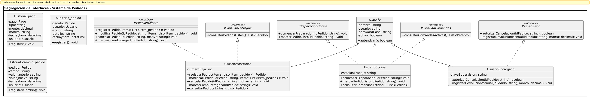

# Principio de Segregación de Interfaces (ISP)

## Propósito y Tipo del Principio SOLID
El **Principio de Segregación de Interfaces (Interface Segregation Principle - ISP)** es el cuarto principio dentro de los principios SOLID de diseño orientado a objetos.
Su propósito principal es establecer que **ninguna clase debe verse obligada a depender de métodos o interfaces que no utiliza**. En lugar de diseñar interfaces monolíticas ("gordas" o *fat interfaces*), el principio promueve la creación de interfaces pequeñas, cohesivas y especializadas por rol.

---

## Motivación
En el modelo del **Sistema de Pedidos**, observamos diversos tipos de usuarios operativos que heredan de la clase abstracta `Usuario` (`UsuarioMostrador`, `UsuarioCocina`, `UsuarioEncargado`) y diversas entidades que gestionan registros y trazabilidad (`Historial_pago`, `Auditoria_pedido`, `Historial_cambio_pedido`).

### Problema Identificado en el Proyecto
Si definiéramos una única interfaz monolítica de gestión operativa (por ejemplo, `IProcesamientoSistema` o `IGestionOperativa`) para ser implementada por los usuarios del sistema, esta debería contener métodos como:
- `registrarPedido()`
- `modificarPedido()`
- `cancelarPedido()`
- `marcarComoEntregado()`
- `consultarPedidosListos()`
- `comenzarPreparacion()`
- `marcarPedidoListo()`
- `consultarComandasActivas()`
- `autorizarCancelacion()`
- `registrarDevolucionManual()`

Al intentar aplicar esta interfaz "gorda":
1. **`UsuarioCocina`** solo necesita preparar los pedidos y consultar las comandas activas (`comenzarPreparacion()`, `marcarPedidoListo()`, `consultarComandasActivas()`). Al obligarlo a implementar una interfaz monolítica, se vería forzado a incluir métodos vacíos o lanzar excepciones para las otras 7 operaciones, como `autorizarCancelacion()` o `registrarPedido()`.
2. **`UsuarioMostrador`** se encarga de la atención al cliente y cobro (`registrarPedido()`, `modificarPedido()`, `cancelarPedido()`, `marcarComoEntregado()`) y de consultar los pedidos listos para entregar (`consultarPedidosListos()`), pero no tiene la responsabilidad de autorizar cancelaciones ni supervisar estaciones de cocina, por lo que quedaría obligado a implementar otras 5 operaciones que no le corresponden.
3. **`UsuarioEncargado`** realiza tareas avanzadas de supervisión como `autorizarCancelacion()` y `registrarDevolucionManual()`, y tendría que implementar las otras 8 operaciones sin necesitarlas.

### Ejemplo del problema (pseudocódigo)
Con la interfaz monolítica, `UsuarioCocina` terminaría escribiendo código como el siguiente:

```text
clase UsuarioCocina implementa IGestionOperativa:

    comenzarPreparacion(idPedido)       -> lógica real
    marcarPedidoListo(idPedido)         -> lógica real
    consultarComandasActivas()          -> lógica real

    registrarPedido(...)                -> lanzar NotImplementedException
    modificarPedido(...)                -> lanzar NotImplementedException
    cancelarPedido(...)                 -> lanzar NotImplementedException
    marcarComoEntregado(...)            -> lanzar NotImplementedException
    consultarPedidosListos()            -> lanzar NotImplementedException
    autorizarCancelacion(...)           -> lanzar NotImplementedException
    registrarDevolucionManual(...)      -> lanzar NotImplementedException
```

Cualquier código que reciba una `IGestionOperativa` podría invocar uno de esos métodos y provocar un error en tiempo de ejecución. Segregar las interfaces elimina ese riesgo desde el diseño.

### Comparación: antes y después

| Clase | Métodos exigidos por la interfaz gorda | Métodos que realmente usa | Métodos innecesarios | Con interfaces segregadas |
| :---- | :-: | :-: | :-: | :------------------------ |
| `UsuarioMostrador` | 10 | 5 | 5 | Implementa `IAtencionCliente` e `IConsultaEntregas` (5 métodos) |
| `UsuarioCocina` | 10 | 3 | 7 | Implementa `IPreparacionCocina` e `IConsultaComandas` (3 métodos) |
| `UsuarioEncargado` | 10 | 2 | 8 | Implementa solo `ISupervision` (2 métodos) |

### Registros y trazabilidad: por qué no se unifican
Las clases `Historial_pago`, `Auditoria_pedido` e `Historial_cambio_pedido` registran hechos distintos: movimientos de dinero, acciones realizadas sobre un pedido y cambios de campos de un pedido, respectivamente. Aunque las tres exponen una operación de registro, **compartir un nombre de método no justifica una interfaz común**. Unificarlas bajo un contrato genérico (por ejemplo, `IRegistrable`) no aportaría beneficio alguno, porque ningún componente del sistema necesita tratarlas de forma polimórfica, y las obligaría a depender de un contrato que no refleja la naturaleza distinta de cada registro.

Por eso, **no se crea una interfaz para estas clases**: cada una conserva su propia operación cohesiva. Si en el futuro surgiera un consumidor real que necesite usar varias de ellas mediante el mismo contrato, se podría introducir una interfaz específica en ese momento, y no antes.

---

## Explicación de Interfaces
En la Programación Orientada a Objetos (POO), una **interfaz** es un contrato abstracto que define *qué* operaciones debe ofrecer un objeto que la implemente, sin imponer cómo debe llevarlas a cabo.

Para cumplir con el principio ISP en nuestro sistema, las interfaces operan como **roles específicos**. En lugar de obligar a que las subclases de `Usuario` asuman contratos generales con métodos irrelevantes, diseñamos interfaces segregadas agrupando comportamientos cohesivos. Además, ISP no implica crear una interfaz por cada clase: una abstracción solo se justifica cuando existe una necesidad real de usar distintas clases mediante el mismo contrato.

---

## Estructura de Clases

Para resolver la rigidez del diseño, se segregaron las responsabilidades de los usuarios en interfaces pequeñas y especializadas:
- **`IAtencionCliente`**: Define las operaciones de atención en caja o mostrador (`registrarPedido()`, `modificarPedido()`, `cancelarPedido()`, `marcarComoEntregado()`).
- **`IConsultaEntregas`**: Permite al mostrador consultar los pedidos que ya están listos para entregar (`consultarPedidosListos()`).
- **`IPreparacionCocina`**: Contiene exclusivamente las operaciones de preparación en cocina (`comenzarPreparacion()`, `marcarPedidoListo()`).
- **`IConsultaComandas`**: Permite a la cocina consultar las comandas activas pendientes de preparación (`consultarComandasActivas()`).
- **`ISupervision`**: Agrupa únicamente los permisos y acciones avanzadas del encargado (`autorizarCancelacion()`, `registrarDevolucionManual()`).

Las consultas se separaron por rol porque el caso de uso *Consultar Pedidos Activos* define vistas diferenciadas por actor: la cocina visualiza los pedidos en estado `RECIBIDO` y `EN_PREPARACION`, mientras que el mostrador visualiza los pedidos en estado `LISTO`. De esta forma, cada rol depende únicamente de la consulta que necesita.

Las clases de registro (`Historial_pago`, `Auditoria_pedido` e `Historial_cambio_pedido`) no implementan interfaces: cada una mantiene su propia operación de registro (`registrar()` en `Historial_pago` y `Auditoria_pedido`, y `registrarCambio()` en `Historial_cambio_pedido`).

### Relación entre clases, interfaces y casos de uso

| Clase | Interfaces que implementa | Casos de uso relacionados |
| :---- | :------------------------ | :------------------------ |
| `UsuarioMostrador` | `IAtencionCliente`, `IConsultaEntregas` | Tomar pedido, Modificar pedido, Cancelar pedido (solicitud del cliente), Cambiar estado de `LISTO` a `ENTREGADO`, Consultar pedidos activos (vista de entregas) |
| `UsuarioCocina` | `IPreparacionCocina`, `IConsultaComandas` | Cambiar estado de `RECIBIDO` a `EN_PREPARACION` y de `EN_PREPARACION` a `LISTO`, Consultar pedidos activos (vista de comandas) |
| `UsuarioEncargado` | `ISupervision` | Cancelar pedido: autorización de cancelaciones en preparación y devoluciones manuales |

### Diagrama UML - ISP



> **Ver archivo de origen PlantUML:** [01-solid-04-isp.puml](../../diagramas/01-diagrama-clases/01-solid-04-isp.puml)

---

## Relación con otros principios

ISP también se aplica en otras partes del diseño, documentadas en sus respectivos anexos:
- **`IElaborable` ([LSP](./03-lsp.md))**: contrato mínimo para lo que se puede preparar en cocina. Lo implementa solo `ProductoPreparado`, de modo que `ProductoEnvasado` no queda obligado a un método que no puede cumplir. No debe confundirse con `IPreparacionCocina`: `IElaborable` describe una capacidad de un **producto**, mientras que `IPreparacionCocina` describe las operaciones de un **rol de usuario**.
- **`IElementoMenu` ([DIP](./05-dip.md))**: expone solo el nombre y el precio, que es lo único que `Item_pedido` necesita de un producto o combo.

Siguiendo el criterio de no abstraer por anticipado, no se crearon interfaces para `Pago`, `Item_pedido` ni `Personalizacion_item`, ya que el diseño actual no muestra consumidores ni variantes que lo justifiquen.

---

## Justificación Técnica
Al observar la refactorización aplicada al diagrama UML del sistema, se constatan las siguientes ventajas técnicas:

1. **Eliminación de interfaces "gordas":** Se descompusieron las responsabilidades operativas en interfaces cohesivas orientadas a cada rol operativo del sistema. Como muestra la comparación anterior, la interfaz monolítica obligaba a cada usuario a implementar entre 5 y 8 métodos que no le corresponden; con la segregación, cada clase implementa solo lo que usa.
2. **Cohesión y Especificidad de Clases:**
   - `UsuarioMostrador` implementa `IAtencionCliente` e `IConsultaEntregas`.
   - `UsuarioCocina` implementa `IPreparacionCocina` e `IConsultaComandas`.
   - `UsuarioEncargado` implementa únicamente `ISupervision`, ya que en los casos de uso su intervención se limita a autorizar cancelaciones y registrar devoluciones.
   - `Historial_pago`, `Auditoria_pedido` e `Historial_cambio_pedido` no implementan interfaces, ya que registran hechos distintos y ningún consumidor del sistema las necesita bajo un mismo contrato.
3. **Sin abstracciones innecesarias:** Al no crear una interfaz genérica de registro, se evita acoplar entidades de trazabilidad diferentes a un contrato que no representa una necesidad real, y se mantiene el diseño alineado con el análisis del [informe del especialista en ISP](../../ia/primer-parcial/especialista-isp.md).
4. **Consistencia con los casos de uso:** Cada interfaz corresponde a operaciones definidas en los casos de uso del sistema, y las firmas del diagrama incluyen parámetros y tipos de retorno para que el contrato sea explícito.
5. **Mantenibilidad y Mínimo Acoplamiento:** Si el día de mañana se modifica la lógica o la firma de los métodos en la interfaz de cocina (`IPreparacionCocina`), las clases de mostrador o encargado no se verán afectadas ni requerirán recompilación o ajustes.