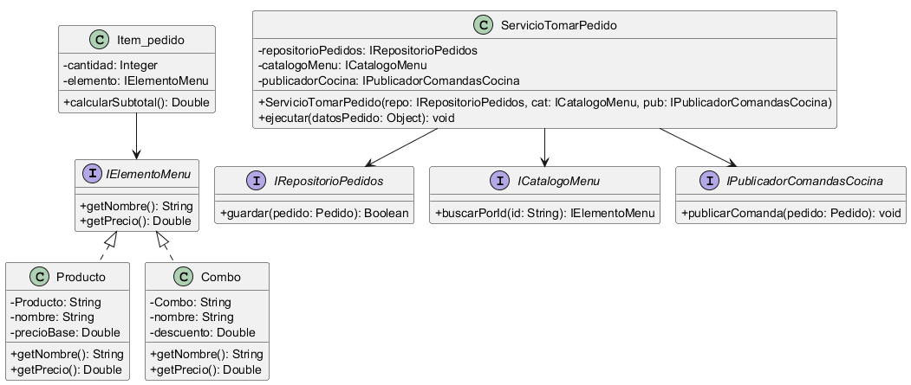

# Principio de Inversión de Dependencias (DIP)

## Propósito y Tipo del Principio SOLID
El Principio de Inversión de Dependencias (DIP) es un principio de diseño estructural y arquitectónico. Su propósito establece que los módulos de alto nivel (la lógica de negocio central) no deben depender de los módulos de bajo nivel (detalles de infraestructura, bases de datos o UI). Ambos deben depender de abstracciones (interfaces o clases abstractas). Además, las abstracciones no deben depender de los detalles, sino que los detalles deben depender de las abstracciones.

## Motivación
En el boceto inicial del sistema, se detectaron dos problemas principales de acoplamiento que violan este principio y dificultan la mantenibilidad:

1. **Acoplamiento de Dominio:** La clase `Item_pedido` dependía directamente de la clase concreta `Producto`, dejando a la clase `Combo` aislada. Esto contradice el Requisito Funcional RF1, que permite incluir tanto productos individuales como combos dentro de un mismo pedido.

2. **Acoplamiento de Infraestructura:** El sistema requiere guardar los pedidos y enviarlos automáticamente a la cocina (RF2). Si los servicios del sistema (módulos de alto nivel) instancian directamente conexiones a bases de datos específicas o envían datos a pantallas físicas concretas (módulos de bajo nivel), el software se vuelve rígido, frágil e imposible de probar mediante pruebas unitarias aislando la infraestructura.

## Explicación de Clases Abstractas e Interfaces
En el Diseño Orientado a Objetos (DOO), las abstracciones son las herramientas principales para desacoplar componentes y cumplir con este principio:

* **Clase Abstracta:** Es una clase que no se puede instanciar directamente y que sirve como plantilla base para una jerarquía de clases. Puede contener tanto firmas de métodos como implementaciones de código o atributos compartidos por sus subclases.
* **Interfaz:** Es un contrato puro que define un conjunto de operaciones que una clase concreta debe implementar, sin proveer ningún tipo de código fuente ni estado interno.

Para cumplir con DIP, se invierten las dependencias introduciendo interfaces en los límites del sistema. En lugar de que la lógica de negocio llame a una tecnología externa concreta, la lógica define una interfaz (un "puerto"). Las herramientas tecnológicas externas actúan como adaptadores concretos que cumplen ese contrato, garantizando que el flujo de dependencias apunte siempre hacia el interior, protegiendo las políticas de alto nivel.

## Estructura de Clases

## Justificación Técnica
El diagrama muestra la resolución de las dependencias a través de inyección e interfaces:

1. **Abstracción en el Catálogo (`IElementoMenu`):** Se creó la interfaz `IElementoMenu`. Tanto `Producto` como `Combo` implementan esta abstracción. Ahora, `Item_pedido` depende únicamente de la interfaz `IElementoMenu` (obteniendo el nombre y precio vigente), desconectándose de las clases concretas y permitiendo futuras extensiones del catálogo.

2. **Puertos de Infraestructura:** Para resolver el RF2, se definieron las interfaces `IRepositorioPedidos` (para la persistencia) y `IPublicadorComandasCocina` (para notificar a la cocina sin acoplarse a una tecnología de red o pantalla específica). 

3. **Inyección de Dependencias:** Los casos de uso son manejados por servicios de aplicación (como `ServicioTomarPedido`). Este servicio no crea sus propias dependencias tecnológicas instanciando clases concretas con la palabra reservada `new`, sino que recibe las implementaciones a través de su constructor (inyección de dependencias). Esto asegura que el servicio orqueste la lógica pura (construye el pedido y solicita su persistencia/publicación) sin conocer *cómo* se guarda en la base de datos o *cómo* se envía la red.

## Validación mediante Tests
El beneficio inmediato y cuantificable de aplicar DIP mediante la Inyección de Dependencias es la mejora en la **testabilidad**. Al depender de interfaces (`IRepositorioPedidos` e `IPublicadorComandasCocina`) en lugar de clases de infraestructura concretas, el diseño facilita la creación de **Mocks** o **Stubs** (objetos simulados en memoria) de estos repositorios. 

Esto permite probar de forma aislada la lógica de negocio del `ServicioTomarPedido`, sin depender de una base de datos real o de hardware físico. Por ejemplo, si el servicio implementara la validación de pedidos vacíos o el cálculo del total, estos comportamientos podrían validarse rápidamente mediante pruebas unitarias. La cobertura final y el éxito de estas pruebas dependerán, naturalmente, de los casos concretos que el equipo de desarrollo decida implementar.