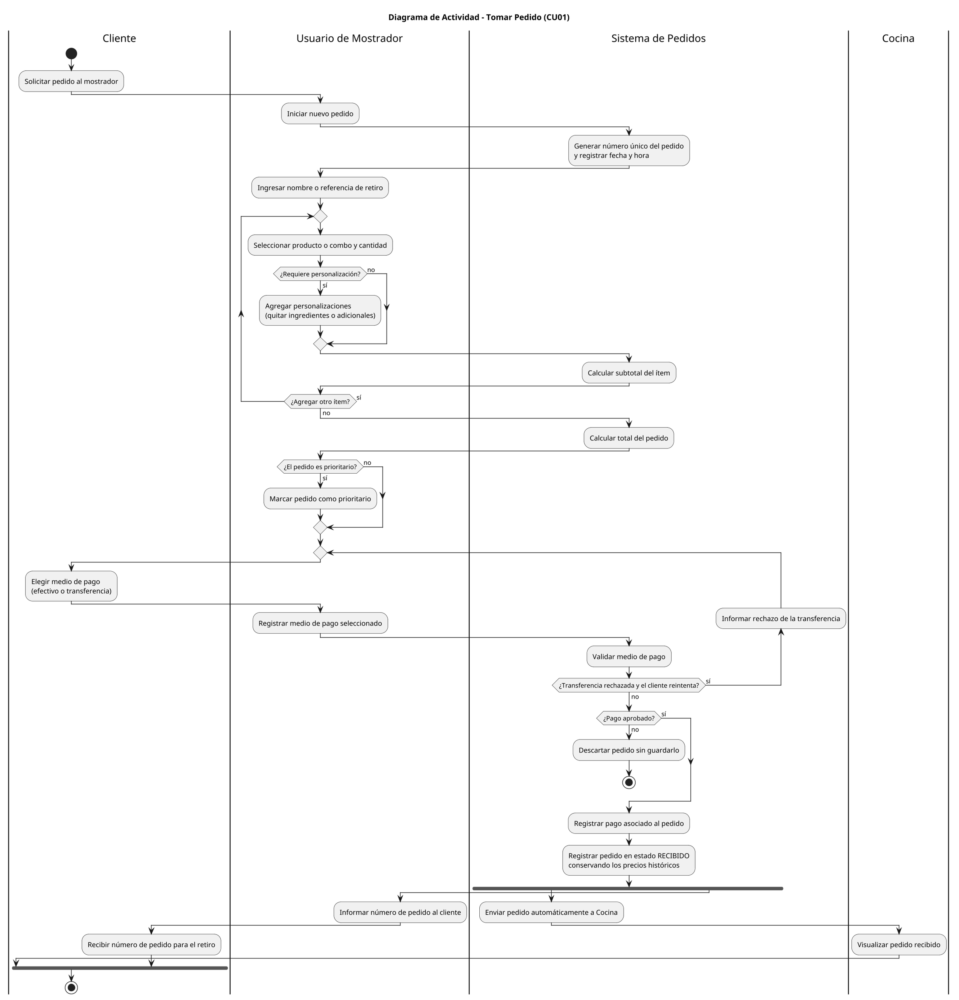
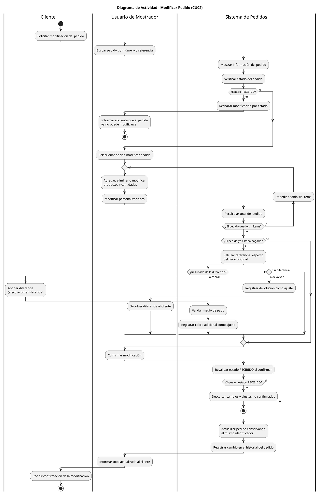

# Informe de Interacción con IA - Especialista en Diagramas de Actividades (CU1 y CU2)

**Rol:** Especialista en Diagramas de Actividades - Casos de Uso 1 y 2

**Autor:** Santiago Medel Marquez

**Herramienta utilizada:** Claude Code (modelo Claude Opus 5.5), extensión de VS Code

> **Aclaración:** la consigna indica GitHub Copilot como herramienta. Para este rol se utilizó Claude Code en modo agente dentro de VS Code, que cumple la misma función: lee los archivos del repositorio como contexto y genera los diagramas PlantUML. Se documenta la herramienta real utilizada.

---

## 1. Archivos de contexto referenciados

- `diagramas/02-casos-de-uso/02-caso-uso-tomar-pedido-01.puml`: actores, límite del sistema y relaciones `<<include>>`/`<<extend>>` del CU1.
- `diagramas/02-casos-de-uso/02-caso-uso-modificar-pedido-02.puml`: actores, límite del sistema y relaciones `<<include>>`/`<<extend>>` del CU2.
- `diagramas/03-escenarios-casos-de-uso/03-tomar-pedido-registro-pedido-01.md`: pasos del flujo principal, precondiciones y aspectos sobresalientes del CU1.
- `diagramas/03-escenarios-casos-de-uso/03-modificar-pedido-modificacion-recibido-01.md`: pasos del flujo principal, precondiciones y aspectos sobresalientes del CU2.
- `ACTIVIDAD_OBLIGATORIA_N_3.pdf`: consigna de la actividad, adjuntada al chat (requisitos mínimos, nomenclatura de archivos y formato del índice).

---

## 2. Prompt utilizado

Se adjuntó la consigna en PDF y se envió el siguiente pedido:

```text
podemos hacer mi parte que es el especialista de diagramas caso 1 y 2
```

Durante la generación se agregaron estas indicaciones:

```text
no lo subas todavia
```

```text
solo armemos la base para tener todo armado
```

Con ese pedido, la IA leyó por su cuenta los archivos de contexto de la sección 1 y tomó de la consigna los requisitos: al menos 10 actividades y 3 carriles por diagrama, decisiones, bifurcaciones y caminos alternativos, y la nomenclatura `04-actividad-nombre-caso-uso-0X.puml`.

---

## 3. Output obtenido

La IA generó los dos diagramas, los exportó a `.png` con PlantUML, revisó las imágenes renderizadas y creó el índice `diagramas_de_actividades.md`.

### Caso de Uso 1 - Tomar Pedido



### Caso de Uso 2 - Modificar Pedido



### Decisiones de diseño tomadas por la IA

- **Carriles del CU1:** Cliente, Usuario de Mostrador, Sistema de Pedidos y Cocina, tomados de los actores del diagrama de casos de uso. El Cliente participa porque solicita el pedido, elige el medio de pago y recibe el número para el retiro.
- **Carriles del CU2:** Cliente, Usuario de Mostrador y Sistema de Pedidos. Cocina no se incluyó porque no es actor del CU2 ni interviene en el escenario.
- **Pasos del escenario:** cada paso del flujo principal de A2 se representa como actividad, en el mismo orden.
- **Caminos alternativos:** salen de los `<<extend>>` de los diagramas de casos de uso: "Marcar pedido como prioritario" y "Resolver rechazo de transferencia" en el CU1; "Rechazar modificación por estado", "Impedir pedido sin ítems" y "Registrar ajuste de cobro" en el CU2.
- **Reglas de negocio de los escenarios:** en el CU1, el pedido no se guarda si la transferencia es rechazada. En el CU2, el estado `RECIBIDO` se revalida al confirmar, el identificador no cambia y cada cobro adicional o devolución se registra como ajuste separado.
- **Bifurcación (fork) en el CU1:** el envío automático a Cocina y el aviso del número de pedido al cliente ocurren en paralelo una vez registrado el pedido.

---

## 4. Ajustes realizados al output de la IA

- No se realizaron ajustes manuales: los diagramas se versionaron tal como los generó la IA, después de revisar los `.png` renderizados.

---

## 5. Iteraciones relevantes

- **Iteración 1:** se pidió no subir los cambios al repositorio todavía. La IA trabajó solo de forma local, sin commit ni push.
- **Iteración 2:** se pidió armar la base del rol. La IA creó la rama `feature/esp-actividades-1-2-add-diagrama-actividad-1`, la carpeta `diagramas/04-diagramas-actividades/`, los dos diagramas con sus `.png`, el índice, este informe y la entrada del `changelog.md`.
- **Iteración 3:** se pidió subir el trabajo. La IA hizo el commit y el push de la rama `feature/esp-actividades-1-2-add-diagrama-actividad-1` al repositorio.

---

## 6. Resultado final

- [Diagrama de Actividad - Tomar Pedido](../../diagramas/04-diagramas-actividades/04-actividad-tomar-pedido-01.png)
- [Diagrama de Actividad - Modificar Pedido](../../diagramas/04-diagramas-actividades/04-actividad-modificar-pedido-02.png)
