# Documentación del uso de Inteligencia Artificial — Especialista en Patrón de Diseño de Comportamiento

---

**Proyecto:** SistemaPedidos  
**Rol:** Especialista en Patrón de Diseño de Comportamiento  
**Patrón seleccionado:** State (Estado)

---

## 1. Archivos referenciados

- `diagramas/01-diagrama-clases/06-clases-diagrama-final.puml`
- `diagramas/01-diagrama-clases/01-solid-01-srp.puml`
- `diagramas/01-diagrama-clases/01-solid-02-ocp.puml`
- `diagramas/01-diagrama-clases/01-solid-03-lsp.puml`
- `diagramas/01-diagrama-clases/01-solid-04-isp.puml`
- `diagramas/01-diagrama-clases/01-solid-05-dip.puml`

---

## 2. Prompts utilizados

### Iteración 1 — Análisis del sistema y selección del patrón

```text
Actuá como arquitecto de software especialista en Diseño Orientado a Objetos (DOO) y Patrones de Diseño GoF de Comportamiento.

### Contexto obligatorio a analizar
Leé y analizá en profundidad únicamente estos archivos del repositorio antes de responder:
- diagramas/01-diagrama-clases/01-diagrama-clases-final.puml (si no existe con ese nombre, usá diagramas/01-diagrama-clases/06-clases-diagrama-final.puml)
- diagramas/01-diagrama-clases/01-solid-01-srp.puml
- diagramas/01-diagrama-clases/01-solid-02-ocp.puml
- diagramas/01-diagrama-clases/01-solid-03-lsp.puml
- diagramas/01-diagrama-clases/01-solid-04-isp.puml
- diagramas/01-diagrama-clases/01-solid-05-dip.puml

### Objetivo de esta fase (SOLO ANÁLISIS, NO CREES NI MODIFIQUES ARCHIVOS TODAVÍA)
1. Detectá problemas concretos de comportamiento, asignación de responsabilidades o comunicación entre objetos existentes en el diseño actual del sistema.
2. Evaluá cuál de estos 6 patrones GoF de comportamiento resuelve de forma más natural, útil y técnicamente sólida un problema real del sistema (sin forzarlo ni duplicar soluciones ya resueltas en los diagramas SOLID):
   - Observer (dependencia uno-a-muchos para reaccionar a cambios de estado sin acoplamiento fuerte)
   - Strategy (familia de algoritmos intercambiables encapsulados para eliminar condicionales rígidos)
   - Command (encapsular peticiones como objetos para desacoplar invocador/receptor, encolar o deshacer)
   - State (variar el comportamiento de un objeto según su estado interno extrayendo cada estado a una clase)
   - Template Method (esqueleto fijo de algoritmo en superclase delegando pasos variables a subclases)
   - Chain of Responsibility (encadenar manejadores para procesar una solicitud a lo largo de la cadena)

### Reglas estrictas
- NO inventes clases de dominio ni casos de uso que no existan en los archivos de contexto.
- Respetá exactamente la nomenclatura, el idioma (español), el estilo de nombres de clases, atributos y métodos que ya usa el repositorio.
- Las únicas clases/interfaces nuevas permitidas son las estrictamente necesarias para implementar la estructura clásica del patrón GoF elegido (por ejemplo: interfaz del patrón y sus implementaciones concretas basadas en conceptos reales del dominio).
- Verificá que el patrón elegido sea coherente con los principios SOLID ya aplicados en los 5 diagramas SOLID del contexto.

### Formato de respuesta esperado
1. Top 2 o 3 problemas reales detectados en el diagrama actual, indicando las clases exactas involucradas.
2. Tabla comparativa breve evaluando qué patrón encaja mejor para cada problema y por qué descartar los demás.
3. Recomendación final única con:
   - Patrón elegido y justificación técnica.
   - Lista exacta de clases existentes que participan (sin cambios de nombre).
   - Lista exacta de nuevas interfaces/clases que introduce el patrón y su rol.
   - Confirmación de coherencia con SRP, OCP, LSP, ISP y DIP.

Esperá mi confirmación antes de generar archivos.
```

### Iteración 2 — Generación del diagrama PlantUML y documento del anexo

```text
Confirmo la elección del patrón State sobre `Pedido` y su ciclo de vida. Volviendo sobre tu respuesta anterior, avanzá con la creación de los archivos aplicando obligatoriamente estos ajustes técnicos sobre tu propuesta inicial:

### Ajustes obligatorios sobre tu propuesta anterior
1. Mecanismo real de transición de estado (GoF State):
   - En `IEstadoPedido`, los métodos que provocan transición deben recibir el contexto `pedido: Pedido` como parámetro para poder cambiar el estado del pedido mediante delegación (por ejemplo: `validarTransicion(nuevoEstado: EstadoPedido, actor: Usuario): boolean`, `cambiarEstado(pedido: Pedido, nuevoEstado: EstadoPedido, actor: Usuario): void`, `cancelarPedido(pedido: Pedido, motivo: String, actor: Usuario): void` y `obtenerEstado(): EstadoPedido`).
   - En `Pedido`, incluí la referencia al estado actual (`- estadoActual: IEstadoPedido`) y el método correspondiente para actualizar la instancia de estado (por ejemplo `+ establecerEstado(nuevoEstado: IEstadoPedido): void`), manteniendo además sus métodos de dominio existentes delegando en `estadoActual`.
2. Convivencia limpia entre `IEstadoPedido` y el enum `EstadoPedido`:
   - Conservá el enum existente `EstadoPedido` (`RECIBIDO`, `EN_PREPARACION`, `LISTO`, `ENTREGADO`, `CANCELADO`) para preservar compatibilidad con el resto del sistema, vinculándolo con `IEstadoPedido` (via `obtenerEstado(): EstadoPedido` y parámetro de transición) sin duplicar lógica ni mantener atributos redundantes desincronizados en `Pedido`.
3. Foco del diagrama y respeto estricto a DIP:
   - Incluí en el diagrama UML ÚNICAMENTE las clases e interfaces directamente involucradas en el patrón: `ServicioPedidos` (cliente que inicia las operaciones), `Pedido` (contexto), `IEstadoPedido` (interfaz State), las 5 clases concretas (`EstadoRecibido`, `EstadoEnPreparacion`, `EstadoListo`, `EstadoEntregado`, `EstadoCancelado`), el enum `EstadoPedido` y la abstracción `Usuario`.
   - NO incluyas las subclases concretas `UsuarioMostrador`, `UsuarioCocina` ni `UsuarioEncargado` en el diagrama para mantenerlo limpio y reforzar DIP; explicá las reglas de cada rol dentro del documento Markdown.
4. Fidelidad al repositorio:
   - Respetá exactamente los nombres de clases, atributos, métodos, tipos de datos y convenciones PlantUML presentes en `diagramas/01-diagrama-clases/06-clases-diagrama-final.puml` y en los 5 diagramas SOLID (`01-solid-01-srp.puml` a `01-solid-05-dip.puml`). No inventes clases de dominio adicionales.

### Tarea 1: Crear el diagrama UML en PlantUML
Creá el archivo:
`diagramas/01-diagrama-clases/01-patron-comportamiento-state.puml`

### Tarea 2: Crear el documento explicativo del anexo
Creá el archivo:
`anexos/patrones-diseno/patron-de-diseno-de-comportamiento.md` respetando las secciones obligatorias de la cátedra:
- Patrones de Diseño de Comportamiento y su relación con SOLID
- Propósito y Tipo del Patrón
- Motivación
- Estructura de Clases (imagen incrustada y enlace al diagrama completo)
- Justificación Técnica de la Estructura de Clases (detalle de cada clase y flujo paso a paso en dos escenarios reales)

### Restricciones
- NO modifiques `README.md`, `anexos/anexos.md`, `anexos/patrones-diseno/patrones_diseno.md` ni `diagramas/01-diagrama-clases/diagramas_clases.md`.
```

---

## 3. Resultado obtenido de la IA

### Resultado de la Iteración 1 (Análisis y selección)

La IA analizó `06-clases-diagrama-final.puml` junto con los 5 diagramas SOLID e identificó tres problemas concretos de comportamiento:

1. **Responsabilidad excesiva de `Pedido` sobre su ciclo de vida:** `Pedido.validarTransicion(...)`, `Pedido.cambiarEstado(...)` y `Pedido.cancelarPedido(...)` concentran reglas que varían según el estado interno (`RECIBIDO`, `EN_PREPARACION`, `LISTO`, `ENTREGADO`, `CANCELADO`), manteniendo al enum y al contexto como responsables de decidir qué operación es válida.
2. **Comunicación directa de cambios a objetos interesados:** `ServicioPedidos.solicitarCambioEstado(...)` coordina efectos hacia pantallas e historiales mediante llamadas directas sin un mecanismo desacoplado de suscripción.
3. **Cancelación y autorización administradas por variantes de método:** `ServicioPedidos` ofrece variantes diferenciadas para cancelar pedidos con o sin supervisión de `UsuarioEncargado`.

| Problema | Patrón preferente | Justificación y patrones descartados |
|---|---|---|
| Estados y transiciones del pedido | **State** | Encapsula el comportamiento y las reglas de cada estado. Observer no controla el estado interno; Strategy cambiaría algoritmos sin representar el ciclo de vida; Chain no aporta entre estados; Template Method supondría un algoritmo fijo compartido. |
| Avisar cambios a cocina, pantallas e historiales | **Observer** | Representa la dependencia uno-a-muchos. State no resuelve publicación; Chain obliga a finalizar el procesamiento; Command describe operaciones, no suscripción. |
| Cancelación normal o con autorización | **Chain of Responsibility** | Pasa la solicitud desde mostrador hasta supervisión. State restringe por estado, pero no coordina una cadena de autorización. |
| Variantes de procesamiento de pagos | **Strategy** | Ya resuelto conceptualmente en `01-solid-02-ocp.puml` mediante `IEstrategiaPago`; aplicarlo nuevamente duplicaría una solución SOLID existente. |
| Algoritmo común de preparación o registro | **Template Method** | Sin evidencia de un esqueleto heredable común en los diagramas analizados. |

**Recomendación de la IA:** seleccionar **State** sobre `Pedido`, introduciendo la interfaz `IEstadoPedido` y cinco estados concretos (`EstadoRecibido`, `EstadoEnPreparacion`, `EstadoListo`, `EstadoEntregado`, `EstadoCancelado`), coherente con SRP, OCP, LSP, ISP y DIP.

### Resultado de la Iteración 2 (Diagrama `.puml` y borrador del anexo)

A partir de los lineamientos de la Iteración 2, la IA generó el borrador completo del documento `anexos/patrones-diseno/patron-de-diseno-de-comportamiento.md` (con introducción SOLID, propósito/tipo, motivación, estructura de clases, justificación técnica por clase y dos escenarios paso a paso) y el siguiente archivo PlantUML inicial:

```plantuml
@startuml 01-patron-comportamiento-state
title Patrón de Comportamiento State - Ciclo de Vida de Pedido
skinparam classAttributeIconSize 0
skinparam linetype ortho
hide empty members

class ServicioPedidos <<control>> {
- pedidos: List<Pedido>
- pedidoEnCurso: Pedido
- itemEnCurso: ItemPedido
- ultimoNumeroPedido: int
  + solicitarCambioEstado(numeroPedido: int, nuevoEstado: EstadoPedido, actor: Usuario): boolean
  + cancelarPedido(numeroPedido: int, motivo: String, actor: Usuario): boolean
  + buscarPedido(numeroOReferencia: String): Pedido
  + consultarEstado(numeroPedido: int): EstadoPedido
}

class Pedido {
- fechaHora: DateTime
- numeroPedido: int
- referenciaRetiro: String
- estadoActual: IEstadoPedido
- prioritario: boolean
- total: decimal
  + obtenerEstado(): EstadoPedido
  + establecerEstado(nuevoEstado: IEstadoPedido): void
  + validarTransicion(nuevoEstado: EstadoPedido, actor: Usuario): boolean
  + cambiarEstado(nuevoEstado: EstadoPedido): void
  + cambiarEstado(nuevoEstado: EstadoPedido, actor: Usuario): void
  + cancelarPedido(motivo: String): void
  + cancelarPedido(motivo: String, actor: Usuario): void
}

interface IEstadoPedido {
  + validarTransicion(pedido: Pedido, nuevoEstado: EstadoPedido, actor: Usuario): boolean
  + cambiarEstado(pedido: Pedido, nuevoEstado: EstadoPedido, actor: Usuario): void
  + cancelarPedido(pedido: Pedido, motivo: String, actor: Usuario): void
  + obtenerEstado(): EstadoPedido
}

class EstadoRecibido {
  + validarTransicion(pedido: Pedido, nuevoEstado: EstadoPedido, actor: Usuario): boolean
  + cambiarEstado(pedido: Pedido, nuevoEstado: EstadoPedido, actor: Usuario): void
  + cancelarPedido(pedido: Pedido, motivo: String, actor: Usuario): void
  + obtenerEstado(): EstadoPedido
}

class EstadoEnPreparacion {
  + validarTransicion(pedido: Pedido, nuevoEstado: EstadoPedido, actor: Usuario): boolean
  + cambiarEstado(pedido: Pedido, nuevoEstado: EstadoPedido, actor: Usuario): void
  + cancelarPedido(pedido: Pedido, motivo: String, actor: Usuario): void
  + obtenerEstado(): EstadoPedido
}

class EstadoListo {
  + validarTransicion(pedido: Pedido, nuevoEstado: EstadoPedido, actor: Usuario): boolean
  + cambiarEstado(pedido: Pedido, nuevoEstado: EstadoPedido, actor: Usuario): void
  + cancelarPedido(pedido: Pedido, motivo: String, actor: Usuario): void
  + obtenerEstado(): EstadoPedido
}

class EstadoEntregado {
  + validarTransicion(pedido: Pedido, nuevoEstado: EstadoPedido, actor: Usuario): boolean
  + cambiarEstado(pedido: Pedido, nuevoEstado: EstadoPedido, actor: Usuario): void
  + cancelarPedido(pedido: Pedido, motivo: String, actor: Usuario): void
  + obtenerEstado(): EstadoPedido
}

class EstadoCancelado {
  + validarTransicion(pedido: Pedido, nuevoEstado: EstadoPedido, actor: Usuario): boolean
  + cambiarEstado(pedido: Pedido, nuevoEstado: EstadoPedido, actor: Usuario): void
  + cancelarPedido(pedido: Pedido, motivo: String, actor: Usuario): void
  + obtenerEstado(): EstadoPedido
}

enum EstadoPedido {
  RECIBIDO
  EN_PREPARACION
  LISTO
  ENTREGADO
  CANCELADO
}

abstract class Usuario {
  # nombre: String
  # usuario: String
  # passwordHash: String
  # activo: boolean
  + autentificar(usuario: String, password: String): boolean
}

ServicioPedidos "1" --> "0..*" Pedido : gestiona y solicita operaciones
ServicioPedidos ..> EstadoPedido : envia estado destino
ServicioPedidos ..> Usuario : identifica al actor
ServicioPedidos ..> IEstadoPedido : inicia la operacion delegada

Pedido "1" --> "1" IEstadoPedido : estado actual
Pedido ..> EstadoPedido : expone estado compatible
Pedido ..> Usuario : valida el actor

IEstadoPedido ..> Pedido : cambia el estado mediante delegacion
IEstadoPedido ..> EstadoPedido : consulta o devuelve estado
IEstadoPedido ..> Usuario : aplica restricciones por rol

EstadoRecibido ..|> IEstadoPedido
EstadoEnPreparacion ..|> IEstadoPedido
EstadoListo ..|> IEstadoPedido
EstadoEntregado ..|> IEstadoPedido
EstadoCancelado ..|> IEstadoPedido

EstadoRecibido ..> EstadoPedido : informa estado
EstadoEnPreparacion ..> EstadoPedido : informa estado
EstadoListo ..> EstadoPedido : informa estado
EstadoEntregado ..> EstadoPedido : informa estado
EstadoCancelado ..> EstadoPedido : informa estado

note right of Pedido
  estadoActual es la unica referencia
  al estado vigente. EstadoPedido se
  conserva como vista de compatibilidad
  para el resto del sistema.
end note

@enduml
```



---

## 4. Ajustes Críticos Realizados

**Sugerencias Aceptadas:**

- Se aceptó la selección del patrón **State** sobre `Pedido`, al resolver un problema real del ciclo de vida del dominio sin duplicar el patrón **Strategy** ya trabajado en `01-solid-02-ocp.puml`.
- Se incorporó la interfaz `IEstadoPedido` junto con las cinco clases concretas correspondientes a los estados reales del sistema (`EstadoRecibido`, `EstadoEnPreparacion`, `EstadoListo`, `EstadoEntregado` y `EstadoCancelado`), sin inventar clases ajenas al dominio.
- Se mantuvo el enum `EstadoPedido` como vista pública de compatibilidad para el resto de los módulos y consultas del sistema.
- Se conservó la estructura general y los dos escenarios de ejecución propuestos para el anexo `patron-de-diseno-de-comportamiento.md`.

**Sugerencias Descartadas o Modificadas:**

- **Corrección de firmas en `IEstadoPedido` y `Pedido` (Iteración 1 → 2):** la propuesta inicial de la IA no pasaba `pedido: Pedido` en los métodos de transición ni incluía un método de actualización en `Pedido`. Se agregaron el parámetro `pedido: Pedido`, el método `obtenerEstado(): EstadoPedido` y `Pedido.establecerEstado(nuevoEstado: IEstadoPedido)` para implementar correctamente la delegación del patrón State y evitar duplicar atributos de estado en `Pedido`.
- **Foco del diagrama UML y DIP (Iteración 1 → 2):** se descartó incluir las subclases concretas `UsuarioMostrador`, `UsuarioCocina` y `UsuarioEncargado` en el diagrama para mantener el foco solicitado por la consigna y reforzar la dependencia hacia la abstracción `Usuario`, dejando el detalle por rol en el documento explicativo.
- **Eliminación de relación incorrecta en el `.puml` (revisión final):** se eliminó `ServicioPedidos ..> IEstadoPedido`, ya que el cliente interactúa únicamente con `Pedido` y no debe acoplarse a la interfaz de estado ni conocer la delegación interna.
- **Limpieza de dependencias redundantes y notación UML (revisión final):** se eliminaron las cinco dependencias repetidas `EstadoX ..> EstadoPedido` (ya cubiertas por `IEstadoPedido ..> EstadoPedido`), se cambió la relación `Pedido --> IEstadoPedido` a agregación (`Pedido "1" o--> "1" IEstadoPedido`), se removió el atributo `- itemEnCurso: ItemPedido` de `ServicioPedidos` por corresponder a una clase ajena al alcance del diagrama y se corrigieron tildes faltantes en etiquetas y notas (`envía`, `operación`, `delegación`, `única`).
- **Ajustes en `patron-de-diseno-de-comportamiento.md` (revisión final):** se corrigió la explicación de DIP para dejar explícito que solo `Pedido` depende de `IEstadoPedido`, se justificó la coexistencia de las firmas sobrecargadas en `Pedido` por compatibilidad con artefactos previos y se pulió la redacción de los escenarios paso a paso.

**Justificación:**

- Los ajustes garantizaron la fidelidad técnica con la estructura clásica del patrón GoF State, evitaron acoplamientos indebidos del cliente (`ServicioPedidos`) hacia la interfaz interna de estados, aseguraron consistencia total entre el diagrama UML y el texto del anexo, y mejoraron la claridad visual y la precisión académica de los entregables finales.